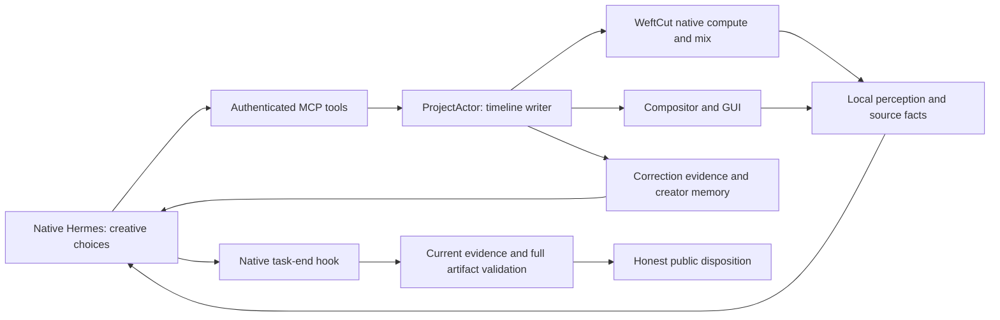

# SCLIP V1 final release-readiness audit

**Verdict: retain the architecture; V1 is not finished. Suitable for internal engineering testing, with configured local models. Supervised creator alpha should follow the cancellation, completion and bootstrap repairs below. Creator beta/public launch are not supported by this evidence.**

Audit target: current uncommitted workspace on `00d48b6fc89932e7ce0fac5f770e5a53f9768035`, 2026-10-12, repository `/Users/adityasamant/SCLIP V1/editor`. The latest user attachment governs this reconnaissance. Earlier audit documents, the screenshot and editor skills are evidence to inspect, not instructions for this audit. No production source fix, instruction edit, commit or production installation was performed. In abbreviated source references, `main/`, `renderer/` and `shared/` mean those directories under `apps/desktop/src/`; `state/` and `mcp/` are under `src/main/`.

The shortest path is a series of targeted repairs and acceptance gates, not a replacement for ProjectActor, Hermes, WeftCut or creator memory. The concrete ranked work, fixes, dependencies and proof requirements are in [the remaining-work plan](</Users/adityasamant/SCLIP V1/editor/docs/acceptance/SCLIP_V1_REMAINING_WORK.md>).

## Evidence and audit integrity

- All tests use disposable projects/app profiles and synthetic creator records. Original tutorial/Motorola footage is authorized, and the user's prior permission covers derived test media sent to OpenRouter. Large source bytes remain at their authorized locations; frozen manifests preserve BLAKE3 identities rather than duplicating every original into the evidence archive.
- Hosted inference is exclusively `nvidia/nemotron-3.5-lightning:free`. Each group checks the live catalog, proxy enforces zero price caps and `allow_fallbacks:false`, rejects other models and disables auxiliary inference. [free-proxy.cjs](</Users/adityasamant/SCLIP V1/editor/.scratch/sclip-v1-final-readiness/free-proxy.cjs>) and each group's `free-route-before-group.json`/`provider-trace.json` record the actual route, HTTP status, tokens and cost. Deterministic validation/most tool tests use zero hosted calls. Existing local weights are used for perception.
- The original 2,215 tracked/nonignored file hashes, dirty state and selected installed-app/settings hashes are in [initial-integrity.json](</Users/adityasamant/SCLIP V1/editor/.scratch/sclip-v1-final-readiness/initial-integrity.json>). Final comparison is in [final-integrity.json](</Users/adityasamant/SCLIP V1/editor/.scratch/sclip-v1-final-readiness/final-integrity.json>). This verifies the specified baseline files, not every byte in the user's home directory.
- **Constraint deviation:** the first disposable `electron-builder` attempt unexpectedly ran `@electron/rebuild` on `node-pty` in `node_modules`. This violated the no-dependency-changes restriction. Manifest/lock/source changes were not observed, but no pre-audit dependency binary baseline exists, so binary identity cannot be certified. The second packaging attempt explicitly used `npmRebuild=false`. See [audit-constraint-deviations.json](</Users/adityasamant/SCLIP V1/editor/.scratch/sclip-v1-final-readiness/audit-constraint-deviations.json>). This deviation is not hidden behind the source-hash result.
- First scratch failures are retained: launcher syntax error before any inference; missing executable mode; error parser assuming JSON; invalid fixture field names; occupied-track duplicate; sandbox-blocked launch; undersized watchdog under load; invalid scratch FFmpeg resource path. Corrected scratch fixtures retain the same intended-result assertions. The output-validation watchdog changed60→300s to allow an actual 30s/1,800-frame export, not to accept a bad result. Logs distinguish these from production defects.
- Disk exhaustion interrupted one original Motorola attempt. Only audit-owned processes and newly created package outputs were stopped/removed. Disposable packages were hashed and removed after smoke tests to recover disk; installed `/Applications/Sclip.app` was never replaced. The initial dependency rebuild remains the known audit-policy exception.

## What is solid, and what is not

| Subsystem | Actual tested behavior / evidence | Remaining risk / status | Good enough for V1? |
|---|---|---|---|
| WeftCut/core | Fresh619 Rust tests; physical speech/source bounds; known native cuts; actual native-backed import/probe/export through desktop | Keep. Standalone native interface coverage is incomplete; passing Rust tests does not prove every desktop method | Core foundation yes; whole interface certification incomplete |
| ProjectActor | Linked placement/move/trim/split/ripple, atomic rollback, persisted compositions, history and GUI undo/redo. [core-functional-retest/assertions.json](</Users/adityasamant/SCLIP V1/editor/.scratch/sclip-v1-final-readiness/core-functional-retest/assertions.json>) | Sole writer is sound. Async synthesis can commit after cancellation; snapshot freshness has an in-flight gap | Keep; cancellation repair required |
| Timeline/tool editing |39 core assertions and35 advanced assertions pass through real MCP/actor; caption cues, groups, links, tracks and keyframes mutate intended state. [advanced-tools-retest/assertions.json](</Users/adityasamant/SCLIP V1/editor/.scratch/sclip-v1-final-readiness/advanced-tools-retest/assertions.json>) | Precise per-tool limits in CSV; untested valid workflows remain uncertified | Core capabilities demonstrated, not every optional capability |
| Renderer/export | Real compositor artifacts and full FFmpeg decoding; actual title geometry and video source maps; real−6dB/mute/multitrack tone mix. [render-signal-retest/results.json](</Users/adityasamant/SCLIP V1/editor/.scratch/sclip-v1-final-readiness/render-signal-retest/results.json>) | Render cancellation retains export ownership. One Motorola full QA export remains blocked, not passed | Keep; resource cancellation required |
| MCP |118 actual authenticated catalog tools, real intended state effects, actionable invalid-contract/atomic errors | Synth cancellation and render freshness/cancellation defects; temporal product inspection failed once; optional profile dependency | Connected foundation yes; universal “all tools work” no |
| Hermes connection | Genuine upstream native PTY, dynamic search/describe/call, actual root task-end hooks and honest dispositions | Many schema/review retries; current package lacks runtime. Registry101 does not mean101 active tools | Workspace connection sound; completion usability/distribution fail |
| Agent autonomy | Actual default SOUL, current skill, source evidence/context and traces leave selection/story/cuts/framing/subjective repairs with Hermes | Agent can make poor choices; this is not proof host scripted creativity | **Autonomy preserved** |
| Vision | Local Qwen sees talking person and ALPHA/blue overlay; source/timeline identity, pixel facts and uncertainty are exposed. [vision-corpus/ground-truth-observations.json](</Users/adityasamant/SCLIP V1/editor/.scratch/sclip-v1-final-readiness/vision-corpus/ground-truth-observations.json>) | Physical folding state wrong on tested open handset, even after disambiguation. Truncation/repetition; sparse frames do not establish motion | Basic observation useful; product-action competence fails this fixture |
| Audio | Local Whisper correctly recognizes known narration; ten boundary/cache fixtures; real Kokoro/voices; SenseVoice English Speech observation | Cold macOS Whisper setup fails; semantic classification scope narrow; cancelled synthesis writes late | Configured workflow useful; cold-start/reliable ownership insufficient |
| Cross-modal | Actual paired A/V ranges stay aligned; source versus rendered audio distinguishable; correct frames can be connected with transcript windows | Alignment is proven; semantic feature-to-narration selection/B-roll relevance not reliably proven. Agent retains partial sentences | Foundation exists; product promise not certified |
| Creator style | Real correction attribution/scoping/restart, evidence-backed hypotheses, two-creator isolation, explicit preference affects native new edit; supplemental genuine correction→28px later edit | A tentative interpretation was written to generic memory, not the canonical evidence-linked style store; general pacing/framing/audio/transition style transfer remains unproven | Useful implementation; full promise only partial |
| BackgroundReviewer | Actual offscreen title warning resolved by real edit; clean no-repair control preserved | Layout diagnostics do not judge story or audio delivery.2/2 repair runs fail trusted completion | Technical detector useful; autonomous self-correction not reliable |
| Completion lifecycle | Genuine normal end produces decoded proof; missing review remains incomplete. Seven native-hook output fixtures pass | Two mixed-media false completions; in-flight A→B→A receipt falsely current; resource/write cancellation gaps | Must repair before declaring verified V1 |
| GUI | Agent mutations appear in actual Electron timeline; AllTracks view, Meta-Z/redo, exit agent view, save/reopen. Screenshots and later public status retained | Full first-run/provider/local-model recovery and long-session usability not certified. Runtime failure can surface generic fetch error | Developer UI functional; application acceptance incomplete |
| Packaging | Disposable unsigned app starts, edits/saves/exports demo, bundled FFmpeg decodes. [packaged-cold-retest/results.json](</Users/adityasamant/SCLIP V1/editor/.scratch/sclip-v1-final-readiness/packaged-cold-retest/results.json>) | Without developer Hermes path: runtimeState failed, “Bundled Hermes runtime is missing”; no bundled Whisper runtime/model. Only developer Mac tested | No |
| Real creator video quality | Twelve required/repeat/audio native runs; full artifacts, frames, speech and frozen states where rendering succeeds |5/12 technically complete; neither tutorial passes full creative brief; neither product finishes; multi-step is one contiguous excerpt | No reliable creator-usable20–30s result demonstrated |

No measured regression appeared in the original shot/physical-speech fixtures. New cancellation/media/freshness cases expose incomplete Phase2 guarantees. Establishing that a defect was *introduced* by a particular phase would require the corresponding earlier revision to run the same new fixture; that causal comparison was not performed.

## Architecture relationship

This is a connection map, not a mandatory editing pipeline. Host validation does not select footage or perform subjective repairs.

## Fresh regressions

| Check | Actual result | Evidence |
|---|---|---|
| TypeScript affected partition |2,659 passed /19 skipped |[typescript-affected-final.log](</Users/adityasamant/SCLIP V1/editor/.scratch/sclip-v1-final-readiness/typescript-affected-final.log>) |
| Renderer/shared/CLI partition |4,909 passed |[typescript-renderer-final.log](</Users/adityasamant/SCLIP V1/editor/.scratch/sclip-v1-final-readiness/typescript-renderer-final.log>) |
| Remaining main partition |628 passed /3 skipped |[typescript-main-final.log](</Users/adityasamant/SCLIP V1/editor/.scratch/sclip-v1-final-readiness/typescript-main-final.log>) |
| Unique TypeScript total |**8,196 passed /22 skipped**,620 passed files /2 skipped files |[regressions-final-status.json](</Users/adityasamant/SCLIP V1/editor/.scratch/sclip-v1-final-readiness/regressions-final-status.json>) |
| Rust lib |**619 passed /1 ignored** |[rust-final.log](</Users/adityasamant/SCLIP V1/editor/.scratch/sclip-v1-final-readiness/rust-final.log>) |
| Scripts |**101 passed** |[scripts-final.log](</Users/adityasamant/SCLIP V1/editor/.scratch/sclip-v1-final-readiness/scripts-final.log>) |
| Production workspace build / TS typecheck |PASS |[build-current.log](</Users/adityasamant/SCLIP V1/editor/.scratch/sclip-v1-final-readiness/build-current.log>); [typecheck-final.log](</Users/adityasamant/SCLIP V1/editor/.scratch/sclip-v1-final-readiness/typecheck-final.log>) |

Counts match the Phase2 reference. Browser-test exclusions/skips remain exclusions/skips. Native Electron tests above supplement them; they do not magically certify every browser-test path. This audit's main partition needed no network-failure retry. The long affected partition ran alongside model jobs; its wall time is not an unloaded performance baseline.

## Rediscovered tool catalogs

| Catalog | Rows | Current certification |
|---|---:|---|
| Authenticated WeftCut MCP |118 |{'PASS — actual end-to-end proof': 86, 'NOT CERTIFIED — exact missing proof': 29, 'FAIL — integration defect': 2, 'BLOCKED — external dependency': 1} |
| Native interfaces |63 =28 NAPI methods +35 invoke commands |{'NOT CERTIFIED — exact missing proof': 44, 'BLOCKED — safety restrictions': 2, 'PASS — actual end-to-end proof': 8, 'PASS — actual functional proof': 9} |
| Upstream Hermes registry |101 |{'BLOCKED — safety restrictions': 5, 'NOT CERTIFIED — exact missing proof': 23, 'BLOCKED — external dependency': 64, 'PASS — actual end-to-end proof': 2, 'PASS — actual functional proof': 7} |

Complete namespace-qualified rows, evidence and exact missing proof are in [MCP_TOOL_COVERAGE.csv](</Users/adityasamant/SCLIP V1/editor/.scratch/sclip-v1-final-readiness/MCP_TOOL_COVERAGE.csv>), [NATIVE_INTERFACE_COVERAGE.csv](</Users/adityasamant/SCLIP V1/editor/.scratch/sclip-v1-final-readiness/NATIVE_INTERFACE_COVERAGE.csv>), [HERMES_TOOL_COVERAGE.csv](</Users/adityasamant/SCLIP V1/editor/.scratch/sclip-v1-final-readiness/HERMES_TOOL_COVERAGE.csv>). Catalog/source metadata: [source-inventory.json](</Users/adityasamant/SCLIP V1/editor/.scratch/sclip-v1-final-readiness/source-inventory.json>), [hermes-registry.json](</Users/adityasamant/SCLIP V1/editor/.scratch/sclip-v1-final-readiness/hermes-registry.json>). The registry availability scan finds35 without credentials. Real benchmark requests expose12 immediate built-ins plus3 deferred dispatch helpers (`tool_search`, `tool_describe`, `tool_call`). Web/vision registry tools can be enabled conceptually yet unavailable in the guarded actual runtime; SCLIP's local WeftCut vision is a separate connected route. Four MCP resource/prompt helpers are protocol capabilities, not additional registry tools.

Passing tool rows certify only their stated fixture. A marker printed by `terminal` proves that shell command, not an editorial completion. Default descriptions/read-only catalogs, no-op calls and unit counts are not automatically upgraded. Nine enabled Hermes built-ins have bounded functional/E2E evidence after direct file/write/patch/search/terminal/process-list/skills-list tests plus genuine memory/todo results. `clarify` interactive round-trip and `skill_view` exact isolated skill read are not independently certified; `skill_manage` writes are prohibited. Optional external services are blocked/unselected, not disconnected V1 editor tools.

Additional actual output proof: crossfade midpoint RGB127/20/113, transition duration snapped to8 frames at30fps, exact checkpoint restoration, and text blur reduces sharp-white pixels2900→0 and exports/decodes. See [transition-effects-retest/assertions.json](</Users/adityasamant/SCLIP V1/editor/.scratch/sclip-v1-final-readiness/transition-effects-retest/assertions.json>). The initial250ms exact-time assertion was corrected to the canonical8-frame266667us expectation, with initial failure retained.

A valid already-decided rough-cut plan is now independently proven: nonmutating validation/dry-run, atomic two-window placement, exact source/time mappings, actual black/white pixels, full2s compositor/decode and mechanical review validation. [rough-cut-functional-ready-retest/assertions.json](</Users/adityasamant/SCLIP V1/editor/.scratch/sclip-v1-final-readiness/rough-cut-functional-ready-retest/assertions.json>). An immediate preview read refused once; unchanged retest after4s UI settling succeeds. The first wrong colour expectation and original refusal remain retained. This is mechanical execution proof, not an editing model or strict editorial-review success.

Important missing functional proofs remain: varied rough-cut A/V/strict-review workflows; full motion-path/tangent workflows; motif authoring/install/render lifecycle; some restacking/marker attachment/media-removal and history operations; missing-source recovery; forced-crash recovery; broad export/aspect-resolution/long-composition matrix; broad music/event/overlapping-speech semantics. Their specific rows remain NOT CERTIFIED/BLOCKED. This is an explicit coverage limit, not a claim they are broken. Caller-selected landscape contain, portrait contain and portrait cover also pass actual calculator→patch→pixels→full export/decode. [fit-functional-retest/assertions.json](</Users/adityasamant/SCLIP V1/editor/.scratch/sclip-v1-final-readiness/fit-functional-retest/assertions.json>); [fit-cover-quantized/assertions.json](</Users/adityasamant/SCLIP V1/editor/.scratch/sclip-v1-final-readiness/fit-cover-quantized/assertions.json>). The calculator is nonmutating and uses existing0.001 scale/0.1px position quantization; the original overly precise scratch assertion is retained. Core edit/render/signal tests cover real output, but this audit does not certify every safely callable optional operation.

## Phase1/Phase2 regression ledger

Full source/fixture/operation/actual/expected/evidence/status/confidence columns: [PHASE1_PHASE2_FIX_LEDGER.csv](</Users/adityasamant/SCLIP V1/editor/.scratch/sclip-v1-final-readiness/PHASE1_PHASE2_FIX_LEDGER.csv>) and [phase1-phase2-fix-ledger.json](</Users/adityasamant/SCLIP V1/editor/.scratch/sclip-v1-final-readiness/phase1-phase2-fix-ledger.json>). Summary:

| # | Previous fix | Current status | Actual result / confidence |
|---:|---|---|---|
| 1 | Shot-detection facade wiring | PASS | Cuts2/4s, actuallinked timeline split — High |
| 2 | Known cut boundaries and persistence | PASS | Three video segmentspersist; invalid operation unchanged — High |
| 3 | Whisper physical segment/word bounds | PASS | Times bounded to physicalrendered/sourcewindows — High |
| 4 | Silence and BLANK_AUDIO | PASS | Silence cases return no usable hallucinated speech — High |
| 5 | AAC/PCM rendered padding | PASS | Bounds physical14.634667s vs old15.04s metadata — High |
| 6 | Whole-source frame rounding | PASS | Frame-rounded whole-source accepted; explicit+1s refused — High; initial120s deadline retained |
| 7 | Cached transcript validation | PASS | Fresh/cached physical bounds validated — High |
| 8 | Explicit output duration recognition | PASS | 30Colorvideoaccepted; 30000s rejected — High; NL coverage bounded |
| 9 | Source versus timeline duration | PASS | source_duration575s separately; current_output20s — High |
| 10 | Repair argument diagnostics | PASS | Errors include missingkey/schema/layercollision advice; no objectObject — High |
| 11 | Atomic rollback/stale critique | PASS | Composition unchanged; stale verification refused — High |
| 12 | Forced cover removed | PASS | No enforcedcover; agentkeptnatural-sizefootage poorly — High; quality fails independently |
| 13 | Auxiliary inference configuration | PASS | Only primary free route; disabledtitle/compression/background — High forobservedrequests |
| 14 | Hermes native task-end hooks | PASS | Completed/incomplete/cancel distinct; nativehookfires — High |
| 15 | PTY readiness/inputmarker | PASS | Promptappearsinrequest andtoolsrun — High |
| 16 | Duplicate/stale lifecycleevents | PARTIAL | Unitdedup/generation checks pass; no independenthostile transport replaythisaudit — Medium; replayfixture missing |
| 17 | CompletionCheckpoint | PARTIAL | Coreguards work; mixed-media cases falselycompleted — High confirmedgaps |
| 18 | Source revision and A-B-A | FAIL | Latecurrent receiptaccepted andcompleted — High; identicalfinalpixels freshnesspolicybug |
| 19 | Cancellation races | FAIL | Cancelstatushonest; renderrunning; lateAudio17.821s — High |
| 20 | Full rendered artifact validation | PASS | Technicaldecoded delivery checked; independentvideosdecode — High boundedresource range |
| 21 | Missing video/audio rejection | PARTIAL | Plainvideo rejectsaudioonly; mixedaudio wording wronglyacceptsbadstreams — High |
| 22 | Audio-only/intentionalblack acceptance | PASS | Legalformats accepted/decoded; blackintention accepted — High technicalscope, partialsentencequalityfails |
| 23 | Bounded hostfeedback | PASS | At most2 checkpoint continuations; ultimatelyhonestincomplete — High; completion usability poor |
| 24 | Currentreview/modality requirements | PARTIAL | Missingreview correctlyblocks manyruns; mixedmedia andin-flight credit holes — High |
| 25 | Genuine normal-session completion | PASS | Five technicalcompletions among12scenario runs; noRepair unchanged — High mechanism; NOT editorial reliability |

## Reconciliation of the reported bugs

**Conflicting prior reports:** the latest executive claim of115 MCP passes is contradicted by its own CSV:118 rows,48 passes,69 not tested and1 blocked. Its native CSV has29 passes/32 not tested/2 safety-blocked; Hermes has14 passes/66 dependency-blocked/16 not tested/5 safety-blocked. The coverage-generation script reads earlier evidence and upgrades selected names; it is not115 fresh functional assertions. Its REAL_HERMES scenario passes cite deterministic MCP calls/native hook cases, not an editing Hermes model. Local Qwen invocation does not turn those into autonomous Hermes benchmarks. See [prior-three-tool-matrices.json](</Users/adityasamant/SCLIP V1/editor/.scratch/sclip-v1-final-readiness/prior-three-tool-matrices.json>) and the original scripts under `.scratch/sclip-final-post-repair-audit/`.

Phase1/2 reports provide stronger real source-bound, actor and genuine native-model traces and explicitly disclose editorial failures. Their broad freshness/cancellation/media guarantees nevertheless miss the new edge cases here. The latest style report's static-KV/no-observation description conflicts with actual CreatorStyleStore provenance/candidates/persistence. “Every mutation requires expected_state_version/MVCC” is also overstated: the actor serializes writes, while explicit optimistic versions apply to selected atomic/ripple paths, not all85 TS schemas. These corrections support keeping the architecture, not declaring it universally certified.

**Whisper setup:** configured developer profile succeeds. Empty disposable macOS speech profile fails: binary missing. A profile with an existing model seeded at `userData/models/ggml-base.bin` is auto-discovered with the available Homebrew binary and succeeds. Startup also contains managed-catalog autofill; judging only one fallback line was incomplete. However managed Whisper runtime/model entries inspected are Windows/Linux, and the actual macOS package contains neither expected Whisper binary nor model. Developer success cannot certify a clean Mac without Homebrew/model paths. [diagnostic-senses-results.json](</Users/adityasamant/SCLIP V1/editor/.scratch/sclip-v1-final-readiness/diagnostic-senses-results.json>); [package-cold-manifest.json](</Users/adityasamant/SCLIP V1/editor/.scratch/sclip-v1-final-readiness/package-cold-manifest.json>); `main/index.ts` speech initialization/autofill and `shared/content-catalog.ts`.

**Pause-after-TTS:** six different local Kokoro trials:6/6 immediate pause calls report “waveform not generated yet”;6/6 retries after2s succeed with actual pause spans. TTS returns `derivative_status:queued`. This is expected asynchronous readiness, not data corruption or a randomly failing pause detector. The agent-facing plain error/event-retry contract is awkward; a structured pending/readiness query or bounded readiness wait would improve it. [diagnostic-senses-retest.json](</Users/adityasamant/SCLIP V1/editor/.scratch/sclip-v1-final-readiness/diagnostic-senses-retest.json>). This is separate from the confirmed late-write-after-cancel defect.

**Voice TypeError:** supported production `list_speech_voices` callback returns28 supported voices with aliases and actual Kokoro model metadata. A harness passing a Boolean where the option requires a callback is invalid configuration. Production-reachable TypeError not reproduced; do not treat it as a release blocker. [diagnostic-senses-results.json](</Users/adityasamant/SCLIP V1/editor/.scratch/sclip-v1-final-readiness/diagnostic-senses-results.json>).

**Eight allegedly unexposed actor operations:**

| Operation | Actual reachability / V1 judgment | Minimum work if needed |
|---|---|---|
| `separate_audio` | Imported A/V already has linked separate Audio/Video layers. Internal operation relocates existing audio onto its own track; it is not an absent AV decoder/splitter | Use existing track/movement/link primitives; expose a narrow convenience command only if an actual task is blocked |
| `fit_composition_to_layers` | Already MCP exposed and functionally tested14s unpin/high-water | None |
| `set_scale_linked` | Already MCP exposed and tested false→true/equal scales | None |
| `update_track_flags` | Exact per-track flags are not an MCP verb. Role mute/solo, individual Audio mute and layer enable cover many agent tasks; track locks protect user intent | If selective-track task proves a gap, add narrow mute/solo interface respecting locks; do not grant bypass-lock by default |
| `update_project_settings` | Preferences/proxy/shot/pause/script settings, not canvas. MCP `set_composition` already controls canvas/fps | Keep preference configuration user-owned unless an actual task needs a safe settings subset |
| `rebind_motif` | Internal dispatcher used through motif lifecycle; not every internal verb requires its own tool | Certify install/update/version-binding path; expose only a demonstrated missing agent intent |
| `correct_caption_text` | MCP can change Text content/restyle; canonical transcript-reference correction differs and is GUI-owned | Targeted transcript-linked caption correction interface may be useful; no failed creator task establishes it as mandatory yet |
| `set_role_gain` | Already MCP exposed; actual role state and−6dB rendered signal verified | None |

Thus **three of the eight names are already exposed**, and several others have meaningful equivalents/internal/user-only responsibilities. Blanket “expose all eight” is not supported. Sources: `state/actor.ts`, `state/mcp-commands.ts`, `state/commands.ts`, MCP catalog and current functional assertions.

**`describe_clip`:** actual native video-understanding profile is missing and errors explicitly. Separate MLX Qwen source/current-composed frame tools work. Native clip description is dependency-blocked, not proof SCLIP is blind. Sparse still frames nevertheless do not establish folding motion or a complete scene understanding; those semantics remain a product acceptance gap. [vision-corpus/ground-truth-observations.json](</Users/adityasamant/SCLIP V1/editor/.scratch/sclip-v1-final-readiness/vision-corpus/ground-truth-observations.json>).

**Errors:** current actual deferred calls report required fields, valid schema, stale review, occupied lane and atomic rollback reasons. No current `[object Object]` reproduction. Errors can be plain text or structured error JSON; the initial audit parser's JSON-only assumption was wrong. Packaged session bootstrap still yields a generic `fetch failed` while status knows the missing runtime, so application-level recovery messaging needs work.

**Distribution divergence:** installed app/source skill hashes differ from the current workspace; same0.1.8 version label is not evidence of same code. The second disposable package, built with rebuild disabled, starts and exports an actual2s demo even when a3s range is requested (clamped to composition). Bundled FFprobe and FFmpeg fully validate it. Fresh isolated runtime status: failed / “Bundled Hermes runtime is missing”; session creation attempts a dead loopback port and fails. `main/index.ts` contains the developer fallback `/Users/adityasamant/SCLIP/hermes-agent-src`; `hermesRuntime.resolveLaunch` expects `resources/hermes/hermes`. Both manifests show it absent. This is a confirmed portability blocker, not merely old installed UI. [packaged-cold-retest/results.json](</Users/adityasamant/SCLIP V1/editor/.scratch/sclip-v1-final-readiness/packaged-cold-retest/results.json>); [packaged-cold-retest/ffprobe.json](</Users/adityasamant/SCLIP V1/editor/.scratch/sclip-v1-final-readiness/packaged-cold-retest/ffprobe.json>); [package-cold-manifest.json](</Users/adityasamant/SCLIP V1/editor/.scratch/sclip-v1-final-readiness/package-cold-manifest.json>). A different physical clean Mac, signing/notarization and updater distribution were not certified.

## Confirmed new defects

1. **Cancellation does not own asynchronous synthesis placement.** Client receives AbortError before any Audio layer exists;17.821s later one Audio layer is committed. Same isolated project, genuine local Kokoro, production MCP/actor. Root: asynchronous compute→placement checks project identity but does not honor request cancellation before the authoritative dispatch. [cancel-edit/results.json](</Users/adityasamant/SCLIP V1/editor/.scratch/sclip-v1-final-readiness/cancel-edit/results.json>); `state/hybrids.ts` speech handler.
2. **Two explicit mixed-media false completions.** “Make a30-second video with an audio track” completed with Audio only; “Make a30-second video with audio” completed with silent Color video. Real native plugin lifecycle, production output verification/compositor/full decode, synthetic decisions and zero model inference. `finalOutput.outputRequirements` treats the phrase “audio track” as audio-only and otherwise lacks independent generic required-audio enforcement. [explicit-media-intent-results.json](</Users/adityasamant/SCLIP V1/editor/.scratch/sclip-v1-final-readiness/explicit-media-intent-results.json>). This is SCLIP validation, not Nemotron judgment.
3. **In-flight A→B→A receipts become current.** A real render chunk completes, then two User commits change and restore exact composition while export is pending. Server checks content-equal ending state and gives the receipt the *late* current epoch. Native conclusion completes. Existing epoch invalidation correctly protects previously acquired receipts and final-validation races, but misses acquisition-in-flight. Final pixels are identical in this probe: it proves a freshness-policy hole, not pixel corruption. [evidence-races-chunk-proof/race-results.json](</Users/adityasamant/SCLIP V1/editor/.scratch/sclip-v1-final-readiness/evidence-races-chunk-proof/race-results.json>); `mcp/server.ts` receipt wrapper.
4. **Render abort leaves owned export work running.** Actual cancelled MCP request returns AbortError, activity still running and immediate second export says “A render is already running.” A real Motorola timeout exhibits this same busy condition during independent QA. `rangeRender` lacks a cancellation channel for its executing compositor export. [evidence-races-chunk-proof/race-results.json](</Users/adityasamant/SCLIP V1/editor/.scratch/sclip-v1-final-readiness/evidence-races-chunk-proof/race-results.json>); [native-release-product-run1-retry/independent-export-verification.json](</Users/adityasamant/SCLIP V1/editor/.scratch/sclip-v1-final-readiness/native-release-product-run1-retry/independent-export-verification.json>). Cancelled disposition remains honest; resource cancellation is still broken.

These tests alter no production code. Remedies and acceptance repros are ranked in the other report.

## Vision, audio and cross-modal facts

Actual stack:

The guarded primary Nemotron route is **text-only** according to the captured live catalog (`text->text`,30B total/3B active MoE). Across465 retained hosted requests, saved message content has0 image-input references, every usage cost is0 and all usage entries are present. Visual semantics come from local Qwen descriptions and objective pixel/geometry facts; speech from local recognizers. Hermes did not directly watch raw pixels in this benchmark. That makes local semantic errors particularly consequential. [provider-cost-summary.json](</Users/adityasamant/SCLIP V1/editor/.scratch/sclip-v1-final-readiness/provider-cost-summary.json>); [native-release-tutorial-run1/free-route-before-group.json](</Users/adityasamant/SCLIP V1/editor/.scratch/sclip-v1-final-readiness/native-release-tutorial-run1/free-route-before-group.json>).

| Sense | Used here | What was measured |
|---|---|---|
| Composed/source visual meaning | `mlx-community/Qwen3-VL-2B-Instruct-4bit`, MLX, auto512px frames | Talking person/text/overlay identification; source timestamps; model repetition/truncation; physical product-state errors |
| Visual objective facts | Live compositor pixels + staged geometry | Blue/ALPHA/black-gap/red fixtures; text bounds; actual canvas/source size; no calibrated face tracking |
| Speech recognition | Homebrew `whisper-cli`, local `ggml-base.bin`, CPU independent QA; production configured `whisper_cpp` | Known speech recognition, physical timing/cache/window bounds, silence sentinel filtering |
| Audio semantics | SenseVoiceSmall INT8 via sherpa-onnx1.13.4 local CPU |10s known narration: language `en`, event `Speech`, emotion `EMO_UNKNOWN`, recognizable matching transcript; no invented emotion certainty |
| Voice generation | Kokoro82M INT8 ONNX `kokoro-v1.0.int8.onnx`, existing local worker, `am_michael` trials | Real generated files/placement/queued derivatives; actual available voice IDs/aliases |
| Signal/mixing | Native sample-accurate mix and rendered PCM/FFmpeg |−6dB ratio0.5011; muting removes the audio stream (not measured zero PCM); aligned two-track ratio2.0010; silence/clipping/window facts; see [render-signal-stream-verification.json](</Users/adityasamant/SCLIP V1/editor/.scratch/sclip-v1-final-readiness/render-signal-stream-verification.json>) |

Direct vision responses preserve `subject_observations.output_limit_reached`, token count and possibly-truncated status. A64-token question reaches its cap and reports it. Product observations can repeat text and hit192 tokens. Source-index descriptions do not carry the same generation metadata through to the understanding map; its JSON-size truncation field is a different limit. Preserve these distinctions when fixing evidence presentation.

Ground truth frames from derived original66s and115s were independently decoded/viewed. At66s the physical handset is open while its screen depicts a closed handset; at115s the physical device is closed. The broad question misclassified both. Explicitly asking about the physical handset fixes the closed sample but still calls the open handset closed. Thus a single still-frame text answer is unsafe evidence of folding action. [vision-action-groundtruth/results.json](</Users/adityasamant/SCLIP V1/editor/.scratch/sclip-v1-final-readiness/vision-action-groundtruth/results.json>); [vision-corpus/ground-truth-product-1s.png](</Users/adityasamant/SCLIP V1/editor/.scratch/sclip-v1-final-readiness/vision-corpus/ground-truth-product-1s.png>); [vision-corpus/ground-truth-product-50s.png](</Users/adityasamant/SCLIP V1/editor/.scratch/sclip-v1-final-readiness/vision-corpus/ground-truth-product-50s.png>). Basic transport/text observations work; model semantics are fallible.

One real product timeline temporal-window inspection failed decoder binding despite an open window. A later known synthetic source2.5s white frame maps to timeline12.5s with RGB255/255/255 before and after GUI seeking, so the requested time is distinguished from the black playhead/source start. That rules out a universal “future frames cannot be inspected” claim; exact product readiness/decoder cause remains unproven. [future-frame-white-groundtruth/results.json](</Users/adityasamant/SCLIP V1/editor/.scratch/sclip-v1-final-readiness/future-frame-white-groundtruth/results.json>). Source versus timeline timestamps are explicit in returned evidence; a failed read is not a valid observation.

Ten audio fixtures establish physical boundaries/mappings, not a universal word-error rate. SenseVoice accurately labels known English speech in one rendered window, even when its authored role is `music`; an authored role label is not acoustic classification. Broad music/silence/event discrimination, overlapping unrelated dialogue and emotional delivery need a labeled accuracy corpus. Tone overlap tests prove real additive mixing, not semantic overlap detection.

Cross-modal evidence can expose corresponding source/timeline A/V ranges, transcript windows, visible frames and rendered audio. Current footage examples show those primitives working. No robust benchmark yet proves Hermes consistently connects a spoken phone feature to the correct demonstrated action or chooses relevant B-roll. The actual repeated creator outputs fail on selection, sentence boundaries, framing and review execution rather than a missing basic A/V link.

## Creator style: implemented versus demonstrated

`CreatorStyleStore.observeChange` records authoritative User/Agent provenance, groups nearby corrections, associates proposal operation IDs, retains uncertainty, and exposes evidence-backed scoped hypotheses/preferences. Canonical files are under `userData/creator-style`, with creator isolation, revision/capsule/context/conflict/control behavior. This is considerably more than a static app_settings KV list. No evidence requires neural training or a system rewrite.

[creator-mechanics-retest-results.json](</Users/adityasamant/SCLIP V1/editor/.scratch/sclip-v1-final-readiness/creator-mechanics-retest-results.json>) demonstrates: explicit scoped preferences; two creators; actual MCP proposal followed by User IPC correction; proper attribution/grouping; hypothesis storage with support; later context; cross-creator refusal; conflicting project/global facts; invalid evidence rejection; repeated corrections; same-profile Electron restart persistence. **The semantic hypothesis in that deterministic test is supplied by the fixture, not extracted by a model.** The conflict test proves storage/context precedence instructions, not every real model's resolution.

The required native style run applies an explicit~40px lower-third preference to “A fresh start” in a new project and completes; actual state/frame corroborate it. The supplemental native study goes further: genuine Hermes caption64px, User correction28px, preserved correction attribution, restarted isolated app/new project with different footage/resolution, and Hermes creates “Another useful idea” at28px (x320/y340). `preferences` remains empty: the model used raw correction context and wrote a tentative caption interpretation through generic `memory`, despite the creator-context instruction to use canonical style memory. It disclosed single-example/different-canvas uncertainty, but did not create a supported canonical hypothesis. The later run times out and is cancelled/unverified, so **behavioral use of one correction passes, canonical preference extraction/persistence and whole-task completion do not**. [native-release-style-source-run2/manual-correction.json](</Users/adityasamant/SCLIP V1/editor/.scratch/sclip-v1-final-readiness/native-release-style-source-run2/manual-correction.json>); [native-release-style-transfer-run2/style-context-before.json](</Users/adityasamant/SCLIP V1/editor/.scratch/sclip-v1-final-readiness/native-release-style-transfer-run2/style-context-before.json>); [native-release-style-transfer-run2/style-memory-after.json](</Users/adityasamant/SCLIP V1/editor/.scratch/sclip-v1-final-readiness/native-release-style-transfer-run2/style-memory-after.json>); [native-release-style-transfer-run2/agent-after.json](</Users/adityasamant/SCLIP V1/editor/.scratch/sclip-v1-final-readiness/native-release-style-transfer-run2/agent-after.json>). Original scratch profile-reuse mistake is retained and not labeled a product defect.

| Style promise | Current evidence |
|---|---|
| Explicit preference storage and later application |PASS, actual native40px title |
| Two-creator isolation |PASS deterministic real interfaces |
| Manual AI correction attributed to proposal |PASS real native source study plus deterministic repeated corrections |
| Reusable meaning extracted autonomously |PARTIAL: native tentative interpretation exists in generic memory; canonical supported candidate supplied only in mechanics fixture |
| Persistence/context across projects/restart |PASS for canonical fixture candidate and actual correction evidence |
| Later edit changes because of evidence |PARTIAL positive:28px after real64→28 correction, direct recorded-context prompt; no complete task verification |
| Conflict resolution/irrelevant evidence/repeated corrections |Storage/rejection/grouping pass; real creative resolution/generalization unproven |
| Pacing, intro, framing, transitions and audio balancing style |Not certified; one caption dimension is insufficient |

## Reviewer, native completion and agenticness

The previous3s→1s no-repair failure was **agent-invented editorial repair**, not a BackgroundReviewer order. The actual initial critique has0 critical,0 warning,0 suggestion and `issues:[]`. Hermes then registered its own issue describing3,000,000us as a “3-minute composition,” called the static title stagnant, trimmed to0.5s then1s, and recorded that outcome. [prior-no-repair-causal-tools.json](</Users/adityasamant/SCLIP V1/editor/.scratch/sclip-v1-final-readiness/prior-no-repair-causal-tools.json>) plus original `.scratch/sclip-phase-2-completion/native-phase2-no-repair-run1/request-30.json` retain the clean critique and subsequent invented issue. The host permits subjective issues by design; accepting a structurally valid issue is not validation of its taste.

Current no-repair repeat **leaves compositions exactly unchanged and completes**. The offscreen title repeats both fix visible geometry (x−500→150 and x−500→960), but both end incomplete after review-contract confusion. Model tool errors include missing action/receipts, invalid action, selecting an issue before initial review and finalize-before-validated-review. It often substitutes terminal `echo` completion claims for successful review state; the trusted host correctly remains unverified. Technical repair is demonstrated; reliable autonomous full self-correction is not.

Actual isolated SOUL files, base and creator home, are the default Hermes personality and identical: [actual-audit-soul-files.json](</Users/adityasamant/SCLIP V1/editor/.scratch/sclip-v1-final-readiness/actual-audit-soul-files.json>). The actual initial system content and15 schemas are preserved in [actual-initial-instructions.json](</Users/adityasamant/SCLIP V1/editor/.scratch/sclip-v1-final-readiness/actual-initial-instructions.json>). Current WeftCut/evidence skills require grounded ownership and honest review, offer references, explicitly reject a fixed transcribe→rough-cut→caption pipeline, and leave framing/cuts/content to Hermes. The editing references supply craft guidance, not host-written genre templates. The active skill/reference availability is not proof the model read every reference; consult actual file-tool traces for a particular run.

ProjectActor applies selected commands; BackgroundReviewer produces fallible technical findings; creator store records scoped facts/hypotheses; completion observer validates objective requirements, evidence freshness and artifacts. None chooses the story, selects a ranked clip or silently applies a subjective repair. **Autonomy preserved.** The review protocol is materially cumbersome, but it constrains validation and state, not scripted creative ownership. Improve its legal next-action contract without replacing it with a predetermined editing pipeline.

### Why it keeps entering preview/Agent Mode

The screenshot shows the intentional Agent Mode shell: large preview + terminal + mini timeline. `renderer/agent/activityStore.ts` switches `mode` to `agent` when a new session arrives, and on the matching `AGENT_VIEW_EVENT`; `useAppWiring.enterAgentMode` also selects it. Exit to editor changes the view. Manual view switching does not end work, cancel calls or certify completion. “Add a clip to start the preview” means there was no visible timeline clip at that moment; a resumed prompt or a running terminal alone does not create one. This is a view policy, not a render/export mode or proof the task succeeded. A “remember my preferred view” option is optional polish, not a foundation blocker.

## Genuine free-Nemotron benchmark

Twelve scored required/repeat/audio runs: gap; tutorial×2; product×2 (ENOSPC original replaced by retained retry); reviewer×2; valid no-repair retry; explicit style; invalid-request recovery; multi-step; audio-only. Original interrupted no-repair/ENOSPC attempts remain separate environment attempts. Supplemental native creator-study runs are additional and not counted as the required twelve.

Every run preserves exact brief, model, initial request/tools, all provider requests/responses, tool errors/selections, activity/mutations, frozen before/after state, source ranges, trusted status and independent export attempt. See [native-benchmark-summary.json](</Users/adityasamant/SCLIP V1/editor/.scratch/sclip-v1-final-readiness/native-benchmark-summary.json>) and `native-release-*/actual-agent-tools.json`. Max48 turns per native loop (same-PTY continuations remain group-bounded),600s active run for main scenarios (300s for supplemental style),64 proxy requests per group,8s upstream spacing,90s request deadline, zero-price guard. Nonzero/absent token-usage entries must be read as such; route/cost guarantees do not infer missing usage. All recorded billed costs are0; final totals by attempt are in [provider-cost-summary.json](</Users/adityasamant/SCLIP V1/editor/.scratch/sclip-v1-final-readiness/provider-cost-summary.json>).

| Run | Infrastructure / objective result | Editorial result | Trusted end |
|---|---|---|---|
| A gap | Actual gap closed25→20s; full decode | Intended simple edit correct |incomplete: current rendered review required |
| B tutorial1 | Paired20s from47.975903→67.975903s; full decode | Opening begins “time you guys…”; source remains1280×720 at origin0 in1920×1080,55.6% unused canvas; fails clean opening/framing |completed technically |
| B tutorial2 | Paired20s from0→20s; full decode | Ends “so I've seen a lot…”; same inset framing, not complete idea |incomplete |
| C product1 retry |30s remains contiguous source0→30; no paired mapping corruption | Proposed multi-shot JSON has unevaluated `+5000000`, never validly applied; claimed showcase does not match actual one-clip state |cancelled at600s; full independent QA initially blocked by continuing render |
| C product2 | Only7s from88→95s; full7s decode | Visible open phone; starts mid-description, not30s highlight, no demonstrated folding sequence |cancelled at600s |
| D reviewer1 | Text−500→150; full3s decode; warning resolved | Readable left-side title |incomplete |
| D reviewer2 | Text−500→960; full3s decode | Readable centered title |incomplete |
| E no-repair retry | Composition byte-structurally unchanged; full3s decode | Legitimate no-change choice; no shortened title |completed |
| F explicit style | New3s40px lower-third title; full decode | Matches supported preference |completed; scope is explicit preference |
| G recovery | Invalid `move_layer` contract rejected, legal IDs/`new_track_id` then succeed; full20s decode | Gap removed without corrupting state |completed; old bogusID was avoided, not executed |
| H multi-step |20s source0→20 +2s title; full decode | One contiguous range plus title; no distinct two-moment assembly evidenced; incomplete sentence/inset; terminal claims two moments |incomplete |
| Audio-led |14s Audio-only, native full audio export/decode | Cuts final sentence after “generation and”; “roughly14s” could have retained14.635s complete sentence |completed technically, editorial failure |

**5/12 technical completions;0/5 full creator-quality passes among the two tutorial, two product and multi-step20–30s tasks.** The second product is7s and fails duration; first product is blocked/unverified for full QA, not assumed decodable. This is a small convenience sample on one route, not a population reliability estimate. Two successful title/control tasks and gap recovery do not establish general video creation. Main hosted traces show no429 explaining the repeated review/selection failures.

Independent QA occurs **after frozen model outcome**, changes no authored edit, and receives no agent-review credit. Each available full video is FFprobed, fully decoded with `-xerror`, sampled at opening/middle/end, black-detected and locally transcribed when audio exists. Artifact existence/decoding is evaluated separately from story/usability. An audio-only video export correctly refuses “No video”; a separately documented exact one-track audio reconstruction is independently decoded/transcribed in [native-release-audio-run1/independent-audio-qa.json](</Users/adityasamant/SCLIP V1/editor/.scratch/sclip-v1-final-readiness/native-release-audio-run1/independent-audio-qa.json>). Its native completed proof already has `has_video:false,has_audio:true`. No black-video file is invented to make this an audio-video pass.

Independent Motorola retry QA attempted byte-identical source recovery in a fresh process; source BLAKE3/size were checked and authored compositions preserved, but export preparation still refused. Those attempts remain in [product-retry-independent-qa/failure.json](</Users/adityasamant/SCLIP V1/editor/.scratch/sclip-v1-final-readiness/product-retry-independent-qa/failure.json>) and [product-retry-independent-qa-retest/failure.json](</Users/adityasamant/SCLIP V1/editor/.scratch/sclip-v1-final-readiness/product-retry-independent-qa-retest/failure.json>), not upgraded. This is a QA archive/path-readiness limitation in addition to the original render cancellation busy condition; exact cause is not certified as original-video corruption. A separate FFmpeg **reference reconstruction** of the asserted simple one-video/one-audio state0–30s was decoded/transcribed/viewed solely to assess content: CES/CNET introduction, presenter/interview welcome, natural-size inset; no demonstrated fold action. [native-release-product-run1-retry/reference-qa.json](</Users/adityasamant/SCLIP V1/editor/.scratch/sclip-v1-final-readiness/native-release-product-run1-retry/reference-qa.json>). It is explicitly not a successful SCLIP compositor export, agent review, creative repair or completion upgrade.

### Root causes of failed videos: nine questions per run

Full per-run nine-column reasoning: [FAILED_VIDEO_ROOT_CAUSES.csv](</Users/adityasamant/SCLIP V1/editor/.scratch/sclip-v1-final-readiness/FAILED_VIDEO_ROOT_CAUSES.csv>). Findings supported by current traces:

- **Gap/reviewer repeats:** known synthetic content and actual geometric warning were sufficient and presented. Real mutation worked. Failure is legal review progression/arguments and model substitution of narrated success, not an inability of the engine to move clips/text. Improve revision status to expose current legal action, needed receipt/dimensions and schema-valid example, then rerun unchanged controls.
- **Tutorial1:** local source/visual/audio evidence exists and actual current inspection was acquired, but Hermes chooses an opening fragment and labels natural-pixel inset acceptable. Tool executes its exact chosen range/transform. It does not meaningfully repair the actual framing/boundary concern before technical completion. A clearer fit/source-boundary decision contract and stricter *observed* review evidence help; they must not silently choose story/crop for Hermes.
- **Tutorial2/H:** agent uses0–20s, transcript shows incomplete end; H claims two moments despite one source range. Source metadata/selected speech are available, but deeper relevant source evidence is not adequately used. Tool execution matches accepted mutations; no valid multi-moment assembly exists. More grounding of chosen ranges/joins and legal review state are needed; never credit an arithmetic-in-JSON plan or terminal prose as an applied edit.
- **Product retry:** source footage contains useful phone views/action; sparse local descriptions can confuse physical versus pictured phone. Evidence is available to Hermes; it repeatedly uses wrong arguments/malformed rough-cut plans. The engine only receives the initial30s insertion and trim changes, not the claimed six-shot plan. Render cancellation then blocks QA. Fix ownership and review ergonomics; certify valid rough-cut plan examples/actual assembly; validate product-action perception on labeled samples before trusting it.
- **Product2:** actual7s selection shows an open phone and aligned speech but does not meet30s. Source/final observations are sparse, plan/task recovery fails within bounded run. No decoder proof can turn7s into a30s success. The required change is a supported assembly/inspection/review workflow that the agent actually executes, measured on this exact brief.
- **Audio-led:** full source has complete fourth sentence; local transcription makes final-word boundaries available. Hermes explicitly calls the partial fourth sentence “complete thoughts,” trims to14s and concludes. Native tools and audio export follow that choice correctly. This is model interpretation plus a completion scope that validates speech existence/bounds, not meaning. Expose approximate-duration tolerance and current boundary context; require honest unresolved outcome when requested complete-thought review has not been satisfied.

Claims marked unknown in the root-cause CSV remain unknown. No paid comparison model was tested; these results neither absolve Nemotron nor prove every model would fail. Deterministic mixed-media/freshness/cancel defects are model-independent SCLIP bugs.

## Final answers

1. **Is the current SCLIP architecture good enough to keep?** Yes. Real actor→native→compositor→GUI persistence/mixing tests work. Retain those systems; repair ownership/validation/bootstrap gaps.
2. **Are the Phase 1 and Phase 2 bugs genuinely fixed?** Original shot/physical-speech/duration/native-hook cases pass. Broader cancellation, in-flight A→B→A and mixed-media claims are incomplete; see25-item ledger.
3. **Are any important tools still disconnected or broken?** Workspace core tools connect. Shot facade is fixed; three allegedly missing verbs are already exposed. Synthesis cancellation/render freshness are broken; `describe_clip` is dependency-blocked;29 MCP rows still lack functional certification in the current matrix.
4. **Does SCLIP's AI have sufficient visual/audio information to edit competently?** Useful primitives and aligned evidence exist. Sparse/fallible product semantics and poor agent use make competent general editing unproven. Known narration is understood, but complete-sentence cuts are not reliably respected.
5. **Does Hermes remain fully agentic?** Autonomy preserved: actual source/tool traces leave creative choices with Hermes; host checks objective state/evidence/artifacts.
6. **Does creator style learning truly work as promised?** Partially. Proven explicit style and actual28px reuse after a manual native correction; canonical supported preference extraction/persistence and broader editing-style transfer are not proven; native tentative meaning was misrouted to generic memory.
7. **Does reviewer self-correction work reliably?** No. Both title repairs execute, both fail trusted completion; no-repair control succeeds. The previous destructive no-repair change was an agent-invented issue after a clean critique.
8. **Can SCLIP currently create a good 20–30-second video autonomously?** Not reliably demonstrated.0/5 relevant current runs satisfy the complete creator-quality brief, despite some valid artifacts and one technical tutorial completion.
9. **What are the remaining must-fix items, in order?** Cancelled late writes; mixed-media requirements; in-flight freshness; cancelled export ownership; bundled Hermes; cold macOS speech setup; legal review progression; demonstrated sentence/framing/assembly quality. Product-action perception and style/application acceptance gates also need verified evidence; detailed ranked classifications are in the roadmap.
10. **What is the shortest realistic path to a usable SCLIP V1?** Four milestones: targeted critical repairs; legal evidence/review and real task success; style/quality acceptance on multiple projects; portable package and supervised creator tests. Preserve working architecture.
11. **Is SCLIP ready for internal testing, supervised alpha, creator beta, or public launch?** Internal engineering testing. Supervised alpha after critical repairs and configured package/models; creator beta/public launch unsupported.
12. **What evidence would change your verdict?** Zero false-completion/late-write/stale-receipt failures on targeted race/stream fixtures; clean nondeveloper Mac startup; repeated unchanged real briefs passing full editorial review; meaningful multi-project style transfer with attributed supported memory; supervised creator acceptance and completed core-tool matrix.
