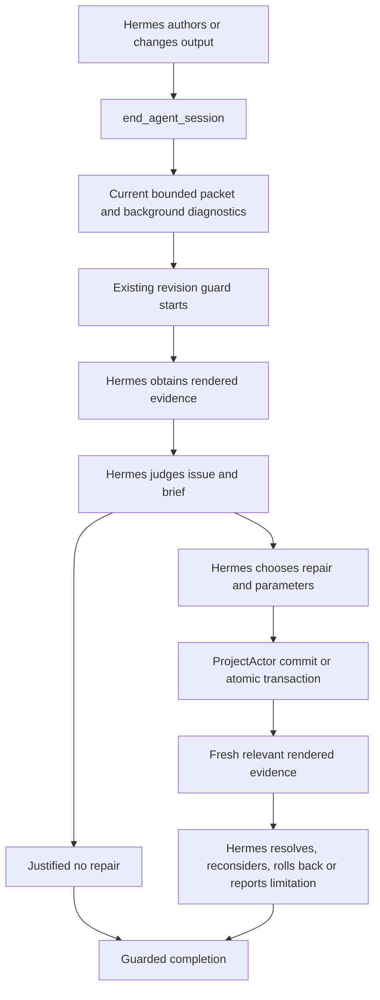

# Sclip reviewer feedback integration

Date: 2026-10-10. Base: `c1db8588`. Implementation: `9238c27a`, `c4440bbc`.

## Verdict and boundaries

**A — REVIEWER FEEDBACK INTEGRATED AND VERIFIED OFFLINE.**

Ordinary editing now has a supported completion-tool boundary that delivers current critiques and initializes the existing guarded review. Offline tests demonstrate delivery, editor-selected repair/no repair, authoritative mutation, fresh rendered verification, and completion. They do **not** demonstrate that a real model understands a critique or improves editorial quality.

No provider inference, including free inference, ran. Paid cost: **$0.00**. User projects, credentials, creator memories and Hermes source/configuration were not changed. The Applications bundle was not replaced. The actual installed Hermes launcher/source was exercised with a disposable profile and the current workspace skill. The existing unrelated change to `apps/desktop/e2e/acceptance-routing/run.mjs` was preserved and excluded from these commits.

## Before: generation and delivery were separate

Relevant implementation:

- `apps/desktop/src/main/index.ts`: startup constructs BackgroundReviewer and the Jev client.
- `apps/desktop/src/main/sclip/reviewer/backgroundReviewer.ts`: actor subscription, debounce, layout estimates, optional range perception and legacy narrative pass.
- `apps/desktop/src/main/mcp/server.ts`: `get_timeline_critique`, tool execution and revision guarding.
- `apps/desktop/src/main/mcp/index.ts`: ordinary evidence preload and explicit review transport.
- `apps/desktop/src/main/sclip/hermesTerminalRuntime.ts`, `autonomousReview.ts`: Hermes startup and evidence staging.
- `revisionLoopGuard.ts`, `editorialRevisionAttempt.ts`, `editorialEvidencePacket.ts`: existing diagnosis, action, receipts, modality requirements and retry/rollback boundaries.
- `timelineContext.ts`, `renderedAudioEvidence.ts`, `timelineTemporalEvidence.ts`, `rangeRender.ts`: existing source mapping and deeper rendered evidence.

The actor subscription scheduled the full reviewer after changes. Its summary lived in an in-memory cache. `get_timeline_critique` exposed it when explicitly called; initial editorial evidence did not automatically include it. Ordinary editing used an idle guard, while the dedicated review endpoint initialized one. The old end handler could block on critical findings or allow a `force` override without a grounded rendered review.

Hermes already had tools to inspect, register, choose, mutate and verify issues. Availability did not establish that ordinary editing delivered or considered the cached critique. Cached findings could be described as current without validating their state identity. Async cancellation and stale publication needed stronger protection.

### Why the existing completion tool is the integration boundary

The installed launcher at `/Applications/Sclip.app/Contents/Resources/hermes/hermes` resolves to `/Users/adityasamant/SCLIP/hermes-agent-src/.venv/bin/python -m hermes_cli.main`. Installed `agent/turn_finalizer.py` invokes the session-end plugin hook after finalization; that hook's result does not reopen inference. A session-end observer therefore cannot safely implement this feedback loop.

The smallest supported alternative is the existing MCP `end_agent_session` response, which Hermes can consume during its current tool loop. The normal skill now asks it to call this for changed nonempty videos, including small changes without a batch. No new scheduler, creative agent or Hermes hook was introduced. **A model that ignores the completion-tool contract and returns prose can still bypass this boundary.** That behavior requires a future live test; there is no claim that all final prose is intercepted.

## Jev enablement root cause and fix

Previously `SCLIP_JEV_ENABLED` controlled the public source-passage tool, but startup supplied the same `jevDecide` function to the background reviewer unconditionally. A valid credential could therefore permit optional paid work through an independently triggered path.

`backgroundAuthorization.ts` now requires a separate explicit opt-in, `SCLIP_BACKGROUND_JEV_AUTHORIZED=1`, plus a nonempty, printable ASCII OpenRouter-format credential without whitespace. Missing/disabled flags, missing/malformed credentials and resolver exceptions reject authorization. This validates configuration, not provider entitlement. Credentials are never returned in critique output.

Mutation scheduling performs deterministic layout auditing only, even when optional flags are enabled. Full optional work is requested at completion and checks authorization at entry and immediately before subcalls. Local optional perception has its own `SCLIP_BACKGROUND_PERCEPTION_AUTHORIZED=1` opt-in. Default editing makes no background inference requests. The separately controlled public source-passage tool retains `SCLIP_JEV_ENABLED` and its existing evaluator/client; it is not silently enabled by background authorization.

Mock tests cover authorized/unauthorized paths, malformed keys, provider failure, cancellation, late results and overlapping passes. The logged HTTP 429 in the focused suite is a **mocked** provider error, not a real request.

## After: ordinary completion uses existing review infrastructure

### Integration changes

1. `completionReview.ts` holds a bounded host-local map of existing RevisionLoopGuards. Eight project entries maximum; active reviews cannot be silently evicted. MCP reconnects reuse the same guard and budgets.
2. An authored-output identity excludes label/lock/marker changes and unused imports. Empty/unchanged output is not sent through a new completion review. Full canonical `reviewState` still governs evidence freshness.
3. On completion of changed authored output, `server.ts` begins the guard, obtains the current reviewer pass, and returns `completion: review_required`, a bounded Evidence Packet, current critique, packet receipt and existing lifecycle instructions. The AgentActivity session remains open.
4. Initial ordinary evidence, explicit-review preload, `get_editorial_evidence_packet` and `get_timeline_critique` deliver current critique data. This supplements existing packet contents rather than duplicating deeper audio/visual inspections.
5. After fresh rendered inspection, Hermes can independently register/select an issue, use existing single edits or atomic repair transactions, and verify it. It can also conclude no justified repair with evidence and a reason.
6. Resolution retains the existing issue-specific fresh/modality requirements. Completion additionally requires current rendered evidence: structural state alone cannot certify that the result was inspected. Geometry from failed visual inference does not masquerade as successful visual observation.
7. A successful current review binds its decision/outcomes to the exact state. Repeated end calls do not start another review. Critique/preload metadata reports `considered_in_completed_review` for that same state. Later state changes invalidate that disposition and permit fresh consideration.
8. Unavailable inspection can be reported using `review_unavailable_reason`. The result is explicitly `unreviewed`, with lifecycle/outcomes retained, never a successful review. Legacy `force` cannot bypass pending review.
9. A new deliberate begin can reset completed/unreviewed work only after the actual begin succeeds. Reconnects cannot reset an active review. Explicit review mode remains supported.

### Identity, provenance and lifecycle

`currentCritique.ts` validates project ID and SHA256 of canonical current state before delivering findings. Unknown/stale/unavailable summaries return no old issues and `not_reviewed`, rather than a fake clean verdict. Packets expose at most 12 issues, bounded descriptions/actions, omission counts and coverage.

Findings have affected layer/range where observable, timeline coordinates, state identity, evidence class/basis, uncertainty and a requirement for further inspection. Layout estimates are deterministic metadata-derived observations, not rendered-pixel proof. Optional model findings are labelled fallible model observations. Source transcript projections are explicitly distinguished from mixed audible speech.

BackgroundReviewer invalidates work on actor events, cancels on new work/dispose, unsubscribes on shutdown, rejects old generations and bounds optional work to a default 30-second deadline. Timeouts/cancellation retain current deterministic facts and explicitly label incomplete optional observations. Same-state deeper evidence is not overwritten by a redundant cheap read.

The existing guard bounds diagnosis and reserves action/verification; it retains its issue/mutation limits, checkpoint requirements, stale rejection and rollback invalidation. This implementation does not add a repair quota or automatically choose any operation. Same-state decisions are host-local bookkeeping, **not persistent memory**: after app restart current facts are regenerated, and prior editorial judgments are not invented. Reconnect persistence and reviewer restart safety are tested separately from durable project/history behavior.

## Decision authority

| Decision | Owner |
|---|---|
| Is a potential critique valid and relevant? | Hermes |
| Which issue matters; should any repair happen? | Hermes |
| Evidence tool, repair tool, layers and creative values | Hermes |
| Transaction contents; intentional A/V offsets | Hermes |
| Is the result better; retain, revise, rollback or stop? | Hermes |
| State identity, stale rejection, receipts, budgets, atomicity | Existing deterministic infrastructure |

No creator-memory changes, fixed repair values, genre recipe, extra agent or experimental Phase 4B.2B skill promotion occurred. Existing calculation tools remain read-only helpers for Hermes-selected choices.

## Capability matrix

“Verified” below refers to offline evidence/execution contracts, not real-model editorial comprehension.

| Review capability | Evidence produced | Reaches Hermes? | Can Hermes repair? | Verified? |
|---|---|---|---|---|
| Framing/layout | Background static scale/font/position and motif overlap estimates; deeper composed frames | Yes: completion, preload and tools | Existing transforms/text/transactions; intentional margins remain valid | Offline delivery/repair/fresh receipts; real compositor pixels and export |
| Timeline gaps/geometry | Authoritative packet/context intervals, mappings and technical invariants; background is not a comprehensive gap scanner | Yes | Existing trims, moves, ripple and transactions | State/transaction/ripple regression tests; no automatic aesthetic verdict |
| Audio levels/technical continuity | Foreground actual mix PCM measurements; optional background range sidecar is partial | Yes when requested; authorized optional findings at completion | Existing audio operations | Rendered-audio contracts and export stream validity; no semantic listening verdict |
| Speech beginning/ending meaning | Not reliably established by deterministic background. Legacy optional Jev uses inline video source transcript windows; actual rendered speech/local Whisper and surrounding source context require foreground inspection | Current available hints plus existing evidence tools | Existing source/timeline repairs, explicit A/V transactions | Modality/freshness contracts tested; meaning/repair quality unverified |
| Story coherence | Hermes interpretation; optional legacy narrative hints are uncalibrated and partial | Available evidence reaches tool/context path | Existing editing tools | No semantic quality proof; background alone unsupported |
| Visual progression | Foreground chronological representative composed samples, per-frame observations/uncertainty | Yes through existing temporal/range tools | Existing sequence and transform tools | Temporal/provenance tests; unsampled motion unknown |
| Timing/pacing | Timeline intervals, mixed-audio quiet measurements, speech context; these are facts, not a quality rule | Yes | Existing ripple/trim/move/audio tools | Mechanics and receipts tested; editorial rhythm unverified |
| Caption correctness | Background layout estimates, authoritative text/timing; correctness of wording needs relevant speech/text reasoning | Yes | Existing text/caption operations | State/history and evidence contracts tested; no general semantic caption claim |
| Technical export integrity | Existing production export plus independent probe/decode; background is not the full export validator | Through existing render tools | Existing repair tools where justified | Actual 2-second H.264/AAC export, 640×360; full decode passed |

## Offline validation and observable trace

### Final results

| Check | Result |
|---|---|
| Focused Vitest suites | **302 PASS, 25 files, 0 FAIL, 0 SKIP**, 5.82 seconds |
| Typecheck (`npm run typecheck`) | PASS |
| Desktop/CLI/skills/WASM build (`npm run build:e2e`; normal build also exercised) | PASS; existing bundler dynamic-import warnings only |
| Real Electron completion/compositor/export test | **1 PASS**, 8.1 seconds total |
| Independent `ffprobe` and full `ffmpeg -f null -` decode | PASS; H.264 video/AAC audio, both 2.000 seconds |
| `git diff --check` | PASS |
| Paid/free model inference | **0 requests, $0.00** |

The final test commands and logs are retained in `.scratch/reviewer-feedback/`. A sandboxed rerun initially failed localhost listening with `EPERM`; localhost-authorized execution passed. One old assertion expected definitive caption-position wording and was updated to assert the new estimated/uninspected wording. These were not hidden or classified as provider/editorial failures.

The first synthetic Electron repair fixture enlarged video without correcting its offset. Independent PNG inspection caught that fixture mistake. The fake editor's parameters were corrected and a chart-specific pixel-coverage assertion added. The final test passes. This changed test choices, not production editing decisions, and was not a real-model retry.

### Mandatory scenarios mapped to tests

| Scenario | Production/offline path exercised |
|---|---|
| Critique generated and delivered | `completionReview.test.ts`: real local MCP transport, BackgroundReviewer, actor, completion result |
| Critique leads to editor-selected repair | Same test: fake editor chooses `update_layer_params`; actual ProjectActor commits |
| Fresh verification | Completion/reviewGrounding/evidenceVerification/guard tests reject premature, stale and wrong-modality resolution; Electron checks fresh composed PNG |
| No repair is valid | Completion test retains intentional inset after rendered receipt and reason, without mutation |
| Stale evidence | Manual actor mutation invalidates diagnosis; current reacquisition succeeds |
| Normal completion | Ordinary default MCP path automatically begins guarded review at end tool; empty/import/label-only paths skip |
| Explicit review preserved | Existing `reviewGrounding.test.ts` explicit endpoint and reconnect cases pass |
| Disabled Jev and no ordinary background spending | `backgroundAuthorization.test.ts` and completion provider spies; all requests zero unless mocked explicit authorization |
| Lifecycle safety | Background authorization/reviewer tests: no findings, deduplication, overlap, cancellation/disposal, timeout, late-result rejection and new reviewer; completion tests: reconnect, unavailable and deliberate restart |
| Existing tools remain connected | Source Understanding, transcript access, rendered audio, temporal evidence, effects, ripple, catalog bijection, actor history, transaction, rollback and creator-memory safety/consolidation suites |
| Installed Hermes delivery | Actual installed Python skill loader and MCP registration/tool handler, described below |

### Actual installed Hermes integration

`completionReview.test.ts` launches the installed checkout's Python interpreter with a disposable `HERMES_HOME`, copies the current normal skill, stages the actual completion packet, then invokes:

- `agent.skill_commands.build_preloaded_skills_prompt`: asserts current framing critique and completion instructions are in native loaded context.
- `tools.mcp_tool.register_mcp_servers`: discovers the real local catalog.
- `tools.mcp_tool._make_tool_handler`: calls `mcp__weftcut__get_timeline_critique` and receives state-labelled current findings.

This test passed here, with **no model construction/inference**. It is conditionally skipped on machines without that installed interpreter; it was not skipped in this run. The Electron transport/export test is separate and does not pretend to be a Hermes reasoning test.

### Real renderer trace

`apps/desktop/e2e/electron/reviewer-completion.spec.ts` uses a generated chart/audio clip and disposable app profile/project. Fake editor decisions are explicitly identified in the test and trace. Provider credentials/optional inference are disabled.

1. Actual authored project → static coverage finding in `end_agent_session`, `completion: review_required`.
2. Actual `inspect_timeline_frame` → PNG and receipt `e2`, state `8f213fe073f882a04a0ff0b2a357fbda4dfb3c49afcf295910685cca0a3f3d2e`.
3. Fake editor registers/selects visual issue, creates checkpoint, chooses explicit transform operations.
4. Actual `apply_repair_transaction` → transaction `01a12658-1ae1-7213-b721-32e09c735aba` commits via ProjectActor.
5. Premature `finish_issue: resolved` is rejected.
6. New actual composed frame → receipt `e3`, state `62161cc330c70fd04c0abe668f3e08ed2f237bafe7c7143fe7d33625ebeb475a`; changed bytes and generated-chart coverage asserted.
7. Fake editor resolves and completes → final `completion: reviewed`; actual project saved and production video exported.

Artifacts (local, not committed media):

- `.scratch/reviewer-feedback/electron/trace.json`
- `.scratch/reviewer-feedback/electron/before.png`, `after.png`
- `.scratch/reviewer-feedback/electron/project.json`, `edit.mp4`
- `.scratch/reviewer-feedback/electron/result.json`, `technical-qa.json`
- `.scratch/reviewer-feedback/final-focused-tests.log`, `typecheck.log`, `build.log`, `electron-tests.log`

The trace records tool activity/observable metadata, not hidden chain-of-thought or credentials. Native engine code was unchanged; a full Rust/platform/full-release suite was not rerun. This report does not claim Sclip is bug-free.

## Remaining limitations and future acceptance

- Completion depends on Hermes following the existing MCP completion contract. Native end hooks alone cannot restart review. No invasive inference scheduler was added.
- Current rendered receipts establish relevant fresh evidence exists; Hermes still judges it. A single frame does not certify a whole video or its story, pacing or speech.
- Static geometry ignores some animation/anchor/occlusion/crop details. Warnings require actual inspection. No requirement to fill the canvas or use a specific font/transform is imposed.
- Optional legacy Jev depends on inline video transcripts, which are not equivalent to normal cached or rendered speech. Scores are uncalibrated. Its narrative coverage is incomplete.
- Optional sidecar inspection covers a bounded representative range. Cancellation prevents late publication; an already issued provider request cannot be made unspent retroactively. Both optional paths are disabled by default and recheck authorization before issuing work.
- Completion dispositions/guards are in memory and survive transport reconnects, not full app restarts. Current facts and state safety survive through project persistence; historic completed-review judgment is not silently reconstructed.
- No real-model understanding, autonomous repair quality, story improvement, publishability or reduction in human correction burden was measured.

Exactly one recommended next action: **run one separately authorized, bounded live editing acceptance to check whether Hermes follows this completion contract and makes defensible repair/no-repair judgments.** Do not change or spend anything automatically after this report.
