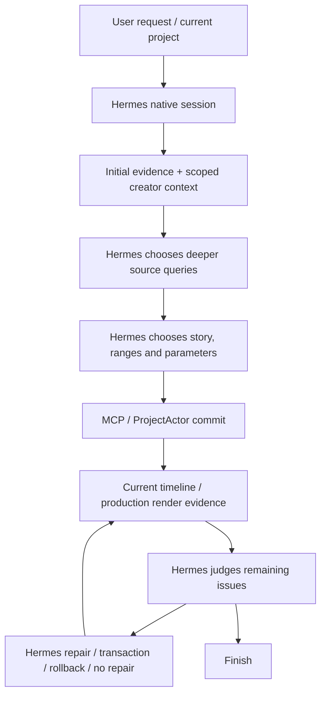

# Phase 4B.2A — Sclip editorial gap analysis

Audited checkout: `667c522d1ef48cb9fd288e9653f3a6f2a24af699`, 2026-10-10. Research only. Historical execution evidence is distinguished from current source capability.

## 1. Source-level workflow

| Boundary | Current implementation inspected | What exists; what it does not prove |
|---|---|---|
| Request → native Hermes | `apps/desktop/src/main/sclip/hermesTerminalRuntime.ts`, `HermesTerminalRuntime.ensure` | Project/session ownership, provider/model config, toolsets, skill preload. Explicit review mode starts review infrastructure; ordinary edit mode does not automatically become a guarded review |
| Evidence injection | `sclip/autonomousReview.ts`: `initialEditorialEvidence`, `stageEditorialEvidence` | Initial authoritative state plus observations in a temporary preloaded skill; no new editorial agent |
| Coarse source | `sclip/sourceUnderstanding.ts`: `buildSourceUnderstanding`; `sourceObservationIndex.ts` | Uniform coverage grid, max 12 cells/24 observations, six coarse samples, explicit unknowns. A coverage cell is not a scene, utterance, take or ranked story unit |
| Source speech | `sourceSpeechContext`; MCP `GET_SOURCE_SPEECH_CONTEXT_TOOL`; native `speech/parse/whisper_json.rs` | Bounded before/selected/after segments and words in source time, source-hash checks. Token-derived word timing exists; engine label `Exact` does not imply acoustically exact. Segment text can cross selected boundaries |
| Optional long-source retrieval | `sclip/sourcePassageEvaluation.ts`: `createSourcePassageEvaluator`; `jevClient.ts` | Cached transcript windows and an optional **paid** Jev shortlist with uncalibrated relevance/completeness/context estimates, no confidence cutoff. Not a cut list, take selector or free deterministic operation. No Jev call made here; keep disabled in a clean Hermes-only experiment |
| Plan | `sclip/roughCutPlan.ts`: `RoughCutPlan`, `validateRoughCutPlan` | Brief, thesis, source summary, section purposes, source ranges/reasons, removed ranges and uncertainty. Mechanical checks; no comparison of alternatives, selected meaning or audible completion certificate |
| Assembly | `state/mutations/roughCut.ts`: `preflightRoughCutPlan`, `compileRoughCutTimeline`; `state/actor.ts` apply arm | Strict Hermes-plan order, frame snapping, requested/actual source mappings, paired layers, checkpoint/history. No independent story choice |
| Current facts | `sclip/timelineContext.ts`: `buildTimelineContext`; MCP timeline handler | Counts by layer kind, topology, source mappings, speech cues, opening context. Cues are projections, not a rendered listening experience |
| Compact current packet | `sclip/editorialEvidencePacket.ts`: `buildEditorialEvidencePacket` | State identity, mappings, A/V relationships, boundary words, text, visuals and unknowns; 28 KB ceiling. Initial speech excerpts are at most 180 characters per indexed layer plus boundary words; no full story guaranteed |
| Actual audio | `sclip/renderedAudioEvidence.ts`: `inspectRenderedAudio`, `measureRenderedPcm` | Production mix, local Whisper recognition, RMS/peak/quiet spans, content hash/current-state identity. It does not judge thought completion, performance, emotional pause or perceptual audio continuity |
| Visual progression | `sclip/timelineTemporalEvidence.ts`: `inspectTimelineTemporalWindow`; `timelineVisualEvidence.ts` | Two–five composed samples, individual observations and structural changes; unsampled motion unknown. A montage of frames is not full temporal comprehension |
| Rendering | `sclip/rangeRender.ts`: `renderComposedTimelineRange` | Actual composition output within resource limits. Returning a render URI is not evidence Hermes watched or listened to it |
| Review → action | `sclip/revisionLoopGuard.ts`: `recordIssue`, `recordEvidence`, `beforeMutation`, `finishIssue`; `evidenceModalities.ts` | Fresh relevant dimensions and bounded lifecycle for registered issues. Infrastructure checks coverage/state, not whether Hermes's diagnosis or satisfaction is correct |
| Repair / reversibility | `state/actor.ts`: `apply_repair_transaction`, `ripple_cut_range`; `sclip/editorialRevisionAttempt.ts` | Explicit operations/values, atomic commit, observable relationship/geometry changes and coherent rollback. No automatic creative partner edit |
| Style context | `sclip/creatorMemoryRetrieval.ts`: `selectCreatorMemory`; native preload above | Canonical scoped live preferences, current-brief priority, tentative evidence, omitted-record notice and on-demand details; normally bounded near 3,000 JSON characters plus notice. No private store read here |

Paths abbreviated after the first row share `apps/desktop/src/main/`; native parser is under `apps/desktop/native/src/`. Existing source tools can retrieve repeated explanations, but no inspected contract declares equivalent takes with performance comparisons. Native audio measurements provide signal facts, not delivery meaning. Dense screen-state/OCR coverage is also not established by the coarse map.

### Existing instructions are substantial

`skills/weftcut/SKILL.md` already contains opening-context guidance and separate purpose/assembly, finer execution and actual-result review sections. It explicitly offers rendered audio, temporal inspection, transactions and grounded no-repair. The editing knowledge includes story spines, performance, rhythm, context, ending and review principles.

Current word counts: main skill 4,460; knowledge references 25,719; total 30,179. They are progressively discoverable, not necessarily all injected. Manchester read four references at startup. Lack of any editing guidance is therefore not a supported diagnosis. Some broad entries emphasize retention/peak endings and contain exceptions; their priority in this specific model's decision is unknown. A bigger undifferentiated knowledge dump is a poor first intervention.

### Two evidence caveats

1. `timelineContext.extractSpeechCues` can distribute segment-only text uniformly when individual words are absent, then expose cut cues. This is a static uncertainty risk, not the demonstrated Manchester cause: that run did return word arrays. Do not treat interpolated cues as phoneme validation.
2. Review guards prove fresh evidence coverage, not semantic insight. A model can fail to register a real issue, declare an incomplete thought acceptable, or overlook a displayed transcript. Tightening mutation safety cannot by itself fix those judgments.

## 2. Manchester: reconstructing the causal chain

Artifact root: `apps/desktop/e2e/bench-results/phase4b-final-manchester-holdout/`.

Read `report.md`, `independent-qa.json`, observable tool decisions, observable terminal output, final project, original and rendered transcript caches. Inspected the saved contact sheet. This phase additionally ran ffprobe and read-only PCM comparisons on the existing files; no new edit/render/model session occurred.

Source is a **135.574875-second already-edited broadcast highlight**, not imperfect multi-take educational raw footage. Brief: “Make a concise, engaging match highlights video from this footage.” Prior cost `$0.20421081`; runner runtime `341.135s`; 17 model responses, 58 function invocations, 35 requested MCP calls / 34 dispatched / one schema refusal. CLI's 74 tool-call message count is not 74 editorial MCP calls.

Rows below are **zero-based positions** in `observable-tool-decisions.json` (76 rows). They refer to observable tool activity, never hidden reasoning.

| Step | Evidence | Finding |
|---|---|---|
| Understand | Row 35: full-source `transcribe_clip`; earlier source queries and later targeted observations | Hermes had content and word timings before selecting ranges. `describe_clip` was unavailable, but other observations remained available |
| Choose story | Row 41: dry-run plan request | A real thesis exists: sending-off → goal/VAR → late save. Each section has purpose/reason. Do not diagnose a missing story-plan subsystem |
| Choose boundaries | Same plan: source 25–42, 64–88, 104–112 seconds | No observable explicit comparison of selected boundary meaning with omissions, or alternate opener/ending, is preserved. This does not establish what hidden deliberation occurred |
| Execute | Row 42 dry-run result; row 44 commit result | All three actual source ranges equal requested ranges. 49-second timeline is exactly their sum; no snapping-induced boundary shift in this case |
| Inspect | Row 48: actual rendered audio; current visual/technical reads | Audible transcript begins mid-thought and ends on an unfinished comparison. Evidence is not merely a source projection |
| Repair | Three explicit `update_layer_params` calls | Hermes independently fixes undersized picture coverage using 1.5× scale. No speech/source/timing repair follows |
| Verify | Row 71: fresh-state rendered audio, plus visual/state inspection | Visual improvement verified. Same rendered-audio content hash before/after visual-only changes is expected |
| Finish | Observable terminal final response | Claims ready for export, citing synchronized audio, inspected visuals/audio and clean diagnostics. Does not acknowledge unfinished speech |

Final source/timeline mapping:

| Source seconds | Timeline seconds | Layers |
|---|---|---|
| 25–42 | 0–17 | Video + linked Audio |
| 64–88 | 17–41 | Video + linked Audio |
| 104–112 | 41–49 | Video + linked Audio |

All three A/V pairs have equal source/timeline ranges and zero relative source offset. No internal main-track gaps/overlaps; no new text. The stored export is H.264/AAC, 1920×1080, 49 seconds. Prior independent QA fully decoded it and reported no black tail. This phase checked metadata and sampled images, not a new full-motion professional assessment.

### The semantic failure and the timing contradiction

Actual rendered transcript at row 48, repeated at row 71:

- Opening: **“a bit of respite, and then Bruno Fernandez goes down…”**
- Ending: **“…That is as good a save as the one he got against.”**

The independent exported-audio transcript agrees on the unfinished thought. ASR punctuation/name spelling is not reliable proof of exact spoken wording or acoustic mid-word cuts.

Full-source row 35 assigns the comparison's final name to approximately 110.01–111.22s and the next short sentence to 111.33–112.22s. Its opening words also do not align exactly with the rendered selection. Thus a nominal end at 112s can look more complete in source-ASR projections than the actual output. It would be wrong to say all timing evidence was accurate and the model simply ignored an unquestionably correct boundary.

Read-only PCM checks compared three seconds from source 25s with output 0s, and source 104s with output 41s. Best mono-16k cosine correlations were `0.98362` and `0.98372`, each at 35ms lag within a ±100ms/1ms search. This supports playback of the declared source excerpts; it does not certify perfect A/V sync or phoneme alignment. No evidence here establishes a multi-second ProjectActor source shift. The source/render transcript disagreement is an **evidence accuracy limitation**; its precise ASR/extraction cause remains unverified.

After row 48, however, the actual-result transcript makes the incomplete comparison visible regardless of source timestamp accuracy. Failure to act or acknowledge uncertainty at that point is a strongly supported **semantic self-review/judgment failure**.

### Earliest consequential failure

The initial selection commits weak speech boundaries; they survive a mechanical dry run. For the opening, standalone context is already questionable in source evidence. For the ending, imperfect source timing may explain the initial choice. Neither a compiler defect nor an incoherent story is demonstrated.

The next consequential failure is approval after actual rendered evidence contradicts a complete ending. Improving only source timestamps could reduce initial errors but would not explain why the explicit rendered contradiction survived review. These two stages should not be collapsed into “the tools were not used”: the audio tool was used twice and a real visual repair worked.

## 3. Cross-case triangulation

| Existing evidence | What it supports | What it cannot establish |
|---|---|---|
| [Phase 4A product holdout](../research/sclip-phase4a-product-holdout-acceptance-2026-10-05.md) | Broad source exploration, local speech/context and coherent three-part product assembly; imperfect caption recognition left unresolved | Universal footage understanding or all editorial taste. Old source is retired |
| Manchester preserved report | Partial 4A→4B shift: assembly → current rendered inspection → framing repair → reinspection; semantic boundary approval remains weak | Performance comparison, rambling-explanation pruning, screen tutorial quality, raw-footage generalization |
| Earlier 3D/3E reports and architecture | Historical A/V half-repair and transaction limitations motivated capabilities now present | They do not explain a run that never attempted a speech repair or transaction |
| Free-model creator-memory smoke reports | Some live retrieval/tool behavior; weak/no editing outcomes in synthetic fixtures | Strong-model editorial quality or causal validation of this proposal |

No old evaluation footage becomes new unseen evidence. Invalid pre-inference routing runs and manually interrupted experiments are excluded from editorial root-cause claims.

## 4. Failure classification and confidence

| Problem | Classification | Confidence / boundary |
|---|---|---|
| Opening depends on omitted commentary | Weak reasoning / poor context use at selection | High observed result; exact alternative not prescribed |
| Ending unfinished | Inaccurate evidence may affect selection; weak semantic review despite actual rendered evidence | High result/review failure; initial timing cause unverified |
| Framing initially underfills canvas | Editorial execution oversight, subsequently repaired | High; current tools were sufficient |
| Few finer pacing edits | Unverified / possible weak editorial judgment | Number of cuts is not quality. The long VAR block may intentionally carry suspense |
| No take comparison | Missing explicit candidate alternatives in current representation; quality impact unverified | Static capability gap, not proven dominant cause in broadcast footage |
| No semantic vocal-delivery observations | Missing evidence for performance-sensitive work | Static limitation; not needed to recognize this incomplete ending |
| No dense visual/screen understanding | Missing evidence for some target workflows | Do not extrapolate from sparse frames; target-domain execution evidence missing |
| No speech repair after review | Weak reasoning / missing meaningful review-to-repair decision | High; no rejected valid repair shown |
| Style context overwhelms brief | Unverified | Bounded retrieval/current-brief priority exist; Manchester used style memory off |

**Likely bottleneck:** converting existing speech evidence into explicit decisions about received meaning at selected boundaries. Source timing uncertainty increases the need for actual-result comparison. Current evidence does not justify a new editor, another critic, automatic take scoring or a timeline rewrite.

## 5. Read-only validation and remaining evidence

Executed: three mapping equality checks; trace/tool-result extraction; source/render transcript comparison; ffprobe; two PCM comparisons; saved contact-sheet inspection. Derived diagnostic details are in ignored `.scratch/phase4b2/artifact-audit.json`; original artifacts remain unchanged. No new ASR/VLM/provider inference was needed.

Needed for stronger conclusions: a consented raw educational/expert recording with genuinely competing takes, full source, creator final edit and explanation/correction notes; and a separate unseen target-domain source/brief. These would discriminate evidence recall, delivery assessment and meaningful redundancy from model judgment. No professional human assessment was fabricated here.

**Verdict B — LIKELY BOTTLENECK IDENTIFIED; LIMITED VALIDATION NEEDED.** Proceed only to the narrow [proposed experiment](first-editorial-experiment-plan.md), under later implementation and inference authorization. Production, skill, app and creator data remain unchanged.
