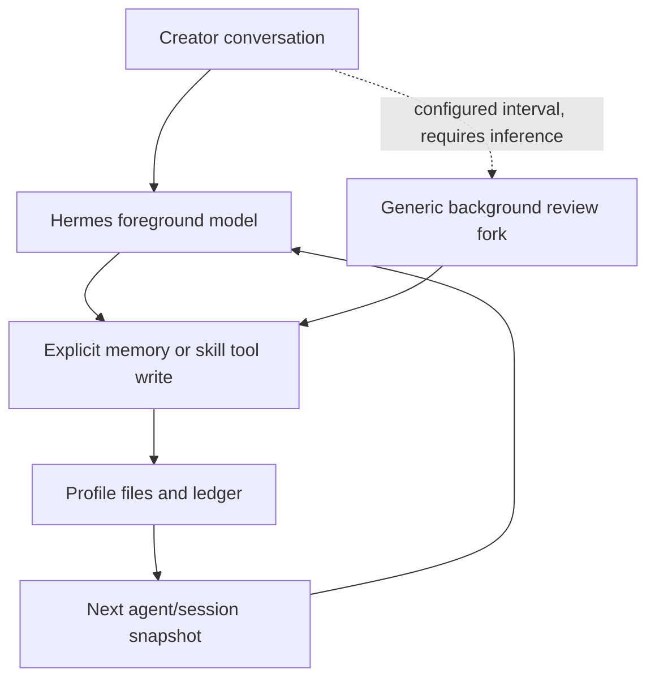

# Installed Hermes learning investigation

Date: 2026-10-08. No inference. Launcher resolves to `/Users/adityasamant/SCLIP/hermes-agent-src`; version 0.20.4, source baseline includes local Sclip additions (style modules originally committed in `8fd95f5`). Existing unrelated tool-search changes preserved.

## Classification: B — persistent memory, not suitable automatic creator-style learning

Generic automatic experience review **does exist**. This is not equivalent to robust creator style learning. It invokes a model fork, has no ProjectActor correction provenance, and cannot infer why a pause was restored. No claim that it works editorially was made without inference.

| Mechanism and installed source | Inputs, trigger, storage and retrieval | Activation and limits |
|---|---|---|
| `tools/memory_tool.py:MemoryStore` add/replace/remove, `agent/agent_init.py` memory initialization, `agent/system_prompt.py` | Model-authored entries; immediately atomic/locked files `HERMES_HOME/memories/MEMORY.md`, `USER.md`. Session-start frozen system snapshot. Bounded 2200/1375 chars; substring replacement, drift guards, threat scanning. | Real profile omits memory config; merged defaults enable memory and user profile. Explicit memory toolset creates store even with skip_memory. Cross-session/project within one home; no creator/series schema, evidence lineage or automatic decay. Mid-session file writes do not refresh frozen prompt. |
| `agent/turn_context.py` nudge, `turn_finalizer.py`, `run_agent.py:_spawn_background_review`, `agent/background_review.py` | Every configured 10 user turns / tool iterations triggers optional post-response memory/skill model review. Fork selects writes from conversation. `auxiliary.background_review.enabled`, memory write approval and skill locks govern. | Defaults enabled, CLI ignore-rules/skip_memory suppresses providers. However explicitly requesting the memory tool creates the store despite skip_memory; memory/skill nudge conditions can still be eligible. No separate skip_background_review flag is passed by cli_agent_setup_mixin.py. Defaults therefore permit generic post-turn forks; no fork was run to test editorial learning. It is a separate inference fork, not used/enabled for Phase 4C. A model must actually write; prose claims are insufficient. |
| `tools/skill_manager_tool.py`, `tools/skill_usage.py`, `agent/curator.py`, `curator_backup.py` | Agent creates/patches procedural skills; on-demand skill loading; usage counters; ledger and before/after backups. Periodic curator pruning; optional consolidation model. | Skill creation guidance exists. Curator consolidation defaults false, interval seven days. Skills are procedures, not evidence of creator taste; no new creator recipes or fork introduced. |
| `hermes_state.py:SessionDB`, `tools/session_search_tool.py` | SQLite `state.db`, messages/FTS search, optionally model-summarized historical conversations. Resume restores history; search retrieves details on demand. | Existing persistent home/session ownership. Session search is not preference extraction. Summarization/compression may require inference and was not exercised. |
| `agent/prompt_builder.py` SOUL/context files | Profile identity/rules read at prompt assembly; not learned automatically. | SOUL exists in real profile, terminal ignore-rules suppresses context-file loading. Not a taste ledger. |
| `agent/style_memory_provider.py`, `style_preference_engine.py`, `style_memory_schema.py` | Installed custom provider consolidates style-events JSONL by numeric/string clusters into winning values, then native MemoryManager prefetch. Caption bridge in Sclip. | Always added when not skip_memory. Terminal uses skip_memory. Real profile has legacy style profile (2485 bytes) but no event journal observed. Missing creator/series scope, provenance IDs, counterexamples and controls. Numeric averaging/winner selection and “adhere” guidance are unsuitable for this mission. Not imported/migrated as approved creator taste. |
| `agent/learning_graph.py`, `learning_graph_render.py`, `learning_mutations.py` | Visualization of memory chunks/skills, lexical edges; edit/delete/archive existing nodes. | Presentation/control, not an additional learning algorithm. |
| `plugins/memory`, `agent/memory_provider.py`, `memory_manager.py` | Supported one-external-provider extension; prefetch, sync, end hooks. External plugins may require services. | No external provider configured. Honcho/other provider availability is not proof of activation. No service introduced. |

No independent “instinct” learner, preference confidence/reconciliation engine beyond the narrow local clustering module, or automatic timeline correction extractor was found in the traced paths.

## Real lifecycle

`MemoryManager.prefetch_all` → `turn_context.py` API-context sidecar → current user-message API copy; `sync_all`/queued prefetch at finalization. These provider hooks are skipped by Sclip terminal's `--ignore-rules` (see `hermes_cli/main.py:cmd_chat`, `cli.py:HermesCLI`, `agent_init.py`). Native file memory remains usable because the terminal explicitly requests the `memory` toolset. API sidecar persists recalled bytes separately from clean user content.

For “shorten long pauses but preserve revelation pauses”: explicit native memory text can persist; automatic recognition needs model judgment and correct evidence, not merely elapsed turns. Timeline edits are invisible to generic conversation review unless surfaced. Home separation survives restart; generic files lack creator IDs and do not isolate creators sharing a home.

## Activation findings and verification

Real config safely inspected only non-secret fields/file sizes: memory, skills and background review absent (defaults); no external memory provider. Production `hermesRuntime.writeHermesProfile` rebuilds config and drops custom memory/auxiliary sections. Benchmark profiles disable memory intentionally and are not product activation evidence. No real memories overwritten or read into reports.

Executed `e2e/phase4c/hermes-memory.test.py`: **3 passed**, no model/client constructed; network creation prohibited in the parent test process. Actual installed MemoryStore saves preference, freezes existing prompt, reloads in another store and fresh Python process, replaces contradictory preference, removes it, separates another home. Actual installed style provider/MemoryManager prefetch retrieves synthetic caption value across sessions but exposes narrow/non-creator semantics. The third test invokes the actual installed `agent.skill_commands.build_preloaded_skills_prompt` in a fresh process/home: scoped synthetic style text appears in its returned model-context string. CLI uses this function and `finalize_preloaded_skills` appends it to the system prompt. No actual taste decision tested.

No disabled safe automatic creator learner was found to activate. Do not enable paid background forks or remove ignore-rules globally just to activate the unsuitable legacy provider. Reuse supported native storage/session/skills context mechanisms; add structured local evidence integration instead.

Upstream comparison (secondary to installed source): [persistent memory documentation](https://hermes-agent.nousresearch.com/docs/user-guide/features/memory) describes bounded frozen snapshots and actual tool writes; [upstream manager](https://github.com/NousResearch/hermes-agent/blob/main/agent/memory_manager.py) provides provider orchestration. Installed source is authoritative for custom Sclip additions and skip-memory behavior.

Activation nuance verified against `hermes_cli/cli_agent_setup_mixin.py`, `agent_init.py`, `turn_context.py` and `turn_finalizer.py`: ignore-rules alone is not a blanket guarantee of no auxiliary review when the memory toolset is explicitly requested. The installed default generic review may run at a nudge. Phase 4C introduces no review fork and exercises no model path. Supported memory/skills settings and deliberate background-review choices are now preserved on profile rewrite. When no explicit choice exists, generated Sclip configuration sets `auxiliary.background_review.enabled: false`: creator learning uses the foreground editor. Other creator homes inherit only safe learning controls, never memory contents/provider credentials. No real profile was rewritten in this task; supported changes take effect on the next workspace runtime start.

Terminal provider bypass stays unchanged. The older gateway does not pass skip_memory and auto-registers the unsuitable legacy style provider. To preserve agency without modifying Hermes internals, the bridge rejects non-default creator runs and default runs with an existing legacy style-profile file, directing the user to the supported isolated terminal. This is a documented limitation, not proof that the gateway supports complete creator learning.
