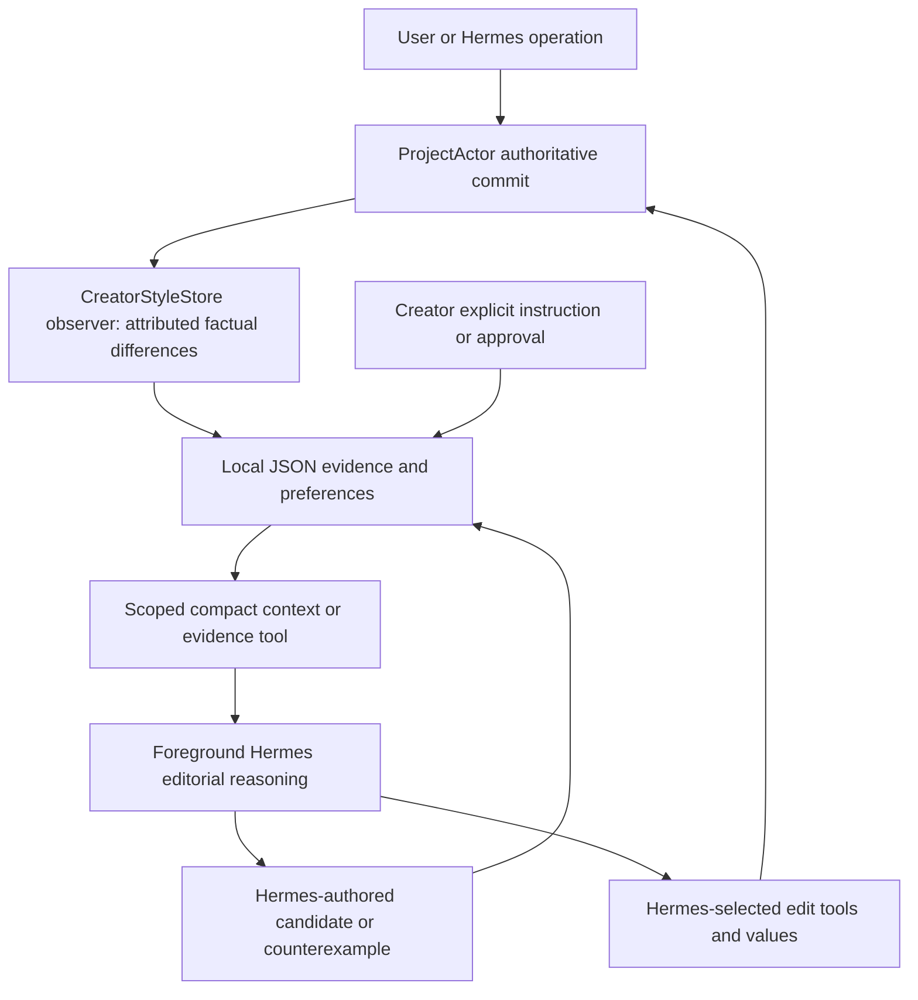
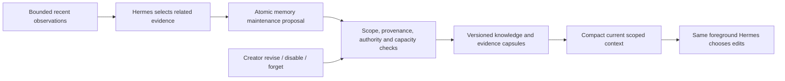

# Phase 4C.2 — Long-term creator memory architecture research

Research date: 2026-10-08. Sclip audit: documentation HEAD `a9f80d76`, production implementation `07419ec4`. Installed Hermes source: `515354038a3c383b38b43aba6959ceddd858bb12`.

**Verdict: B — ARCHITECTURE IS SOUND BUT REQUIRES TARGETED MEMORY QUALITY CHANGES.**

This is research and a proposal, not an implemented consolidation system. Production code, Hermes internals, creator data and the installed app were not changed. No inference or editorial holdout was run. Provider cost: **$0.00**.

## 1. Finding

Sclip has a useful local, scoped evidence foundation and a real foreground-Hermes integration. It does not yet have a sustainable long-term knowledge lifecycle. Its limits bound storage by stopping learning, not by transforming experience into compact knowledge.

The raw part is effectively a **bounded, lossy editing-observation log**, alongside a separate explicit/inferred preference collection. It is neither an exhaustive timeline journal nor an automatically consolidated creator profile. Adjacent same-property grouping is valuable physical compression, but it cannot establish semantic equivalence, preference, acceptance or intent.

The decisive offline results were:

- 10,000 effective User edits across 100 synthetic projects all committed to ProjectActor. Memory retained 600 records, missed 9,400 subsequent observations and generated no preferences automatically.
- Reusing one hypothesis ID across 100 projects kept one preference, but retained 100 evidence records and 100 supporting IDs. Supplying a new ID allowed 100 identical hypotheses; the next hypothesis was rejected.
- Explicit series boundaries worked. A candidate could nevertheless be retargeted from series A to B while retaining A's old evidence.
- An agent counterexample changed a disabled preference into `disputed`, making its text retrievable again.

These are executed implementation probes, not demonstrations of model learning or future editing quality. Detailed findings and reproduction instructions are in [the gap analysis](memory-quality-gap-analysis.md).

## 2. Professional systems: transferable lessons and limits

### OpenAI / ChatGPT

OpenAI describes synthesizing information across conversations, updating memory over time and letting users inspect/correct a memory summary. This supports the distinction between accumulated experience and useful current understanding. The public account does **not** disclose a reproducible storage schema, retention policy or consolidation algorithm. Its efficiency results cannot be imported as Sclip cost estimates. [OpenAI: Dreaming](https://openai.com/index/chatgpt-memory-dreaming/)

The product documentation also distinguishes disabling recall from deleting underlying information and explains that multiple sources can preserve information. For Sclip, forgetting must cover evidence, profile versions, recalled context and overlapping memory sources, not just hide a row. [ChatGPT memory controls](https://help.openai.com/en/articles/8590148-memory-in-chatgpt)

**Our inference:** adopt inspectable current knowledge and explicit source boundaries; do not claim to reproduce OpenAI's undisclosed implementation.

### Letta / MemGPT

MemGPT's original contribution is agent-managed movement between limited context and external memory. That is context management, not a proof that archived memories are accurate, consolidated or bounded. [MemGPT paper](https://arxiv.org/abs/2310.08560)

The repository named in the request now points active development toward Letta Code; the older V1 API is a separate historical surface. Current Letta documentation describes versioned MemFS, memory inspection and optional background dreaming. A bounded working profile is useful; a second background editorial agent is inappropriate here. [Letta repository](https://github.com/letta-ai/letta), [current memory documentation](https://docs.letta.com/configuration/memory)

The audited Letta Code validator supports file and aggregate core-memory character constraints and protected files. These are technical boundaries, not semantic consolidation. [Pinned validator implementation](https://github.com/letta-ai/letta-code/blob/0440e0c05f8c0042be98ff8db89c853cf8ca7e91/src/agent/memory-constraints.ts)

**Lesson:** separate small working context from retained evidence, version changes and protect creator-owned information. Do not import a framework or dreaming agent.

### Mem0

The pinned OSS `_add_to_vector_store` implementation retrieves up to ten existing memories, performs an LLM extraction, embeds extracted text and prevents exact hash duplicates against retrieved results/current batch. `infer=False` still invokes embedding. This is not a free global semantic deduplicator or a bounded consolidation guarantee. [Pinned OSS implementation](https://github.com/mem0ai/mem0/blob/b7ad69afda6b6ed030347c66d48a13e4de9dec08/mem0/memory/main.py#L882), [Mem0 research paper](https://arxiv.org/abs/2504.19413)

Managed Dream separately documents synthesis, supersession and merge. Original sources remain; default reads can include superseded records unless current-only retrieval is requested. Managed behavior must not be attributed to the OSS pipeline. [Mem0 Dream](https://docs.mem0.ai/platform/features/dream)

Its documented decay feature changes retrieval ranking rather than deleting memories. Returning an item frequently is not independent creator endorsement; Sclip should avoid a feedback loop that promotes its own repeated retrieval. [Mem0 decay specification](https://github.com/mem0ai/mem0/blob/b7ad69afda6b6ed030347c66d48a13e4de9dec08/docs/platform/features/memory-decay.mdx)

**Lesson:** canonical IDs, explicit replacement relationships and current-only reads matter. Extraction plus an archive can still grow indefinitely. Remote embeddings/background synthesis violate this phase's preferred cost boundary.

### Zep / Graphiti

Graphiti retains episode provenance and distinguishes fact validity time from system recording/expiration time. Its edge resolver uses model reasoning to identify duplicates and contradictions before applying temporal invalidation. A graph is not necessary to borrow validity intervals and provenance. [Graphiti](https://github.com/getzep/graphiti), [pinned resolver](https://github.com/getzep/graphiti/blob/86f1c941bea7bf53fa45fe4e08c03244b4990eee/graphiti_core/utils/maintenance/edge_operations.py#L748), [Zep paper](https://arxiv.org/abs/2501.13956)

**Lesson:** preserve when a belief applied and what replaced it; do not interpret a contextual exception as a timeless contradiction. The storage/backend and additional model processing would be excessive for Sclip's present needs.

### Other relevant research

| Source | Relevant finding | Sclip interpretation / limitation |
|---|---|---|
| [LongMemEval](https://arxiv.org/abs/2410.10813) | Evaluates cross-session, temporal, updating and abstention capabilities | Test updates and appropriate non-use, not just recall. Answering memory questions is not proof of better editing. |
| [A-MEM](https://arxiv.org/abs/2502.12110) | Evolves linked memory notes | Useful evidence/knowledge distinction; model-driven note processing has a cost. No need for a new note agent. |
| [Personalize-then-Store](https://arxiv.org/abs/2605.25535) | Studies selective personalized storage over long histories | Admission should reject transient clutter; the benchmark does not establish Sclip's required capacity. |
| [PersonaMem-v2](https://arxiv.org/abs/2512.06688) | Evaluates explicit and implicit personalization | Evaluate preference application and exceptions. Do not introduce fine-tuning. |
| [Hu, Koren, Volinsky: implicit feedback](https://yifanhu.net/PUB/cf.pdf) | Observed behavior is noisy; observation confidence differs from preference | A committed edit can be accurately recorded without establishing taste. No cross-creator recommendation model is proposed. |
| [Concept drift survey](https://arxiv.org/abs/2004.05785) | Distinguishes detection, understanding and adaptation to change | Different footage/series can resemble changing taste. Require contextual reasoning before supersession. |

All conclusions above use primary documentation, papers or source. No system's benchmark scores are presented as Sclip results.

## 3. Actual ownership and lifecycle

`CreatorStyleStore.observeChange` captures actor identity, state hashes, changed fields and bounded before/after values. It links a manual change to an AI proposal only when the preceding layer hash matches a retained proposal. Unlinked edits and restorations retain uncertainty. Saves/exports are not approvals. Agent changes populate proposal bookkeeping, not positive style evidence.

Storage is `creator-style/creator-style.json` under Electron user data. `mutate` clones, validates size/counts and atomically renames a local file. The observer's failure does not abort the timeline commit. ProjectActor owns actual timeline/history; memory is a subscriber, not another writer.

Native terminal startup stages compact creator context beside the evidence packet; the bridge appends request-ranked context to the foreground request. The memory MCP tool provides fresh context/detail and allows Hermes to propose hypotheses/counterexamples. Creator controls own explicit approval, scope binding and removal. Source locations are indexed in the gap analysis.

### Hermes and legacy memory

Installed Hermes provides bounded, file-backed `USER.md`/`MEMORY.md`, exact duplicate checking and atomic add/replace/remove batches. Its loaded prompt snapshot is frozen for caching; removing a record does not remove it from an already-loaded snapshot. A fresh instance excludes it. The safe temporary-profile probe verified this without constructing an AIAgent.

Native Sclip terminal uses `--ignore-rules`, bypassing the external legacy style provider. **That flag is not proof that generic file memory is off:** `agent_init.py` can initialize it when the memory toolset is requested. Generic configuration remains conditional. No real private profile was inspected in this task; we cannot certify absence of historical style text in generic memory.

The old style engine calculates numeric clusters/winners and style values. Re-enabling it as a consolidator would violate the present agency boundary. The curator's optional model consolidation is primarily a skills mechanism, not a proven creator-ledger reconciler. Sclip cost guards cover autonomous/background behavior; no background learner is proposed. See `tools/memory_tool.py`, `agent/agent_init.py`, `agent/style_preference_engine.py`, `agent/style_memory_provider.py`, `agent/curator.py` in the audited Hermes checkout.

## 4. Alternatives challenged

| Alternative | Learning and reliability | Maintenance / integration | Storage and model cost | Controls / privacy / recovery | Decision |
|---|---|---|---|---|---|
| A. Current ledger unchanged | Correct facts and scopes; saturation, duplicates, lifecycle gaps | Least work now; recurring manual cleanup later | Bounded by refusing writes; $0 local capture | Local and inspectable; deletion lifecycle incomplete | Not sustainable |
| B. Targeted ledger + compact knowledge | Preserves attribution; adds canonical beliefs and bounded evidence capsules | Small schema/tool/control extension; existing single writer | Bounded working memory; foreground interpretation tokens only | One authority, reversible migration, explicit controls | **Recommended** |
| C. Native Hermes primary store | Good curated text; lacks typed edit provenance/scoped evidence lifecycle | Less storage code, more adapters/controls and semantic policing | Small prompt blocks; model must manually consolidate at overflow | Home isolation; free-text scope, frozen snapshots, weaker traceability | Insufficient as primary store |
| D. Sclip evidence + duplicated Hermes-managed preferences | Can recall style but creates competing truth/version/deletion paths | Synchronization and reconciliation cost | Two stores and potentially two injections | Forgetting/approval harder to guarantee | Reject duplication; reuse Hermes reasoning, not a second canonical copy |
| E. Mem0/Graphiti/Letta adoption | Rich retrieval/history; editorial effectiveness unproven here | New backend/providers/schema and operating surface | Embedding/extraction/dreaming costs; retained history still grows | Additional data and failure boundaries | No demonstrated need |

B is not chosen because it is a hybrid by default. It is chosen because Sclip already has the only reliable edit-attribution and creator-control boundary, while Hermes already supplies interpretation. Moving that boundary loses evidence; duplicating it adds reconciliation.

## 5. Recommended three logical levels

These are record roles in the existing store, not three services or databases.

1. **Recent experience:** bounded transient observations of actual commits. Preserve uncertainty and attribution. ProjectActor still owns undo. No permanent raw event archive by default.
2. **Evidence capsules:** scoped, version-bound groups with factual counts, temporal coverage, representative positive/counterexamples, operation/state references and explicit omissions. Hermes supplies the claim-to-evidence mapping; infrastructure verifies references and organizes facts.
3. **Durable knowledge:** stable preference ID/version, Hermes- or creator-authored hypothesis, scope, applicability/exception text, authority, status, validity, capsule references and supersession links. Current brief always wins. A retrieval does not reinforce belief strength.

Twenty caption adjustments may remain one ambiguous sequence, several independent observations or support for two contextual preferences. Only Hermes/creator decides their editorial relationship. Equal numeric values, shared properties and repeated removals do not justify a universal rule. Consolidation is not averaging preferred font sizes or computing cut values.

**Admission:** no-op/load/redo bookkeeping is not taste; AI proposals, saves and exports are not approval. Keep ambiguous manual edits temporarily as facts. Explicit instructions enter immediately. Reference observations retain own-work versus inspiration and project versus persistent intent. Untrusted transcript/media text cannot gain creator-statement authority.

**Consolidation:** exact duplicate records can be coalesced mechanically only with identical creator, scope, authority and meaning-bearing fields. Semantic merges and contextual abstractions require a foreground Hermes proposal. Preserve aliases and independent-project/time coverage; linked edits in one gesture are not many independent endorsements. See the implementation plan for bounded provenance and atomic maintenance.

**Drift:** a new brief is a local override, not global drift. Conflicting explicit instructions remain visible until the creator reconciles them. Hermes may propose a candidate exception or supersession; it cannot silently rewrite approved text. Old evidence belongs to the old version unless deliberately reattached with valid scope. Calendar age changes relevance/review urgency, not truth.

**Forgetting:** compaction removes redundant detail while retaining a valid provenance capsule. User forgetting suppresses/removes the identified belief, aliases and supporting retrieval paths and invalidates recalled sessions. Disabled is sticky until creator re-enables. Scoped tombstones prevent resurrection from old evidence. Future genuinely new feedback is distinct; topic-level non-learning needs explicit creator control. A paraphrased semantic resurrection cannot be perfectly prevented by exact-string hashes.

## 6. Capacity and cost: workload-derived proposal

Measured mixed-property synthetic records occupied 2,084,535 bytes at 600 observations, approximately 3.47 KB/record including document/proposal overhead. At 50 ungrouped observations/video, the present cap is reached after about **12 videos**; at five grouped sequences/video, after about **120**. Both are workload projections, not observed creator frequencies. At 500 videos the first workload produces 25,000 observations, about 86.9 MB if naively uncapped.

Start validation with the following **provisional engineering envelope**, not taste parameters:

| Layer | Proposed working bound | Rationale / overflow |
|---|---|---|
| Recent unclaimed evidence | 600 records per creator, byte cap, reservable lanes for distinct projects/properties | Reuse known capacity while making it rotating rather than terminal; eviction counts visible. No guaranteed retention duration. |
| Current inferred knowledge | 100 canonical families per creator, including series-specific families | Stable-profile workload should fit tens, not hundreds, of paraphrases. Sweep 20/100/200 distinct families before finalizing. Overflow archives inactive candidates; never deletes approved knowledge. |
| Capsule per belief version | Up to 6 representative examples initially; positive and contradictory partitions, exact aggregate totals with coverage/loss disclosure | Prevent 100 support IDs becoming 100 full snapshots. Preserve known counterexample categories; escalate/keep cold detail if six cannot explain a material conflict. |
| Foreground recall | Typical 600–900 proxy tokens; test 1,200-token ceiling, details on demand | Existing examples measured 315–1,169 tokens; target avoids adding a large new prompt. Do not silently truncate an applicable explicit restriction. |

These bounds are a starting hypothesis. Profiles with 30 series × 8 distinct beliefs need 240 beliefs, not 100 falsely merged ones. Use paged cold storage for creator-authored/approved information and less-used series, with compact indexes and targeted retrieval. Never pretend an arbitrary hard limit supports infinite distinct approved instructions.

**Important tradeoff:** bounded automatic memory, preservation of every approved statement and unlimited novel user information cannot all imply constant total disk usage. Bound automated experience and the hot knowledge/context footprint. Preserve user-owned information in a local inspectable archive unless they explicitly remove it. Archive growth tracks genuinely distinct approved information, not every timeline adjustment. Tombstones, scope bindings and version archives also need measured retention/index policies.

Near capacity, reserve admission space, atomically compact capsule-backed records and rotate unclaimed transient evidence. Without an active Hermes session, maintenance may compact/evict facts mechanically but must not invent new taste. Report dropped coverage and maintenance debt. This continues capture while honestly acknowledging lost opportunities for semantic learning.

### Scenario H — long-run cost projection

Assumptions: 50 observations/video, one 900-token style packet, 16 possible full input replays, optional memory maintenance inside existing foreground work every five videos with 1,500 input + 600 output tokens. Frequency is for costing, **not** a mandated call schedule. Actual tokenization, caching and maintenance frequency vary.

| Videos | Raw observations | Current lost observations, at least* | Uncapped raw storage projection | Initial recall input tokens | Recall if replayed 16 times | Maintenance input / output tokens |
|---|---:|---:|---:|---:|---:|---:|
| 10 | 500 | 0 | 1.74 MB | 9,000 | 144,000 | 3,000 / 1,200 |
| 100 | 5,000 | 4,400 | 17.4 MB | 90,000 | 1,440,000 | 30,000 / 12,000 |
| 500 | 25,000 | 24,400 | 86.9 MB | 450,000 | 7,200,000 | 150,000 / 60,000 |
| 1,000 | 50,000 | 49,400 | 173.7 MB | 900,000 | 14,400,000 | 300,000 / 120,000 |

*Under this ungrouped workload with no prior explicit/reference records or earlier byte/preference exhaustion. The proposed rotating store would remain bounded but continue admitting recent evidence; consolidated knowledge capacity is not yet measured because it is not implemented.*

Local capture/retrieval/physical maintenance add **$0 model inference** but consume CPU/I/O. Foreground interpretation is not free simply because no background agent exists. Cost is `(input tokens × actual input $/M + output tokens × actual output $/M) / 1,000,000`. At illustrative, non-provider prices of $1/M input and $5/M output, initial recall plus maintenance costs $0.018 / $0.18 / $0.90 / $1.80 across the four workloads; sixteen full replays instead yield $0.153 / $1.53 / $7.65 / $15.30. These exclude ordinary editing, retries and any additional turns caused by maintenance. Prefix caching may reduce cost; it is not assumed. No live pricing/auth query or inference was needed.

## 7. What remains unproven

- Semantic admission/merging quality and fewer repeated human corrections require separately authorized behavioral acceptance.
- Appropriate limits depend on real creator/series diversity and multilingual context, not just English synthetic examples.
- A bounded capsule must disclose lost detail; a hash is an integrity reference, not recoverable evidence.
- Native generic memories and resumed/compressed conversations can retain old style information. Canonical-store policy alone cannot guarantee global forgetting.
- The proposed profile/capsules and maintenance API are not implemented. They must preserve creator approvals through migration and rollback.

Next: review the [targeted implementation plan](memory-consolidation-implementation-plan.md). Do not start production work or a model acceptance from this research task.
