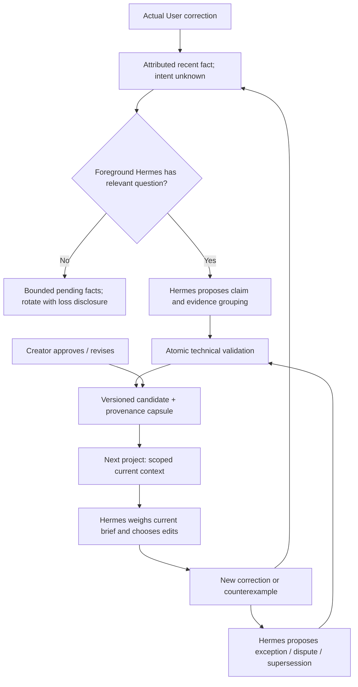

# Phase 4C.2 — Targeted memory consolidation implementation plan

**Proposal only. No production implementation is authorized by this research task.**

Recommended verdict: **B — sound ownership architecture; targeted memory quality changes needed.** Preserve ProjectActor, its history, existing evidence dimensions, Hermes as sole creative decision-maker and local foreground operation. Do not resume editorial-quality work or run a model acceptance as part of this plan.

## 1. Ownership decision

Sclip remains the canonical store for creator-style facts, beliefs, authority and controls. Foreground Hermes interprets facts, supplies semantic consolidation and decides whether/how memory affects an edit. Generic Hermes memory remains a separate non-style facility; do not mirror canonical preferences into it.

Reuse `CreatorStyleStore`, `creatorEvidence`, actor subscription, `creator_style_memory`, the Settings control boundary, scope bindings and terminal/bridge context injection. Reuse the **idea** of installed Hermes's atomic memory batch, not its free-text schema or a second store.

No independent learner, model judge, numeric style winner, vector database or graph database. Model-free maintenance must never write inferred preference wording, assign genre, choose exceptions or generate creative values.

## 2. Contracts: minimally extend existing records

| Record | Minimal extension | Owner |
|---|---|---|
| Recent observation | Existing attribution/state/property facts; retention lane, counted omissions, eligibility/pinned state | Deterministic capture |
| Evidence capsule | Creator/scope, belief version, Hermes-declared support/counterexample linkage; exact totals, independent-project coverage, time span, bounded samples, source operation/state references, truncation/loss disclosure | Hermes maps relevance; infrastructure preserves factual summaries |
| Preference | Stable ID, version, canonical aliases, current/superseded lineage, validity timestamps, applicability/exception text, capsule IDs; existing authority/status preserved | Creator/Hermes writes editorial text; infrastructure validates lifecycle |
| Control record | Sticky disable/forget state, scoped aliases/evidence exclusion, creator-controlled re-enable, recall epoch | Creator only |
| Maintenance receipt | Requested operations, old/new generation, affected IDs, retained/compacted counts, completeness warnings | Infrastructure, no editorial evaluation |

Avoid a generic graph schema. Ordinary ID references and a small local index are enough. Validity records when the author says the belief applied; recording time is separate. No numeric probability should masquerade as learned creator taste.

Separate **observability strength** (known actor, state, independent projects, elapsed time, counterexamples) from **Hermes's interpretation** and **creator authority**. Replace the overloaded `supported` badge with factual coverage metadata; retain migration information about the old label without treating it as approval.

### Proposed atomic memory-maintenance interface

Extend the existing tool with one bounded maintenance action after controls/retention are safe:

```text
creator + current project binding + expected memory revision
1–8 Hermes-authored memory operations
  attach supported evidence to a specific belief version
  consolidate an inferred candidate into an existing canonical family
  revise an inferred candidate / propose a contextual exception
  supersede an inferred candidate
  compact claimed evidence into a factual capsule
→ validate entire batch
→ commit one memory revision, or commit nothing
→ return before/after IDs, versions, scope and retained provenance
```

This is a memory API, not an edit transaction. It must not call ProjectActor. Creator-approved text/scope cannot be changed or merged away by this interface. Such changes are proposals requiring existing creator controls. Hermes can decline maintenance and choose no edit; memory maintenance must not become a prerequisite for ordinary editing.

All referenced old and new support/counterexamples must belong to the same creator, permitted scope and appropriate belief version. Rewriting a hypothesis does not silently carry its old support forward. Claim relevance is a Hermes judgment, not keyword-based deterministic validation. Infrastructure can reject wrong scope/authority/stale IDs but cannot certify a claim's editorial truth.

## 3. Incremental changes tied to confirmed gaps

### P1 — Respect creator controls and version-bound evidence (essential first)

**Limitation / source:** G4/G5/G7/G8 in `creatorStyle.ts:198–209,139–160`; disabled counterexamples revive context, retargeted candidates keep old support, revisions keep unversioned contradictions.

**Small solution:** reject agent updates to disabled/forgotten IDs. Only user controls may re-enable. Introduce belief versions and supersession links; revalidate all retained evidence at scope/version changes. Track suppression reasons/owners so approval of another belief cannot undo a forget request. Add scoped aliases/tombstones for old evidence lineage. Candidate exceptions remain tentative until appropriately approved.

**Rejected:** automatic contradiction detection from values, unconditional age decay, deleting older explicit statements, heuristic semantic bans. They conflate editorial meaning with lifecycle.

**Hermes impact:** keep tool reasoning; no internal changes. Invalidate Sclip-recalled session context on creator actions. Agent maintenance changes need a fresh tool result/revision, without necessarily discarding the entire editing conversation.

**Cost:** $0 deterministic checks; a few metadata fields. No background call.

**Migration:** preserve text, IDs, status and all original evidence; create initial version with `legacy_unreviewed` linkage where semantics are unknown. Do not automatically upgrade confidence or reinterpret old counterexamples. Disabled rows stay disabled.

**Tests:** disabled counterexample rejected; re-enable requires creator; series A evidence rejected for new B version; old contradictions remain historical unless deliberately attached; shared suppression never unforgotten by approval; stale batch publishes nothing.

**Rollback:** feature gate/versioned backup; never let old code or a backup reactivate a later forgotten record. Retain a control watermark outside rollbackable profile versions or require explicit user-reviewed restoration. Existing timeline/history untouched.

### P2 — Continuous bounded admission and provenance capsules (essential)

**Limitation / source:** G1/G3, limits and `mutate`, `observeChange`, accumulating `support`. Current overflow refuses all new evidence and can block a different creator's explicit instruction.

**Small solution:** separate protected creator knowledge from transient observation quotas; use bounded recent-observation storage and capsule-backed compaction. Isolate capacity per creator, with a small catalog/binding index and per-creator local files if needed to avoid a shared global gate. Keep one app-owned writer and current atomic file replacement. This is storage partitioning, not a new database or timeline system.

Existing grouping remains; mechanical compaction can remove redundant retained snapshots only after producing validated factual capsules. Unclaimed observations rotate under record/byte limits, retaining project/property/attribution coverage lanes rather than letting one drag flood every slot. Lanes are factual partitions, not importance rankings. Undo experiments remain uncertain. Evicted unclaimed facts create no belief; expose exact loss counts.

Reserve space for pending evidence and control updates. As the byte/count envelope approaches its threshold, run deterministic compaction/rotation before rejecting admission. Protect explicit text and the evidence needed to explain active knowledge. Without foreground Hermes, retain recent facts and report semantic-maintenance debt; do not manufacture an interpretation.

**Initial envelope to validate:** 600 recent records per creator with a 2 MB byte quota; 100 current inferred canonical families, including series variants; up to six representative examples per capsule, normalized factual samples targeted at ≤500 bytes each. Example storage: 100 × 6 × 500 = 300 KB, plus counters/indexes/preference text. Target ≤1 MB for the working knowledge/capsule partition and retain headroom within a roughly 4 MB hot envelope. Both record and byte caps apply; six examples is not permission to erase material counterexamples. A 2 MB recent quota may hold fewer than 600 mixed-property observations.

Creator-approved information is not evicted to satisfy that inferred-profile envelope. Page less-used series and genuinely distinct approved instructions into an inspectable cold local archive, retrieved on demand. Automatic raw experience must not accumulate there. Preserve exact approved text and relevant provenance. Archive and tombstone size can grow with distinct user-owned information; disclose this instead of claiming mathematically constant storage for unlimited approved knowledge.

Version history also needs a bound: initially test current plus two prior inferred versions per family, retaining a compact transition count/time span and aliases for older versions. Do not archive every automatic inferred revision forever. Keep evidence required by the current belief and its relevant exceptions/counterexamples; if compaction cannot preserve their meaning, retain a bounded unresolved conflict and report the limitation rather than manufacture continuity. Creator-approved revisions remain user-owned archive data. These version/sample bounds must be swept in the long-horizon tests, not treated as evidence that three versions or six examples suffice universally.

**Rejected:** raise 600 to 50,000; purge everything at capacity; protect every raw event forever; synthesize taste in an eviction routine; duplicate ProjectActor undo history.

**Hermes impact / cost:** existing foreground evidence tool gets capsule details and loss disclosure. Capture/retrieval/physical maintenance $0 inference. Whole-document cloning/write costs need local profiling; no per-edit synthesis.

**Migration:** validate legacy rows, preserve all referenced/approved evidence initially, move eligible detail only after verified capsule construction. Legacy excess lives in a read-only migration archive, not a falsely consolidated profile. New capture must continue. Per-creator storage cutover is activated only after checksums, links and counts validate.

**Tests:** ≥10,000 mixed operations continue admitting recent facts; 100/500/1,000-project sweeps stay within hot bounds; one creator cannot exhaust another; explicit admission works at transient capacity; counterexamples and attribution retained; low disk/write failure preserves old state; no dangling provenance.

Also test 10,000 revisions of the same inferred family: recent-version/capsule/alias retention remains bounded, repeated operation replay adds no reinforcement, and relevant contradictions are not silently collapsed. Project binding indexes should be paged or pruned only when ownership remains recoverable; they must not become a hidden raw-edit log.

**Rollback:** stage migrated files separately, validate, then activate by an atomic version pointer. Preserve original ledger for recovery. Retry capture safely after failure; never fail a timeline commit. Restore only under current control watermarks.

### P3 — Canonical admission and foreground semantic maintenance (essential for actual learning)

**Limitation / source:** G2/G3/G6, new-UUID hypothesis admission and count-based strength.

**Small solution:** idempotent exact admission keyed by identical creator/scope/authority/text, returning the same stable family. Near-duplicates remain separate until Hermes proposes a semantic merge with evidence. Merge keeps aliases, existing evidence authority, exceptions and counterexamples. User-approved distinct statements never disappear automatically.

Use the bounded atomic interface above. On meaningful feedback/new-project foreground context or accumulating maintenance debt, make relevant unresolved evidence available to the same Hermes session. Do not launch a session for maintenance, append all historical records or demand an update every N edits. An unresolved batch can remain pending and age out transparently without becoming a preference.

**Rejected:** semantic merge by string distance, embeddings alone, averaging numeric edits, native legacy style engine, another learner/critic, copied generic memory.

**Hermes impact / cost:** same model authors hypothesis, applicability and consolidation operations. Additional input/output tokens and possibly extra foreground turns; no claim that interpretation is free. Bounded maintenance context and work must fit the session's existing cost policy. No background paid agent.

**Migration:** preserve existing duplicate text/IDs as aliases only after identical authority/scope validation; require creator reconciliation if approved entries have conflicting meaning. Paraphrases are not migrated as equivalents automatically.

**Tests:** 100 recurring facts converge when fake Hermes explicitly reuses/merges families; paraphrase with different scope remains separate; near-opposites not auto-merged; two different Hermes hypotheses/repairs/no-learning choices legal; exact batch idempotent; no generated creative parameters.

**Rollback:** preserve original aliases and before/after receipt; restore earlier candidate version without reactivating forgotten information. This test establishes a working path, not semantic skill of a real model.

### P4 — Relevant compact retrieval with selection provenance (essential)

**Limitation / source:** G9/G10, active-first sort and metadata selection different from prompt selection; terminal initializes without future request.

**Small solution:** one retrieval result object generates both prompt and returned IDs. Apply creator/scope/control/validity gates first; prioritize explicit current-project directions and genuinely relevant series/global knowledge, with separate bounded candidate/conflict lanes. Expose omitted applicable directions and on-demand pagination rather than silently losing an important explicit instruction. Include dimension, version and why selected. Carry a small profile index at terminal initialization; refresh with the actual request via the existing tool.

Use local lexical/typed scope retrieval first, deduplicated words rather than repeated-word boosts. No automatic semantic genre classification. Hermes can request different dimensions/details; retrieval never selects media or edit values. Age may guide candidate review urgency, not weaken approved text or count repeated recall as reinforcement.

**Rejected:** always inject all active preferences; add vectors before evidence shows lexical/on-demand failure; treat current brief as a rigid edit template.

**Hermes impact / cost:** typical 600–900 proxy tokens; validate a 1,200-token envelope across scripts/languages. Details cost additional foreground tokens when requested. Real tokenizer/caching must be measured later; character estimates alone cannot enforce a provider-token ceiling.

**Migration:** existing fields read unchanged; selection object/version added. No data loss.

**Tests:** eight irrelevant globals do not hide applicable project evidence; returned IDs match packet contents after trimming; contradictions preserved when relevant; brief overrides memory in fake runtime; malicious media text remains evidence rather than creator authority; creator isolation; context bound with 20/100/200 families and 1/10/30 series.

**Rollback:** retrieval-only feature switch; saved data remains compatible with the new store. The old active-first path must not bypass new disable/forget gates.

### P5 — Reconcile overlapping native/legacy sources (essential boundary; limited initial scope)

**Limitation / source:** G11; conditional native MemoryStore initialization, frozen prompt and retained generic/legacy sources.

**Small solution:** retain one canonical style store; do not silently import or reactivate legacy inferred numeric profiles. Offer creator-reviewed import/quarantine of identified old style sources with provenance, then retire their style injection. Keep generic non-style memories on disk; do not broadly erase them. Use existing supported runtime configuration/session invalidation where possible.

**Unresolved constraint:** free-text generic memory has no reliable automatic style namespace. “Do not mirror” guidance does not prove technical separation. Before claiming comprehensive forgetting, specify which source/session copies controls invalidate and which old backups require creator action. An automatic heuristic that deletes supposed style text is unsafe. If excluding a builtin block from Sclip context is needed, validate supported configuration without changing normal Hermes data or internals.

**Cost:** $0 configuration/migration checks; any semantic import needs user or separately authorized foreground interpretation. No background scanning model.

**Migration / tests / rollback:** temporary profiles only; old store unchanged until creator reviews; restarted and resumed sessions, compressed context, export/import and old backups tested. Home isolation verified. Rollback cannot reintroduce removed style through old generic snapshots. No real memory is modified during research or validation without explicit product controls.

### Later, only if evidence requires it

Semantic/vector retrieval, extensive preference analytics, richer reference analysis and automated drift detectors can wait. First test simple scoped retrieval and foreground maintenance. No new database/framework is justified by current record counts.

## 4. Full lifecycle and examples



Example: twenty font adjustments are recorded as accurately attributed changes, with project/series and uncertainty. Hermes might conclude they are project-specific legibility fixes, two contextual caption preferences or insufficient evidence. Infrastructure can count projects and compact snapshots, but cannot decide the conclusion or a future font size.

Changing taste: later restrained typography in a different series need not contradict energetic captions elsewhere. Hermes may propose an exception. A creator explicitly saying their taste changed can authorize revision/supersession. Historic examples remain bound to earlier versions; the current profile avoids repeatedly injecting both as unconditional rules.

## 5. Migration, recovery and creator control

1. Read and validate v1 without altering it; produce a dry-run inventory of creators, scopes, approvals, duplicates, broken IDs and size. No raw creator text in diagnostics.
2. Copy to a staged v2 store and retain exact approved/explicit statements, bindings, statuses, origins, evidence and source references. Do not manufacture confidence or semantic merges.
3. Preserve excess legacy evidence in a local migration archive; label it historical/unreviewed and exclude it from automatic taste reinforcement. Safely create factual capsules only where source links remain valid.
4. Compare record/checksum/link invariants, then activate atomically. If validation/write fails, retain v1 and report a recoverable unavailable state rather than initializing empty memory.
5. Creator controls expose inspect/revise/disable/forget, scope override and export/reset. Routine compaction is distinct from requested forgetting. Backups and imported source copies have disclosed retention/deletion rules; do not promise forensic erasure from OS snapshots.
6. Rollback to an older schema/profile must still respect later disable/forget watermarks. Never automatically recover an old forgotten preference just because it appears in a backup.

## 6. Acceptance gates after approval

- **Safety:** controls sticky, stale requests rejected, all memory transactions atomic; no timeline/history corruption.
- **Admission:** noisy/AI/untrusted evidence cannot become creator authority; explicit feedback remains recordable at capacity.
- **Scale:** A–H workloads continue capture within working bounds; no linear accumulation of raw corrections; meaningful distinct series preserved rather than averaged.
- **Provenance:** active beliefs remain explainable after compaction, including counterexamples and source limitations.
- **Continuity:** restart/reopen/cross-project retrieval survives; no duplicate reinforcement after replay; migration/rollback respects controls.
- **Agency:** Hermes can choose different hypotheses, exceptions, edits/parameters or no repair; deterministic code generates none.
- **Behavior:** only after separate model authorization, measure repeated correction burden on new projects for one creator, plus override and isolation cases. Fake-model/context tests cannot prove editorial adaptation.

## 7. Cost and design review

Local fact capture, retrieval and physical storage maintenance: $0 inference. Semantic interpretation remains foreground work, with token/turn limits and visible provider cost. The cost scenario in the research document is illustrative, not authorization to spend or a provider quote.

| Review question | Answer |
|---|---|
| Duplicate Hermes memory? | No new canonical copy. Existing generic/legacy overlap needs controlled reconciliation. |
| Second creative brain? | No. Same foreground Hermes owns meanings and decisions. |
| Infer taste from ambiguous edits? | No deterministic promotion. Ambiguity remains; semantic claims are candidates. |
| Survive restarts? | Existing persistence reused; version/capsule migration and stale recall tests required. |
| Cross-project adaptation proven? | Proposed path, not live proof. Offline integration plus later authorized correction-burden study. |
| Current brief overrides? | Required context/control policy; real-model obedience still must be measured. |
| Validate without paid inference? | Storage, provenance, lifecycle, retrieval, agency interfaces and migration yes; genuine semantic learning no. |
| Overengineering? | Bounded extensions to one store/tool. Defer frameworks, new agents, embeddings and complex classifiers. |

**Exactly one recommended next action:** review and approve this targeted plan, beginning with P1 creator-control/version safety and P2 continuous admission. Do not run another model or start implementation automatically.
