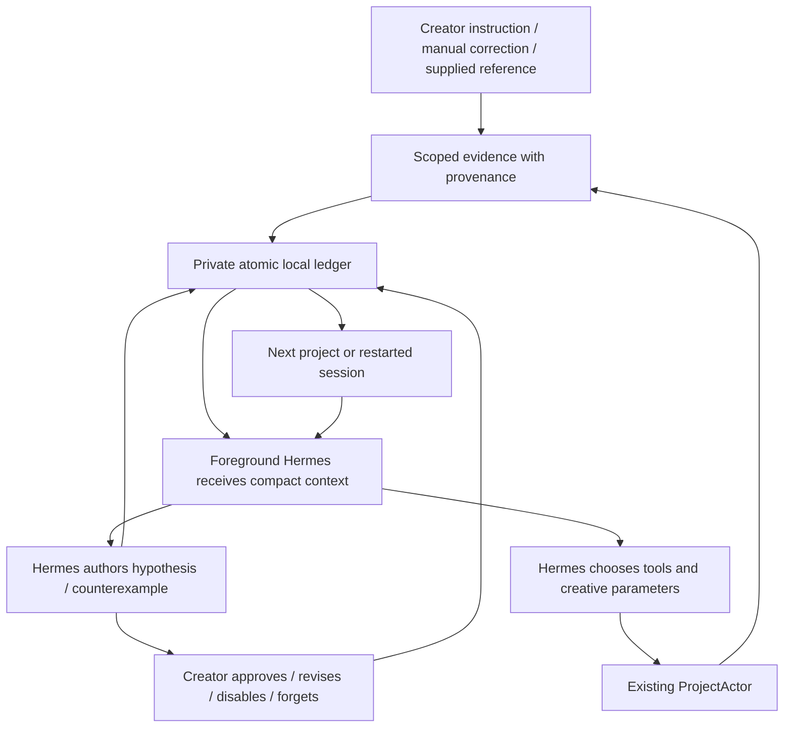

# Phase 4C — creator style learning

Date: 2026-10-08. **B — PHASE 4C IMPLEMENTED, LIVE ACCEPTANCE PENDING.**

**IMPLEMENTED — BEHAVIORAL ACCEPTANCE PENDING.** The persistent evidence, preference controls and foreground editing-context paths work offline. Fewer repeated corrections by a real model across new videos have **not** been demonstrated. Provider/model spending: **$0.00**. No holdout, inference, account-limit change or Applications bundle update.

## 1. Hermes learning investigation

Installed source: `/Users/adityasamant/SCLIP/hermes-agent-src`, Hermes 0.20.4. Classification **B — persistent memory, but not suitable automatic creator-style learning**. See [source-grounded investigation](hermes-learning-investigation.md).

- Native `MemoryStore` persists bounded USER/MEMORY files; the current session snapshot is frozen. Actual reopen, fresh-process recovery, replacement, deletion and separate-home tests passed.
- Session SQLite/search, skill writing/usage and optional consolidation exist. They are not an attributed editorial preference system.
- Generic automatic memory/skill review exists and can spawn model inference. Real profile had no explicit override; defaults permit it. Terminal `--ignore-rules` skips providers but does not alone guarantee no generic review when the memory toolset creates a store.
- Installed custom `SclipStyleMemoryProvider` clusters caption property values and supplies winning rules. It lacks creator/series identity, correction provenance and counterexamples. It was **not activated, imported or treated as approved taste**.
- Profile generation now preserves supported memory/skills controls and explicit background-review choices. With no explicit choice, automatic background review defaults off; the foreground editor owns style interpretation. New creator homes inherit only safe controls. Real user configuration/memory files were not rewritten during this task.
- Actual native skill-preload function was exercised without a model client. The launch path supplies the staged evidence skill through `--skills`; native CLI preload/finalization feeds that text into model context. No claim of live model obedience follows from this test.

## 2. Sclip architecture findings

See [editing and correction map](sclip-learning-architecture.md). Reused `ProjectActor`/`ChangeEvent`, `dispatchAs`, history/undo/transactions, `ts-actor-host.onProjectChange`, authenticated MCP, staged editorial evidence, native Hermes homes/session persistence and existing settings.

Observable: Agent/User operation attribution, operation IDs, before/after state, layer values, undo/restore and exact matching previous Agent proposal. Unobservable: why a manual change occurred, whether an export approves every choice, or whether an Agent revision was authored by the creator. These remain uncertain. No taste is inferred from saves, exports or Agent output. Loading a project is not feedback.

The legacy caption-event feed is disconnected from new production observations; legacy files/modules remain preserved. Existing timeline/repair semantics are unchanged.

## 3. Final architecture

Ownership **B: Sclip owns structured local evidence; foreground Hermes interprets and applies it**. Design and review were committed before production work: [design](style-learning-design.md).



Storage: `<Sclip userData>/creator-style/creator-style.json`, one app writer, private atomic writes, schema version 1. Creator/project/series scopes; creator and project opt-out; explicit versus inferred preferences; supporting/counterexample IDs; timestamps and active/candidate/disabled/disputed status. Confidence labels describe evidence support, **not measured probability of taste**.

Bounds: 600 evidence records, 100 preferences, 4 MB document; proposal associations capped at 200. Correction capture retains up to eight layer deltas with bounded values and structural facts. Context stays under 12,000 characters; scoped preferences and recent evidence are summarized. Deeper MCP retrieval retains source records. Capacity errors are visible and publish no memory change; actor state remains committed.

Current request takes precedence; project directions precede series/global preferences. Inferred hypotheses remain tentative, even with repeated evidence. Hermes can adapt, choose a different valid edit or make no repair. No edit parameter is supplied by learning infrastructure.

## 4. Implementation

| Files | Behavior |
|---|---|
| `src/shared/creator-style.ts`, `main/sclip/creatorStyle.ts` | Local ledger, creator bindings, scopes, evidence capture, persistent proposal association, hypothesis/counterexample bookkeeping, compact retrieval and user controls |
| `main/sclip/creatorStyleTool.ts`, `main/mcp/server.ts` | Discoverable `creator_style_memory` tool; creator/evidence ownership validation; stale creator-session rejection; no timeline dispatch |
| `main/sclip/creatorReference.ts` | User-selected imported finished-video metadata/cached local observations; retains per-frame contradictions and unknowns; rechecks creator/project/source after asynchronous read |
| `main/index.ts` | Existing actor observer integration, settings IPC, safe session invalidation, reference choices and gateway limitation enforcement |
| `main/sclip/hermesTerminalRuntime.ts`, `hermesRuntime.ts`, `autonomousReview.ts` | Actual staged skill context, isolated native homes, supported control preservation and recalled-context generation identity; Phase 3D packet itself unchanged |
| `main/sclip/hermesBridge.ts` | Gateway context/session identity integration and user-change run stopping; unsupported legacy/multi-creator execution rejected explicitly |
| `renderer/settings/CreatorStyleSection.tsx`, `SettingsPanel.tsx` | Inspect, explicit instruction, creator/series/project scope, opt-out, approve/revise/disable/forget/reset, reference registration and visible errors |
| `skills/weftcut/SKILL.md` | Existing memory guidance updated for the canonical evidence ledger; no genre recipe or editorial-quality patch |

Paths in this table are relative to `apps/desktop/src/` except the skill. Added adjacent focused tests and `apps/desktop/e2e/phase4c/hermes-memory.test.py`.

Commits:

- `57b077ad` — investigation, architecture map and design review before implementation.
- `50848876` — persistent scoped evidence and isolated Hermes context.
- `5fc650b2` — correction observer, MCP, creator controls and reference integration.
- Final documentation commit contains this report and reconciled investigation/design findings.

## 5. Tests

| Validation | Final result |
|---|---|
| `npm run typecheck` | PASS |
| `npm run build` | PASS: desktop main/preload/renderer, CLI and bundled skills; existing ineffective dynamic-import warnings remain |
| Focused TypeScript suite below | **14 files, 83 tests PASS** |
| Installed Hermes offline Python suite | **3 tests PASS** |
| `git diff --check` | PASS |
| Live behavioral acceptance / paid inference | NOT RUN, requires separate authorization |
| Full repository/Rust/Electron installed-app acceptance | Not rerun; this task used relevant focused suites, builds and offline integration |

Exact focused command from repository root:

```sh
npm test -- src/main/sclip/creatorStyle.test.ts src/main/sclip/creatorStyleMcp.test.ts src/main/sclip/creatorReference.test.ts src/renderer/settings/CreatorStyleSection.test.tsx src/main/sclip/hermesTerminalRuntime.test.ts src/main/sclip/hermesSettings.test.ts src/main/sclip/hermesBridge.test.ts src/main/sclip/autonomousReview.test.ts src/main/state/__tests__/mcp.skill-conformance.test.ts src/main/sclip/styleEvents.test.ts src/main/state/__tests__/repair-transaction.test.ts src/main/sclip/revisionLoopGuard.test.ts src/main/sclip/renderedAudioEvidence.test.ts src/main/sclip/timelineTemporalEvidence.test.ts

PYTHONDONTWRITEBYTECODE=1 PYTHONPATH=/Users/adityasamant/SCLIP/hermes-agent-src /Users/adityasamant/SCLIP/hermes-agent-src/.venv/bin/python apps/desktop/e2e/phase4c/hermes-memory.test.py
```

Coverage: explicit persistence/reopen and staged context; creator/home isolation; actual Agent→User correction attribution; repeated project evidence; ambiguous undo; counterexamples; project/series scope; current-brief override contract; disabled/forgotten evidence suppression; immutable creator-approved preferences; references with contradictory observations; bounded/corrupt memory; actual SDK catalog/tool calls; UI controls/errors; native loader; intact A/V offsets, actor undo/history and existing atomic repairs/modality guards.

An initial integration run exposed an asynchronous source-identity race and two test-fixture/assertion errors; all were fixed. Final inspection added regression tests for project-only quote leakage and approved-preference overwrite after dispute. Final suite has no failures. Tests use synthetic data, fake PTY/gateway/model responses and in-memory MCP; native memory/preload tests execute installed source without inference.

## 6. Concrete demonstration

**Executed offline:** a real synthetic ProjectActor receives an Agent caption proposal; a User restyles it. The observer records actual actor/op/state IDs and matching proposal before/after. No preference is inferred automatically. A fake foreground Hermes supplies a hypothesis with the actual evidence ID. Another project's supporting correction strengthens its evidence label while it remains a candidate. Creator approval records an explicit confirmation. Store reopen and a new project's staged skill recover it; fake terminal launch arguments point to that skill. Actual native Hermes preload was separately verified.

**Simulated editorial adaptation:** the end-to-end test's fake model selects caption size 64 from the approved hypothesis and dispatches that value to the real actor in a second project. A current brief requesting large text makes the fake model select 96 instead. These choices are test-fixture model decisions, **not production preference rules**. This proves the evidence/context/execution path can carry adaptation and an override; it does **not** prove a real Hermes model learns or obeys appropriately.

No human correction count improvement, Video 2/3 editorial quality or live automatic preference interpretation is claimed.

## 7. What remains

**Working offline:** scoped durable ledger, native generic memory reuse, correction/undo facts, proposal matching, counterexamples, creator controls, context injection, isolated terminal homes and project opt-out. Agent-created edits alone never reinforce taste. Learning touches no timeline mutation logic.

**Limited:** finished-video learning retains metadata and already-cached local observations. Missing senses remain unknown. It does not reconstruct original cuts, generate a finished style analysis automatically or launch perception to populate missing observations. Hermes can use existing source tools; references may need reimporting into another project for deeper source inspection. One manual edit remains ambiguous. Context and evidence are deliberately bounded.

**Not implemented:** automatic transcription of chat preferences into approved persistent taste, guaranteed interpretation of every correction, multi-creator gateway execution, cross-device memory sync, original edit reconstruction, automatic decay/pruning or a separate learner. Explicit persistent preferences are entered through creator controls; Hermes proposes inferred hypotheses using attributed records. Requests asking Hermes to revise still produce Agent operations, not fabricated human-authored values.

The older gateway auto-registers the legacy style provider. Runs with that profile or a non-default creator are directed to the terminal; gateway multi-creator learning is not claimed. Native generic USER/MEMORY data are preserved and separately managed; ledger reset does not clear those files or retroactively sanitize unrelated old generic memories. New creator homes do not inherit them. No prior benchmark/holdout results were imported into the ledger.

**Awaiting actual-model acceptance:** whether Hermes naturally notices relevant corrections, formulates good hypotheses, honors applicable preferences, appropriately overrides them and reduces repeated creator corrections over multiple new projects. Installed Applications bundle remains unchanged; this is a verified workspace build.

## 8. Cost

Provider/model spending **$0.00**. No paid or free LLM inference, no background review, no reference upload, no provider allowance change. Existing credentials, projects, settings, Hermes memories and unrelated working-tree changes preserved.

## 9. Agenticness and verdict

- Hypothesis meaning/editorial dimension/scope: **foreground Hermes**.
- Explicit preference and approval/revision/reset: **creator**.
- Story, cuts, framing, pacing, captions, tools and creative values: **Hermes**, through existing editing capabilities.
- Taste inferred from AI output/save/export/one undo: **NO**.
- Second creative brain, automatic A/V synchronization, forced creative treatment or deterministic creative leakage: **NO**.
- Different valid interpretations/repairs and justified no repair: **allowed**.

**B — PHASE 4C IMPLEMENTED, LIVE ACCEPTANCE PENDING.** The infrastructure path is tested; actual behavioral learning remains unproven.

## 10. Exactly one next action

Seek separate authorization for one bounded, same-creator three-project learning acceptance: establish a baseline, collect genuine corrections, then evaluate relevant adaptation on two new sources including an explicit override. Record repeated corrections and independent quality; do not train on prior holdouts. **Not executed.**
