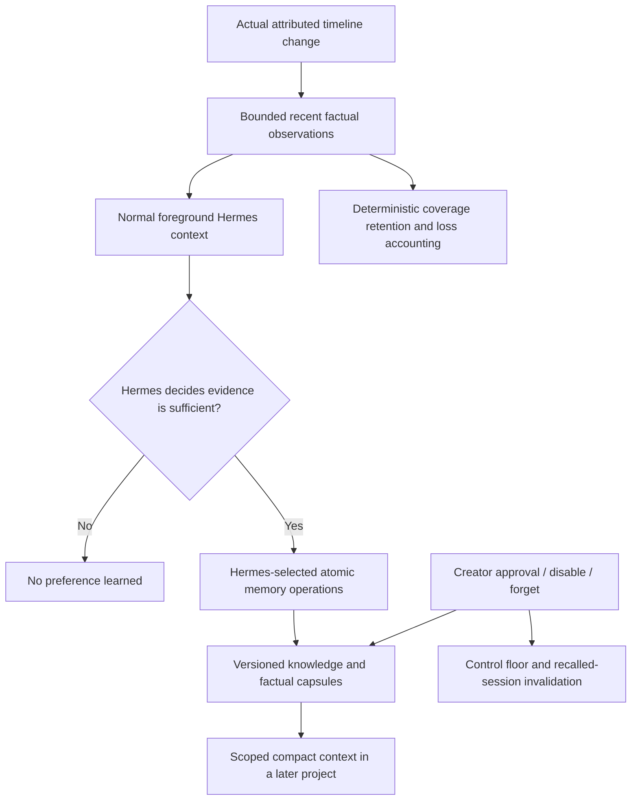

# Phase 4C.3 — sustainable creator memory

## Verdict

**A — SUSTAINABLE MEMORY INFRASTRUCTURE VERIFIED OFFLINE.**

**Live behavioral acceptance remains pending.** These results establish memory correctness, bounded factual retention and actual runtime integration. They do not demonstrate that a real model learns accurate taste or reduces human corrections.

Provider/model cost: **$0.00**. Background inference: **0**. No provider completion, embedding, second agent or new memory database was introduced.

## Implementation and original defects

The three Phase 4C.2 research documents were read before implementation. The existing app-owned local ledger, creator controls, foreground Hermes tool, launch context and ProjectActor observer were retained.

| Original defect | Implemented correction / offline result |
|---|---|
| Counterexamples/reactivations bypass disabled authority | Sticky creator controls; only explicit creator approval clears disable. Creator revision preserves disable until approval. PASS |
| Forgotten aliases, linked facts or stale recall resurrect knowledge | Canonical family controls, bounded alias lineage, conservative membership filter, suppressed retired facts, fresh revision checks and session epochs. Missing control floor fails closed. PASS |
| Series A evidence supports series B belief | Creator/series/project ownership validation on evidence, targets and consolidation sources. Thirty genuinely distinct series retained separately. PASS |
| Rewording inherits old support/counterexamples | Explicit meaning versions, fresh selected references, separate capsules per version/role. Current plus two prior inferred versions. Exceptions reference an exact base version. PASS |
| Approved knowledge overwritten by inferred writes | Protected authority independent of status; link cannot revise approved scope/conditions; model consolidation cannot retire approved knowledge. PASS |
| Global full store stops admission / blocks another creator | Per-creator recent/count/byte, inferred/count/byte and proposal envelopes; protected knowledge separate from transient quotas. Actor subscriber failure never cancels a committed edit. PASS |
| Repeated adjustments become independent confirmations | Existing adjacent same-property grouping retained; factual capsule replay membership is bounded and conservative. Counts never promote epistemic confidence. PASS |
| Equivalent submissions create permanent duplicate beliefs | Exact key includes creator, scope, origin, dimension, wording, applicability and exception version. One hundred identical inferred submissions reuse one candidate; one hundred identical explicit instructions retain one active instruction and one quote. PASS |
| No foreground knowledge consolidation | Atomic 1–8 operation maintenance in existing `creator_style_memory`, including link, hypothesis, counterexample, contextual exception, consolidation and supersession. Hermes supplies every interpretation/reference. PASS |
| Eight unrelated global preferences hide project candidate / metadata mismatches | One canonical retrieval selection supplies both actual context and reported IDs. Applicable project candidate survives; omitted creator instructions disclosed and retrievable through version-checked pagination. PASS |

### Changed production boundaries

- `shared/creator-style.ts`: versions, authority, controls, capsule/provenance and retention contracts.
- `creatorMemoryDocument.ts`: validated schema inventory/migration, ownership/references and checksums.
- `creatorMemoryKeys.ts`: exact admission keys and bounded conservative lineage/replay membership.
- `creatorMemoryRetention.ts`: mechanical retention, coverage lanes, capsules, loss counters and bounded receipts/history.
- `creatorMemoryRecovery.ts`: protected knowledge snapshot and explicit control-preserving recovery.
- `creatorMemoryRetrieval.ts`: canonical relevant selection, omission disclosure and exception-version validity.
- `creatorStyle.ts`: integrate the above into the existing single app writer/observer; atomic foreground maintenance and creator controls.
- `creatorStyleTool.ts`: registered MCP schema/descriptions and on-demand current preference/evidence retrieval.
- `CreatorStyleSection.tsx`: inspect retained capsule samples and accurate factual/loss counts; existing approval/disable/forget controls preserved.
- `skills/weftcut/SKILL.md`: discoverability of foreground maintenance and omitted-memory retrieval; no editorial recipe.

No ProjectActor, timeline operation, perception algorithm, creator editing value or Hermes implementation was rewritten. The existing terminal integration fixture was updated to submit fresh memory metadata and keep this run's artifacts separate.

## Storage and lifecycle

One existing local JSON store, not three services:

| Logical record | Current envelope per creator |
|---|---|
| Recent observations | Up to 600 records **and** 2 MB; fewer large records may fit |
| Agent proposal references | Up to 200 |
| Inferred knowledge | Up to 100 current canonical families **and** 2 MB including their capsules/history |
| Inferred meaning history | Current + two prior versions |
| Capsule detail | Separate support/counterexample capsules; up to three samples each, each ≤2,000 bytes; up to 128 project IDs |
| Aliases / semantic lineage details | Up to eight explicit aliases and eight consolidation summaries; conservative fixed-size lineage membership |
| Maintenance receipts | Last 32 per creator, with request identity/body digest |
| Normal foreground packet | Up to eight selected preferences/two unresolved observations, trimmed toward 3,000 payload characters with omissions disclosed |

Samples preserve first/latest factual examples, actor/operation/state identity, coverage and counterexamples. Large detail is mechanically bounded and explicitly labelled unrecoverable from a hash. Per-frame source observations are not converted into a fabricated global style conclusion. Automated versions, aliases, capsules and transient records do not acquire an unlimited cold archive.

Creator-owned/approved instructions and their revisions are protected from inferred/transient quotas. Their storage can grow with genuinely distinct creator-owned information. The working document remains one file; physical disk exhaustion and very large amounts of approved knowledge are not magically eliminated by per-creator logical quotas.

Without Hermes, deterministic maintenance only rotates/compacts facts. It never writes a hypothesis. Unclaimed evidence can be lost before interpretation; exact observation/operation loss totals are exposed. Repeated support counts remain factual coverage, not independent confirmations of taste. Inferred claims stay tentative.

Foreground maintenance validates creator, current memory revision, target/source version, applicable scope, evidence references and protected authority. The whole batch validates on a clone and publishes with one atomic replacement. Invalid/stale/member-two/internal-failure cases publish no memory change. Idempotent replay does not reinforce evidence. No maintenance is required per edit and no session is launched to maintain memory.

## Migration, recovery and preservation

- Schema 1 is validated and transformed purely in memory to schema 2; constructor does not write it.
- Migration inventory records original creator/preference/evidence counts and SHA256. First successful write preserves a byte-identical immutable schema-1 backup; backup checksum is verified before replacement.
- Migration preserves approved wording, ID, origin/approval authority, status, scope and usable source provenance. No semantic merges occur during migration. Any later factual compaction is disclosed; the original migration backup remains available.
- Tests use disposable legacy copies, invalid ownership/reference data, failed atomic rename, corruption, main-file rollback and missing control protection. No error initializes an empty store.
- Latest creator intent is stored in a control floor with protected knowledge. Creator control writes precede the primary commit: a failure may deliberately leave recall unavailable rather than forget restrictive intent. Foreground agent batches do not change this floor.
- One recovery checkpoint is refreshed for knowledge changes and periodically for transient edits; no accumulating raw-event archive. Explicit `recoverCreatorMemory(directory, false)` validates a recovery preview; `true` commits it with one pre-recovery backup. This is an offline developer recovery facility, not an automatic silent repair or new GUI wizard. Missing/malformed protection requires creator review.
- Approved text and current controls win over an older checkpoint. Disabled/forgotten families cannot return through main-file rollback. A corrupt/missing source is preserved until explicitly recovered.
- Inventory of the normal installed Sclip/WeftCut profiles found no existing canonical creator-style file; no real creator store needed conversion during this task. Generic Hermes data, projects, settings and credentials were not reset/imported.

Protection covers the current canonical store and managed Sclip recall paths. It cannot erase arbitrary historic chat text, personal Hermes memory, external snapshots/backups, or identify later intent after someone restores an entire old profile including every protection file. No personal `USER.md`/`MEMORY.md` was rewritten to conceal this limitation.

## Measurements

### 10,000 actual timeline operations / 100 projects

The workload used real synthetic ProjectActor commits with disjoint operation-ID namespaces, alternating independent properties and no model calls. It was not a fabricated event-count simulation.

| Projects | Hot document bytes | Elapsed milliseconds |
|---:|---:|---:|
| 1 | 324,305 | 1,111 |
| 10 | 1,915,243 | 62,473 |
| 50 | 1,915,365 | 422,040 |
| 100 | 1,915,367 | 780,991 |

- All **10,000** edits committed across **100** projects.
- **600** recent manual observations retained; **9,400** unclaimed observations/**9,400** operations evicted and reported.
- No automatic preference generated, no raw history archive, and no creator-approved knowledge evicted.
- A new explicit creator instruction still worked at saturation; another creator's knowledge remained intact.
- After that new instruction, total document size: **1,920,946 bytes**. Separate checkpoint/protection files remain bounded copies, not an accumulating archive.
- End-to-end stress runtime: **781.4 seconds**, approximately **78 ms/operation** average including actor, validation, hashing and synchronous local persistence under concurrent test/build load. This is a worst-case independent-edit workload, not an isolated memory-only latency estimate. Whole-file write amplification remains a limitation; grouping makes repeated adjustments substantially smaller.

### Recurring preference / contradictions

One recurring Hermes-authored candidate linked **100 distinct factual observations across 100 projects** into one support capsule, with **three** retained samples/**97** omitted details. A separate counterexample capsule retained one contradictory observation. Candidate count remained **1** and confidence remained tentative.

After 700 later observations: 600 recent rows, 100 claimed observations compacted, 100 unclaimed observations evicted, no lost current capsule sample references. Document: **179,760 bytes**. Three hundred meaning revisions retained one current family/two historic versions/three support capsules/32 receipts. One hundred subsequent supersession operations retained one family/eight explicit aliases/one current capsule. Retrieval replay created no storage changes or reinforcement.

### Context and cost

Cached **o200k_base** tokenization, with network disabled, measured the eight-global-preference/project-candidate adversary:

- **939 proxy tokens**, **3,290 UTF-8 bytes** of actual context.
- Full `context` tool response: **1,404 proxy tokens**, including repeated context plus bookkeeping.
- Local retrieval measurement: **6.3 ms** in that small adversary.

The 600–900 token target is a performance guide; this adversary is slightly above it. Character trimming is not a provider-token guarantee. Omitted applicable creator instructions remain accessible; details and semantic interpretation consume additional foreground tokens. For 16 uncached replays, 939 context tokens imply approximately 15,024 additional input tokens; cost is those tokens times the actual authorized model's input price, plus any foreground semantic output. No current provider pricing is claimed and no such run was made. Foreground interpretation is **not** advertised as free.

## Validation

| Gate | Final result |
|---|---|
| Focused creator-memory, actual MCP, Hermes runtime/terminal and ProjectActor history suites | **235 PASS**, 10 files |
| Capacity suite, including 10,000-edit workload/grouping/storage failure/claimed evidence | **3 PASS**, 1 file |
| Native Rust library | **613 PASS**, **1 SKIP** (explicit live Qwen perception test), 0 FAIL |
| Installed Hermes source offline memory/preload/provider distinction | **3 PASS**, no model client |
| Typecheck | PASS |
| Desktop main/preload/renderer, CLI, skills, WASM build | PASS |
| Workspace Electron/manual correction/restart/native preload | PASS, disposable profile/fake Hermes; current MCP catalog 116 tools |
| Installed Electron/manual correction/restart/actual native preload | PASS, version 0.1.8 packaged app, disposable profile/fake Hermes |
| Installed asset comparison / profile preservation | PASS: 51 compiled assets, 13 skill files; 27,035 profile files unchanged |
| Diff whitespace check | PASS |

Two supplementary filtered capacity runs skipped the nonselected tests intentionally; the complete capacity suite later passed all three. The first stress run also completed all 10,000 commits but failed three incorrect fixture assertions (literal history label, quantized no-op count, and a coverage-lane eviction assumption). Those assertions were corrected and the full gate rerun; no product behavior was changed to make them pass. Initial sandbox GUI launch failed; the same offline fixture passed with desktop launch permission. Initial packager attempted an unavailable GitHub download; packaging uses the existing unpacked Electron distribution instead.

The entire unrelated desktop test glob was not rerun. The existing project-history suite and native library were checked; no inference-only acceptance was run.

## Agenticness and limitations

- Hermes chooses preference meanings, consolidation, exceptions, evidence relevance and whether to learn at all. Creator controls remain authoritative.
- Infrastructure chooses retention/technical validity/context selection only. It creates no edit, creative parameter, timeline value or certainty from counts. ProjectActor remains the only timeline writer.
- Counterexample detail is bounded and disclosed. Older omitted examples cannot be reconstructed from hashes.
- Membership filters can conservatively undercount or reject a novel replay/wording through a false positive; never falsely reinforce a preference. Long histories may require creator review. There is no semantic similarity matcher pretending paraphrases are equivalent.
- Legacy copies of preferences outside canonical Sclip memory remain a documented limitation. Current brief priority is context guidance/runtime plumbing, not proof of actual model obedience.
- Capacity reached by distinct inferred knowledge requires a foreground consolidation decision; deterministic code never guesses which belief to delete. Raw facts still rotate and explicit instructions remain admissible.
- Broad live learning accuracy, actual provider tokenization, relevance quality on real creators and fewer repeated corrections are **not behaviorally verified**.

## Commits

- `d97ab604` — completed research documents and offline probes preserved.
- `7a3ee58e` — creator-control and evidence-version safety.
- `a2a7e495` — bounded capsules and control-safe recovery primitives.
- `c550fa8e` — foreground consolidation, canonical scoped retrieval and integration.
- `8f7c4f5d` — creator authority through revision/dependency/recovery boundaries.
- `7759bb40` — long-horizon actual-edit/capacity tests.

The pre-existing edit to `apps/desktop/e2e/acceptance-routing/run.mjs` is unrelated and preserved uncommitted.

## Installation and exactly one next action

The safety/stress gates passed before replacement. `/Applications/Sclip.app` version **0.1.8** was installed from tested source commit `7759bb409e51cf97e81c658f85bba5d262309155` (production changes through `8f7c4f5d`). All **51 compiled JS/CSS/HTML assets and 13 skill files** match the tested build. Main SHA256: `74d5cd04979f3c317891fc1459f906b3dd7a58c9e3a45cfb750c6387d922b0c8`.

Previous app backup: `/Users/adityasamant/SCLIP V1/backups/installed-apps/Sclip-backup-20261008-202812.app`. **27,035 non-cache/log profile files remained hash-identical** during replacement. The local Hermes launcher was copied unchanged. No model allowance, project, credentials, native model configuration or generic memory was changed. Installed-app verification uses a disposable profile and fake Hermes, never the user's actual profile for inference.

Durable aggregate measurements: `docs/phase4c/research/phase4c3-validation.json`. Synthetic GUI/runtime artifacts: `.scratch/phase4c3/gui/`; stress/capsule/token results and installation/asset comparison: `.scratch/phase4c3/`.

**Next action:** request separate consent for one small, bounded cross-project live learning acceptance that measures whether a real creator's repeated correction decreases. Do not execute it in this task.
