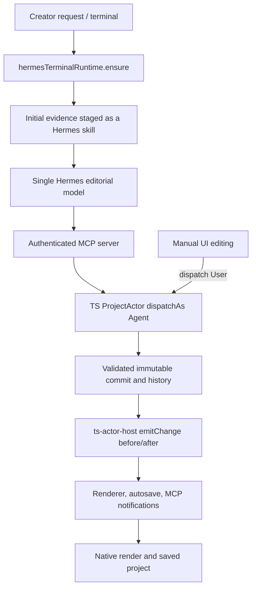

# Sclip learning architecture investigation

## Current execution and ownership

Sources: `main/sclip/hermesTerminalRuntime.ts`, `autonomousReview.ts`, `main/mcp/server.ts`/`mutationTools.ts`, `main/state/actor.ts`, `history.ts`, `ts-actor-host.ts`, `autosave.ts`; project and source evidence modules under `main/sclip`. Phase 3D evidence/Phase 3E transactions/Phase 3F restoration remain unchanged (ADRs 0074–0076). Source Understanding is coverage, not editorial selection (ADR 0077).

Actor is the single writer. Agent/user attribution is real: `history.Actor`, `dispatchAs`, `ChangeEvent.actor`. `ts-actor-host.emitChange` retains observed before snapshot and invokes `onProjectChange`, then emits actual current state. Transactions publish one boundary; undo/redo/restore are real events. Main currently attaches `styleEvents.createStyleEventRecorder` here, writes caption font/outline deltas to Hermes style-events.jsonl and current active_project pointer. Existing observer is narrow, in-memory agentTouched and treats same-layer changes as potential correction; object-reference inequality can overattribute. No persistent proposal association.

## Observable versus unknown

| Action | Evidence that actually exists | What cannot be concluded |
|---|---|---|
| Agent creates/modifies | actor.kind Agent, client, op ID, affected references, before/after | Creator approval or preference |
| Creator modifies | actor.kind User and before/after | Reason, enduring preference, whether a gesture was experimentation |
| Creator asks a revision | Hermes session text; resulting operation remains Agent | Human authorship of specific creative values without explicit feedback |
| Undo/redo/restore | Unrecorded ChangeEvent and history effect lineage | Taste or rejection of every affected choice |
| Save/export | Persistence/render events | Endorsement of every edit |
| New/open project | project ID/state replacement; workspace owns files | Identity of creator without an explicit binding |
| Accepts proposal | No general explicit acceptance signal | Do not fabricate acceptance |

History is runtime bounded (200 snapshots by default) with evicted/effect status; project serialization is not a durable universal history archive. Correction evidence must be captured at the existing observer boundary, not reconstructed after history loss. Unknown associations must remain unknown after restart unless explicitly persisted. Exact matching prior agent after-values can identify a changed proposal, never the creator's reason.

## Existing style facilities

Caption style recorder plus custom installed Hermes provider are legacy, not complete creator learning. Project settings/templates/Motifs/fonts are authored state/assets, not preferences. App settings are operational. Generic Hermes USER memory is conversational, not an attributed correction ledger. No persistent creator/series binding or reference ownership/permission model found in relevant editing paths. No evidence-backed broad creator model is already complete.

## Integration boundaries

Reuse actor observer and immutable state; keep bounded evidence facts locally. Reuse authenticated MCP for inspection and Hermes-authored hypotheses; never route learning into timeline mutations. Reuse staged session skill for immediate compact context and existing native memory/session persistence. Use app-owned creator/project bindings outside project schema. Controls belong in existing settings. Reference evidence uses cached SourceObservationIndex and imported media metadata; absent senses stay unavailable. Save/export and historical holdouts are excluded from learning.
