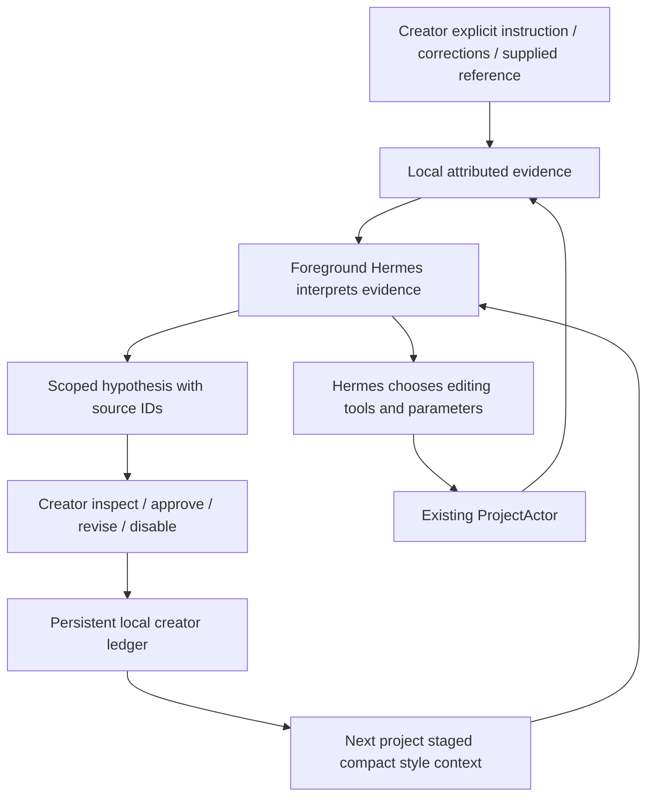

# Phase 4C design — reviewed before production changes

## Decision: B — Sclip owns structured style evidence, Hermes interprets it

Native Hermes memory works, but lacks actor provenance, creator/series scopes and structured revisable evidence. Its custom style engine averages/selects creative values; its generic auto-review forks another model. Neither is appropriate to activate. Reuse Hermes's supported foreground tool/context paths, native per-home generic memory and session persistence. No Hermes internal replacement or new agent.

Sclip stores one small local JSON document with explicit creator/project bindings, evidence and preferences, atomic private writes, schema version and bounded capacity (fail clearly instead of silently losing evidence). No embeddings/services. Existing actor observer captures immutable before/after facts; main is the sole store writer. Hermes submits hypotheses using MCP, which validates evidence ownership/provenance, never extracts taste, chooses a value or applies an edit. Native USER memory is not mirrored; the structured ledger is canonical for style. Legacy caption events are preserved but cease new automatic rule feed; legacy inferred rules are not imported as approved taste.

## Contracts

- Creator: opaque id, label, learning enabled. Default local creator preserves existing Hermes home/data. Other creators receive distinct homes with fresh generic memory/session DB, shared shipped skills and copied non-secret provider routing; credentials still injected via existing key environment. No generic memories copied.
- Project binding: creator id, optional series id; project id is authoritative, not model selected. Rebinding stops terminal sessions. Current brief is never parsed into a deterministic recipe.
- Evidence: id, creator/project/series, time, source kind (`explicit_instruction`, `correction`, `undo`, `reference`), authority, actual actor and operation/state IDs, bounded relevant layer deltas or quote or cached source observations. Agent proposal links require actual matching persisted same-layer before/after state; otherwise unknown. Undo remains ambiguous. Saves/exports/AI edits never reinforce a preference.
- Preference: id, creator, scope (creator/series/project), editorial dimension string, hypothesis text, explicit or inferred, supporting/counterexample IDs, Hermes-reported confidence annotated by evidence counts, first/last observed, status (`active`, `candidate`, `disabled`, `disputed`). Explicit user instructions active immediately. Inferred hypotheses remain candidates until creator approves, or are contextual tentative evidence; a single ambiguous undo cannot activate a preference. Counterexamples mark disputed until creator/Hermes revision with retained provenance. No numeric clustering/edit values.
- References: imported media identity/hash, own finished work vs external inspiration, project vs persistent intent, cached independent per-frame local observations and metadata. Current senses do not establish every cut/music/caption technique; no original edit reconstruction. Hermes chooses further analysis through existing tools. References are not preferences automatically.

## Execution

Compact context: active relevant scoped preferences first; candidate/disputed summaries explicitly tentative; bounded recent correction/reference evidence. Current request overrides memory; uncertainty/irrelevance allows no adaptation. Context delivered in the same staged skill already loaded by `--skills`, not a claim in logs. Fresh `creator_style_memory context` available during rough cut, fine work, self-review and feedback. Store data is untrusted evidence, escaped as JSON, never executable instructions. Runtime isolation identifies creator; model cannot change binding through MCP.

## Controls and privacy

Existing Settings → Hermes gains a small creator-memory section: creator/project/series binding, enabled switch, explicit preference input, inspect hypotheses/evidence, approve/update/disable/remove/reset. Disabled creator suppresses context and capture. Reset clears ledger and rotates its generation; old staged context is removed by stopping sessions. Creator homes stay private, preserve existing files, no credentials serialized. References are imported user-selected local media; cached local observations only, no external upload.

## Failure cases

Disk/schema errors surface, never overwrite corrupt data. Evidence capacity fails visibly. Before/after capture doesn't imply reason. Actor Agent output alone cannot become support. Old same-layer provenance retained only if latest after-value matches correction before-state. Unknown loaded historical edits remain unassociated. Cross-creator references rejected. Counterexamples preserved; deleting support disables unsupported hypotheses. Current project instructions override global context. App quit flushes current observer. Other clients/gateway route limitations documented and tests must not claim terminal verification covers all launch paths.

## Review checkpoint

- Duplicate Hermes memory? **No**: existing generic memory/session/skills reused; canonical structured editorial evidence is distinct and not mirrored. Legacy provider bypass remains in terminal.
- Second creative brain? **No**: no learner model/fork/scoring recipe; foreground Hermes supplies hypothesis and edits.
- Ambiguous taste inference? **No**: changes are facts; candidate hypotheses explicitly attributed and inspectable. Ambiguous undo never active by itself.
- Survives restart? **Yes**, atomic local document + existing native home persistence, deterministic reopen tests required.
- Cross-project adaptation? **Context path demonstrable offline**; actual fewer corrections requires separately approved multi-project live test.
- Current request overrides? **Yes**, explicit context contract and project/series scoping; no editing tool receives forced values.
- $0 validation? **Yes**, actual actor, store, MCP, staged context, fake PTY, installed native MemoryStore.
- Overengineering? **No**: one ledger/module + one MCP management tool + existing UI/observer/context paths; no new engine/database.

## Incremental work and testing

1. Foundation/store, scopes, explicit preference persistence and context.
2. General bounded actor facts and proposal attribution.
3. MCP Hermes-authored hypotheses/counterexamples; settings controls and creator home isolation.
4. Cached reference evidence using existing source observations.
5. Offline end-to-end across projects/restart; focused suites, typecheck/builds; no provider inference.

Alternatives rejected: Hermes-only loses authoritative correction attribution; external provider requires removing ignore-rules and activates unsuitable legacy provider; hybrid mirroring two preference stores makes corrections/forget ambiguous; vector DB/fine tuning unsupported by evidence. No production changes to Phase 4B/3D/3E evidence or edits required.
