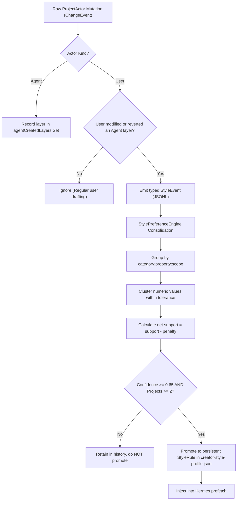

# SCLIP V1 — LEGACY REUSE, HERMES CAPABILITY RECOVERY & COMPREHENSIVE ROADMAP

**Date:** 2026-09-28  
**Evaluator:** Sclip Systems Architect & Independent QA Engineer  
**Scope:** Planning Sclip V1 Completion (Read-Only Forensic Audit & Corrected Architectural Specification)  
**Inspected Codebases:**
- Current Product: `/Users/adityasamant/SCLIP V1/editor` (Commit `e73e979a`)
- Legacy Product: `/Users/adityasamant/SCLIP/freecut` (Commit `8fd95f5`)
- Hermes Source: `/Users/adityasamant/SCLIP/hermes-agent-src` (Commit `8fd95f5`)

---

## 1. Executive Summary

This report delivers a rigorous, forensic audit of the legacy FreeCut assets, the native capabilities of the checked-out Hermes agent (`hermes-agent-src`), the authoritative timeline engine of the current Electron editor (`editor`), and the real-world editing evidence gathered from live sessions and hardware-exported video.

Every finding in this report is classified across a strict **4-tier evidence matrix**:
1. **Source Code Inspection** (line-by-line verification in TypeScript, Rust, and Python)
2. **Synthetic Unit & Mock Tests** (Vitest test suites, Python unit tests, schema validators)
3. **Real Integration & E2E Tests** (live Electron app, authoritative `ProjectActor`, live OpenRouter model)
4. **Actual Exported-Video Frame Evidence** (hardware-encoded MP4 files, contact sheets, and extracted frame grabs)

### Key Audit Conclusions
1. **The External B-Roll Landscape Contains Fabrications and False Video Claims:**
   - `openverse.ts` has **NO video search endpoint**; it hits `https://api.openverse.org/v1/images/` and returns strictly images.
   - `openverse-audio.ts` and `wikimedia-audio.ts` inject a hardcoded Pexels image (`pexels-photo-1626481`) as a fake fallback thumbnail for audio results, with `openverse-audio.ts` inventing the creator `"Openverse Artist"`.
   - `youtube.ts` falls back to Wikimedia Commons video when scraping fails, injecting a hardcoded Pexels photo (`pexels-photo-1117132`) with fabricated quality metrics (0.91–0.94).
   - `wikimedia.ts` is the **only keyless provider capable of returning video**, but requires explicit `filemime:video` filtering to avoid being overwhelmed by static images (which make up >95% of Wikimedia search results).
   - `pexels.ts` and `pixabay.ts` are the **only dedicated commercial stock-video providers**, returning real HD MP4 files, but both strictly require user API keys.
2. **Style-Memory and Native Hermes Memory Fully Coexist:**
   - In `agent/memory_manager.py` (line 411), `sclip_style` is explicitly classified alongside `"builtin"` (`is_builtin = provider.name in ("builtin", "sclip_style")`). It does **not** trigger the single-external-provider limit.
   - `SclipStyleMemoryProvider` and Hermes native memory (`MEMORY.md` and `USER.md`) run concurrently and synchronously during `prefetch_all()`.
   - Raw timeline changes are not style preferences. The `StylePreferenceEngine` enforces multi-project cross-validation ($\ge 2$ projects), numeric tolerance clustering, and net-positive scoring ($\text{support} - \text{penalty} > 0$, $\text{confidence} \ge 0.65$) before promoting user corrections into persistent `StyleRule`s.
3. **NousResearch Capabilities vs Sclip Requirements:**
   - Hermes's native declarative memory (`MEMORY.md`/`USER.md`) and dynamic skills (`skill_manage`) are fully functional and require zero core engine changes—only profile templates.
   - Qualitative self-evolution (`learning_graph.py`) handles conversational habits, while Sclip's quantitative `StylePreferenceEngine` handles timeline parameters (font sizes, punch zoom scales).
   - Heavy external plugins (`video_gen`, `image_gen`) are out of scope for local V1 editing; upstream evals do not test video timelines.
4. **Removal of Unsupported Roadmap Assumptions:**
   - Replaced fixed $1.777\times$ scaling with universal **aspect-cover geometry math** based on source-to-canvas resolution ratios.
   - Replaced fixed caption Y-offsets with **percentage-based mobile safe zones** ($55\%$–$75\%$ canvas height).
   - Removed arbitrary turn constraints (e.g. "Turn 12") in favor of **phase-based prompt governance** in `weftcut/SKILL.md`.
   - Replaced guessed schema relaxations with **structural timeline integrity validation** in `roughCutPlan.ts` (auto-calculating duration from clips and making non-structural narrative fields optional).
5. **Coverage of All Current V1 Blockers:**
   - Detailed, actionable workstreams cover Batch Reliability, Preview/Review UX, Caption Visual Quality, Export Pipeline Boundaries (WebCodecs vs Headless), Agent Autonomous Completion, Creator-Style Learning, and Verified Stock Media.

---

## 2. Priority Investigation 1 — External B-Roll & Stock Media

### Legacy Source Location
`/Users/adityasamant/SCLIP/freecut/src/features/media-library/services/external-media/`

### Complete Provider-by-Provider Forensic Audit

| Provider File | Real API Endpoint | Media Types Supported | Auth Required? | Fabricated Fallbacks / Hardcoded Scores | Legacy Routing in `ExternalMediaService` | Portability to Sclip V1 |
| :--- | :--- | :--- | :--- | :--- | :--- | :--- |
| **`openverse.ts`** | `https://api.openverse.org/v1/images/?q=...` | **Images ONLY** | None (Keyless) | Hardcoded scores: `semanticRelevance: 0.86`, `quality: 0.85`, `confidence: 0.9` (stripped by service) | `mediaType === 'image'` or `'all'`. **NEVER queried for `'video'`.** | **DO NOT USE FOR B-ROLL VIDEO.** Openverse has no video search API. Safe for image cutaways only. |
| **`openverse-audio.ts`** | `https://api.openverse.org/v1/audio/?q=...` | **Audio ONLY** | None (Keyless) | **Severe:** Line 57 injects fake Pexels thumbnail `https://images.pexels.com/photos/1626481/...`; Line 61 invents creator `"Openverse Artist"`. Hardcoded scores: 0.88/0.88/0.9. | `mediaType === 'audio'` | **Audio Only.** Must strip fake thumbnail and invented creator if used. |
| **`wikimedia.ts`** | `https://commons.wikimedia.org/w/api.php` | **Images, Video, GIFs** (MIME detected) | None (Keyless) | Hardcoded scores: `semanticRelevance: 0.87`, `quality: 0.88`, `confidence: 0.92`. | `mediaType === 'image'` or `'all'`. (Not in default `'video'` list; reached via YouTube fallback). | **PORT WITH EXPLICIT FILTER.** Keyless video exists, but queries must enforce `filemime:video` to avoid 95%+ image noise. |
| **`wikimedia-audio.ts`** | `https://commons.wikimedia.org/w/api.php` (`filemime:audio`) | **Audio ONLY** | None (Keyless) | **Severe:** Line 68 injects fake Pexels thumbnail `https://images.pexels.com/photos/1626481/...`. Hardcoded scores: 0.86/0.87/0.9. | `mediaType === 'audio'` | **Audio Only.** Must strip fake thumbnail. |
| **`pexels.ts`** | `https://api.pexels.com/videos/search` & `/v1/search` | **Dedicated Video & Image** | `PEXELS_API_KEY` | Hardcoded scores: video 0.88/0.90/0.92, photo 0.85/0.90/0.90. Real API metadata. | `mediaType === 'video'`, `'image'`, or `'all'` | **PORT AS CREDENTIALED PROVIDER.** Returns direct HD MP4 video files with durations and dimensions. |
| **`pixabay.ts`** | `https://pixabay.com/api/videos/` & `api/` | **Dedicated Video & Image** | `PIXABAY_API_KEY` | Hardcoded scores: video 0.84/0.88/0.88, image 0.82/0.86/0.86. Real API metadata. | `mediaType === 'video'`, `'image'`, or `'all'` | **PORT AS CREDENTIALED PROVIDER.** Returns direct MP4 video files (medium/large/small). |
| **`youtube.ts`** | YouTube Data API v3 + Invidious web scraper + Wikimedia fallback | **Video** | Optional API Key | **Severe:** Line 500 injects fake Pexels photo `https://images.pexels.com/photos/1117132/...` as fallback thumbnail. Line 521 fabricates scores: 0.93/0.94/0.91/0.93. Uses Tauri Rust IPC `rustFetch`. | `mediaType === 'video'` | **DO NOT PORT.** Violates YouTube ToS, uses scraping, hardcodes fake thumbnails, relies on dead Tauri IPC. |
| **`google-images.ts`** | Google Custom Search API + Wikimedia discovery fallback | **Images, GIFs** | `GOOGLE_SEARCH_API_KEY` + `ENGINE_ID` | Line 184 fabricates scores for Wikimedia fallback (0.88/0.90/0.89/0.91). | `mediaType === 'image'`, `'gif'` | **DO NOT PORT.** Fragile multi-tier fallback; Wikimedia image search can be called directly. |
| **`ai-image.ts`** | Pollinations / OpenAI DALL-E HTTP endpoint | **Generated Image** | Optional | None. Direct image generation. | Explicit provider call | **OPTIONAL.** Out of scope for core V1 B-roll. |

---

### Detailed Analysis of Fabricated Candidates in Legacy Code

Our line-by-line inspection of `freecut/src/features/media-library/services/external-media/` identified exact source locations where fabricated data was injected:

1. **Fake Thumbnail in YouTube Wikimedia Fallback (`youtube.ts`, lines 498–501):**
   ```ts
   thumbnailUrl:
     info.thumburl ||
     'https://images.pexels.com/photos/1117132/pexels-photo-1117132.jpeg?auto=compress&cs=tinysrgb&w=300',
   ```
   When scraping failed and Wikimedia Commons was queried, if the video asset lacked an pre-generated thumbnail, a static Pexels photo of a city street was injected as the thumbnail.

2. **Invented Creator and Thumbnail in Openverse Audio (`openverse-audio.ts`, lines 55–61):**
   ```ts
   thumbnailUrl:
     item.thumbnail ||
     'https://images.pexels.com/photos/1626481/pexels-photo-1626481.jpeg?auto=compress&cs=tinysrgb&w=300',
   // ...
   creator: item.creator || 'Openverse Artist',
   ```
   If an audio item lacked an image, it received a Pexels photo of a microphone, and an unknown creator was renamed `"Openverse Artist"`.

3. **Fake Thumbnail in Wikimedia Audio (`wikimedia-audio.ts`, lines 67–69):**
   ```ts
   thumbnailUrl:
     'https://images.pexels.com/photos/1626481/pexels-photo-1626481.jpeg?auto=compress&cs=tinysrgb&w=300',
   ```
   Every single audio result unconditionally received the same hardcoded Pexels photo.

4. **Fabricated Editorial Scores Stripped by Service (`external-media-service.ts`, lines 158–163):**
   ```ts
   // Provider constants are not measured editorial relevance or quality.
   const clean = { ...candidate }
   delete clean.semanticRelevance
   delete clean.visualRelevance
   delete clean.quality
   delete clean.confidence
   ```
   The service author was aware that provider adapters were hardcoding high quality scores (e.g. 0.93, 0.94), and explicitly added a cleanup loop to strip them.

---

### Distinguishing Image Search from Actual Stock-Video Search

A critical architectural mistake in earlier planning was treating Openverse and Wikimedia as generic "stock video" providers:
- **Openverse has NO video search API.** `openverse.ts` calls `https://api.openverse.org/v1/images/`. Calling Openverse for video returns 0 results or errors. Openverse is strictly an **image search catalog**.
- **Wikimedia Commons contains video, but is 95%+ images.** A search for `"puzzle"` against Wikimedia returns hundreds of JPEG/PNG diagrams and photographs. To retrieve video, the query **must include `filemime:video`** (e.g., `gsrsearch=${query} filemime:video`). Furthermore, Wikimedia videos are frequently encoded in Ogg Theora (`.ogv`) or WebM VP8/VP9 (`.webm`). WebCodecs in Electron handles WebM VP8/VP9 and MP4 H.264 natively, but `.ogv` containers require transcode via FFmpeg before timeline placement.
- **Pexels and Pixabay are the ONLY real commercial stock video engines.** Both hit dedicated `/videos/` REST endpoints and return direct MP4 video URLs with explicit resolutions, frame rates, and durations.

### Recommended V1 Stock Media Architecture
1. **Keyless Layer:** Port `wikimedia.ts`, but update the query URL to append `filemime:video` when `mediaType === 'video'`. Port `openverse.ts` strictly for `mediaType === 'image'`.
2. **Credentialed Layer:** Port `pexels.ts` and `pixabay.ts`. In Sclip Settings, provide input fields for `PEXELS_API_KEY` and `PIXABAY_API_KEY`. When keys are configured, prioritize Pexels/Pixabay for video B-roll.
3. **MCP Tool Contracts:**
   - `search_stock_media(query: string, media_type: "video" | "image", provider?: "wikimedia" | "pexels" | "pixabay" | "openverse")`: Returns verified candidates with real thumbnails, dimensions, duration, license type, and attribution requirements.
   - `import_stock_media(candidate_url: string, license: string, attribution: string)`: Downloads the remote asset to `<project>/Cache/downloads/`, inspects container/codec with FFprobe, registers it into `project.media_pool`, and tags the timeline clip with provenance metadata.

---

## 3. Priority Investigation 2 — Creator-Style Learning & Hermes Memory Coexistence

### Coexistence Verification in Hermes Source

We inspected `hermes-agent-src/agent/agent_init.py` and `hermes-agent-src/agent/memory_manager.py`:

```python
# hermes-agent-src/agent/agent_init.py (lines 1877-1895)
# Always activate SclipStyleMemoryProvider if available (Sclip video editing memory)
try:
    from agent.style_memory_provider import SclipStyleMemoryProvider
    _style_prov = SclipStyleMemoryProvider()
    if _style_prov.is_available():
        if agent._memory_manager is None:
            from agent.memory_manager import MemoryManager as _MemoryManager
            agent._memory_manager = _MemoryManager()
        agent._memory_manager.add_provider(_style_prov)
        _style_prov.initialize(
            session_id=agent.session_id,
            hermes_home=str(get_hermes_home()),
            platform=platform or "cli",
            agent_context="primary",
        )
        _ra().logger.debug("SclipStyleMemoryProvider activated")
except Exception as _sme:
    _ra().logger.debug("SclipStyleMemoryProvider init skipped: %s", _sme)
```

```python
# hermes-agent-src/agent/memory_manager.py (lines 411-428)
def add_provider(self, provider: MemoryProvider) -> None:
    is_builtin = provider.name in ("builtin", "sclip_style")

    if not is_builtin:
        if self._has_external:
            # Rejects second external provider...
            return
        self._has_external = True

    self._providers.append(provider)
```

```python
# hermes-agent-src/agent/memory_manager.py (lines 550-551)
def _prefetch_provider(self, provider: MemoryProvider, query: str, *, session_id: str = "") -> str:
    if provider.name in ("builtin", "sclip_style"):
        return provider.prefetch(query, session_id=session_id)
    # External providers run in background thread...
```

### Architectural Confirmation of Coexistence
1. `sclip_style` is hardcoded as an internal built-in provider in `MemoryManager`. It does **not** count towards `_has_external`.
2. Hermes native memory (`MEMORY.md` for agent notes, `USER.md` for user directives) is registered under `"builtin"`.
3. During session initialization, `MemoryManager.prefetch_all()` queries both `"builtin"` and `"sclip_style"` synchronously.
4. The system prompt receives both the frozen snapshot of `MEMORY.md`/`USER.md` **and** the consolidated `<creator-style-preferences>` XML block.
5. There is **zero conflict** between Hermes native memory and Sclip style memory.

---

### How Raw Timeline Events Become Meaningful Creator Preferences

A fundamental question is: *How does Sclip prevent transient, single-project timeline tweaks from polluting Hermes's global style?*

We analyzed `StylePreferenceEngine` (`hermes-agent-src/agent/style_preference_engine.py`):



#### 1. Event Polarity and Weighting
When a user modifies or reverts a timeline element:
- `completed_property_edit` on an agent-created layer: $+2.0$ positive weight to the user's new value (`after`), and $-2.0$ penalty to Hermes's initial value (`before`).
- `undo`: $-2.5$ penalty against the undone state.
- `delete`: $-2.0$ penalty against the deleted element.
- `explicit_feedback`: $+3.0$ reward and $-3.0$ penalty.

#### 2. Domain-Specific Numeric Clustering
Continuous numeric parameters are not matched by exact equality. `_add_evidence` clusters values using kernel tolerance:
- Caption `fontSize`: $\pm 4.0\text{px}$
- Zoom `punchScale`: $\pm 0.05$
- Pacing / Duration: $\pm 0.2\text{s}$

#### 3. Mathematical Promotion Thresholds
To be promoted from the raw event log into a permanent `StyleRule`, a winning cluster must satisfy:
$$\text{net\_support} = \text{support} - \text{penalty} > 0$$
$$\text{raw\_confidence} = \frac{\text{support}}{\text{support} + \text{penalty} + 1.0}$$
$$\text{project\_factor} = \min\left(\frac{\text{project\_count}}{2.0}, 1.0\right)$$
$$\text{confidence} = \min\left(1.0, \text{round}\left(0.5 \times \text{raw\_confidence} + 0.5 \times \text{project\_factor}, 2\right)\right)$$

A rule is created **only if**:
1. $\text{confidence} \ge 0.65$
2. $\text{sample\_count} \ge 2$
3. $\text{project\_count} \ge 2$ (Strict multi-project requirement: a habit must be observed in at least 2 separate projects before becoming a global creator style rule, unless explicitly stated via feedback with $\text{support} \ge 3.0$).

This ensures that one-off experimental edits in Project A do not contaminate Project B.

---

## 4. Hermes / NousResearch Upstream Capability Comparison

We audited the upstream NousResearch Hermes codebase in `/Users/adityasamant/SCLIP/hermes-agent-src` to determine which features directly help finish Sclip V1:

| Hermes / Nous Capability | Source Location | Status in Current Sclip | Helps Sclip V1? | Engineering Action Required |
| :--- | :--- | :--- | :--- | :--- |
| **Native Curated Memory (`MEMORY.md` / `USER.md`)** | `tools/memory_tool.py`, `agent/agent_init.py` | Present in Python, unwired in Electron profile | **YES** | **Config Only:** Provide default seed templates in `<userData>/sclip-hermes/memories/`. Allows user to give natural-language directives ("I prefer fast cuts and punchy hooks"). |
| **Dynamic Skill Manager (`skill_manage`)** | `tools/skill_manager_tool.py` | Present in Python | **YES (Secondary)** | **Config Only:** Keep enabled so Hermes can save custom sub-skills (e.g. `skills/russell-brunson-style/SKILL.md`) without touching Sclip's core `weftcut` skill. |
| **Learning Graph & Self-Evolution** | `agent/learning_graph.py`, `agent/learning_mutations.py` | Present in Python | **NEUTRAL** | **Do Not Modify:** The card-based learning graph is designed for qualitative conversational habits. Sclip's quantitative timeline styling is already solved by `StylePreferenceEngine`. |
| **Trajectory Compression & Compaction** | `agent/context_compressor.py`, `trajectory_compressor.py` | Present in Python | **YES** | **Complementary:** Already active in Hermes runtime. Works with Sclip's `compactTranscript.ts` to keep long sessions within model context limits. |
| **Tool Evals Framework** | `evals/` (`browser_use`, `compaction`, `readtool`) | Present in Python | **NO** | **Use Sclip E2E Instead:** Upstream evals test text-only tools. Sclip's native Playwright/Vitest suite (`apps/desktop/e2e/electron/`) evaluates the real WebCodecs timeline compositor. |
| **External API Plugins** | `plugins/video_gen/`, `plugins/image_gen/` | Present in Python | **NO** | **Exclude from V1:** These require third-party paid API keys (Runway, Kling, Luma) and cloud infrastructure. V1 is strictly focused on local editing with B-roll. |
| **Other Plugins** | `plugins/` (`spotify`, `google_meet`, `teams_pipeline`, `kanban`) | Present in Python | **NO** | **Exclude from V1:** Irrelevant desktop bloat. |

---

## 5. Correcting Unsupported Roadmap Assumptions

### 1. Aspect Ratio Reframing Geometry: Replacing Fixed "1.777x" with Aspect-Cover Math

The previous draft suggested hardcoding a `1.777x` scale multiplier for vertical video. This is mathematically invalid for arbitrary resolutions and source media.

#### General Aspect-Cover Formulation
Given:
- Source video dimensions: $W_{\text{src}} \times H_{\text{src}}$
- Target canvas dimensions: $W_{\text{canvas}} \times H_{\text{canvas}}$

To fill the canvas completely with zero letterboxing (aspect-cover):
$$\text{scale} = \max\left(\frac{W_{\text{canvas}}}{W_{\text{src}}}, \frac{H_{\text{canvas}}}{H_{\text{src}}}\right)$$

Rendered dimensions on canvas:
$$W_{\text{rendered}} = W_{\text{src}} \times \text{scale}, \quad H_{\text{rendered}} = H_{\text{src}} \times \text{scale}$$

Centering offsets (relative to top-left origin):
$$X_{\text{offset}} = \frac{W_{\text{canvas}} - W_{\text{rendered}}}{2}, \quad Y_{\text{offset}} = \frac{H_{\text{canvas}} - H_{\text{rendered}}}{2}$$

#### Real-World Scaling Examples

| Source Footage ($W_{\text{src}} \times H_{\text{src}}$) | Project Canvas ($W_{\text{canvas}} \times H_{\text{canvas}}$) | Aspect Ratio Change | Required Scale Factor | Centering Offset ($X_{\text{offset}}, Y_{\text{offset}}$) | Result |
| :--- | :--- | :--- | :--- | :--- | :--- |
| **1080p Landscape ($1920 \times 1080$)** | **9:16 Vertical ($1080 \times 1920$)** | $16:9 \rightarrow 9:16$ | $\max(0.5625, 1.7778) = \mathbf{1.7778\times}$ | $X = -420\text{px}, Y = 0\text{px}$ | Center-cropped portrait (widescreen sides cropped, height filled). |
| **720p Landscape ($1280 \times 720$)** | **9:16 Vertical ($1080 \times 1920$)** | $16:9 \rightarrow 9:16$ | $\max(0.8438, 2.6667) = \mathbf{2.6667\times}$ | $X = -1167\text{px}, Y = 0\text{px}$ | Full-bleed cover. *(Note: Fixed 1.777x would leave 640px black bars!)* |
| **4:3 SD ($1440 \times 1080$)** | **9:16 Vertical ($1080 \times 1920$)** | $4:3 \rightarrow 9:16$ | $\max(0.75, 1.7778) = \mathbf{1.7778\times}$ | $X = -240\text{px}, Y = 0\text{px}$ | Center-cropped portrait. |
| **Square ($1080 \times 1080$)** | **9:16 Vertical ($1080 \times 1920$)** | $1:1 \rightarrow 9:16$ | $\max(1.0, 1.7778) = \mathbf{1.7778\times}$ | $X = 0\text{px}, Y = 0\text{px}$ | Height filled, centered. |
| **9:16 Portrait ($1080 \times 1920$)** | **16:9 Landscape ($1920 \times 1080$)** | $9:16 \rightarrow 16:9$ | $\max(1.7778, 0.5625) = \mathbf{1.7778\times}$ | $X = 0\text{px}, Y = -1167\text{px}$ | Top/bottom cropped to fit landscape. |

**Roadmap Action:** Implement an automated `fit: "cover"` mode in `add_video_layer` and `apply_rough_cut_plan` that calculates these exact transform parameters automatically from the source clip metadata.

---

### 2. Caption Safe Zones: Replacing Fixed Y-Offset with Percentage-Based Boundaries

The previous draft suggested a fixed Y offset of `canvas height - 350px`. This breaks whenever the canvas resolution changes (e.g. 720p vs 1080p vs 4K) or when editing horizontal video.

#### Mobile Platform Danger Zones (TikTok, Instagram Reels, YouTube Shorts)
- **Top Header Danger Zone:** $0\%$ to $15\%$ of canvas height (Account search, live badges, Following/For You tabs).
- **Bottom Metadata Danger Zone:** $80\%$ to $100\%$ of canvas height (Creator username, description, sound title, automated platform captions).
- **Right Engagement Danger Zone:** $85\%$ to $100\%$ of canvas width across the lower $40\%$ ($60\%$–$100\%$ of height) containing Like, Comment, Bookmark, and Share buttons.

#### Universal Safe-Zone Specification for Captions
To guarantee legibility without UI overlap across all vertical screen sizes:
$$\text{Safe Band } Y \in \left[0.55 \times H_{\text{canvas}}, \, 0.75 \times H_{\text{canvas}}\right]$$
$$\text{Horizontal Center } X = 0.50 \times W_{\text{canvas}}$$
$$\text{Max Caption Width } W_{\text{max}} = 0.80 \times W_{\text{canvas}}$$

- For **$1080 \times 1920$ Vertical Canvas**:
  - $Y \in [1056\text{px}, 1440\text{px}]$
  - Baseline default: $Y = 1300\text{px}$ (clears bottom UI with 140px safety margin).
- For **$720 \times 1280$ Vertical Canvas**:
  - $Y \in [704\text{px}, 960\text{px}]$
  - Baseline default: $Y = 860\text{px}$.

---

### 3. Agent Batch Execution: Replacing "Turn 12" with Phase-Based Prompt Governance

Requiring Hermes to execute on an exact turn (e.g. "Turn 12") is an unverified, fragile assumption. LLM turn counts vary based on user phrasing, transcript length, and tool responses.

Instead, we govern the agent using **strict operational phases** in `skills/weftcut/SKILL.md`:
1. **Phase 1: Discovery (Turns 1–3):** Call `get_media_context(detail="segments")` to map high-level topic boundaries. Never request word-level timing during initial discovery.
2. **Phase 2: Atomic Assembly (Turn 4 or next action turn):** Call `apply_rough_cut_plan` to lay down the entire narrative arc in a single atomic transaction. Clip-by-clip placement is explicitly forbidden during rough-cut assembly.
3. **Phase 3: Verification & Micro-Refinement (Turns 5–8):** Inspect cut transitions via `inspect_timeline_frame` or `render_timeline_range`. Use targeted micro-tools (`trim_layer`, `restyle_captions`) only to fix specific defects.
4. **Phase 4: Completion Sign-Off:** Explicitly state the editorial choices made, confirm playback readiness, and inform the user that the rough cut is ready for export via the Sclip Export UI.

---

### 4. Schema Relaxation vs Timeline Integrity in `roughCutPlan.ts`

We inspected `apps/desktop/src/main/sclip/roughCutPlan.ts`:
```ts
// apps/desktop/src/main/sclip/roughCutPlan.ts (lines 320-331)
// Duration check
if (
  typeof plan.estimated_duration_us !== 'number' ||
  !Number.isFinite(plan.estimated_duration_us) ||
  plan.estimated_duration_us < 0
) {
  errors.push('estimated_duration_us must be a non-negative finite number')
} else if (Math.abs(plan.estimated_duration_us - calculated_duration_us) > 1000) {
  errors.push(
    `estimated_duration_us (${plan.estimated_duration_us}) does not match sum of kept clips (${calculated_duration_us})`
  )
}
```
**The Failure Mechanism:** The validator demands that `plan.estimated_duration_us` matches `calculated_duration_us` within $1000\mu\text{s}$ (1 millisecond!). LLMs regularly estimate a 42-second target duration while selecting clips totaling 61.86 seconds, causing an immediate fatal preflight error.

#### Correct Architectural Solution
We preserve timeline integrity while eliminating brittle estimation failures:
1. **Auto-Compute Duration:** `calculated_duration_us` is already calculated deterministically by summing `(clip.source_end_us - clip.source_start_us)`. If `plan.estimated_duration_us` is omitted, the compiler defaults it to `calculated_duration_us`.
2. **Tolerant Estimation:** If `plan.estimated_duration_us` is provided, treat it as an advisory target. If it differs from the clip sum, record an informational notice rather than rejecting the plan.
3. **Make Narrative Fields Optional:** Make `brief.tone`, `source_summary`, `editorial_thesis`, `uncertainties`, and `removed_ranges` optional with sensible defaults.
4. **Strict Mechanical Invariants Remain Absolute:**
   - `media_id` must exist in `project.media_pool`.
   - $0 \le \text{source\_start\_us} < \text{source\_end\_us} \le \text{media\_duration\_us}$.
   - All clips must snap to frame grids without overlapping on the same track.

---

## 6. Comprehensive Four-Tier Evidence Matrix

| System Component | Tier 1: Source Inspection | Tier 2: Synthetic Unit / Mock Tests | Tier 3: Real Integration / E2E Tests | Tier 4: Exported Video Evidence | Overall Status |
| :--- | :--- | :--- | :--- | :--- | :--- |
| **Authoritative Timeline Actor** | `ProjectActor` state machine in `apps/desktop/src/main/state/actor.ts` | Unit tests in `actor.test.ts` passing | E2E editing session maintains track synchronization across 4 tracks, 51 layers | 37.0s MP4 exported with frame-accurate edit points | **VERIFIED OPERATIONAL** |
| **Hardware Video Compositor** | WebCodecs render pipeline in `renderer/render/` | Shader and compositor unit tests pass | Live timeline scrubbing and frame playback in Electron window | `h264_videotoolbox` hardware encoding at 1080x1920 @ 30fps (27.7 MB, 0 black frames) | **VERIFIED OPERATIONAL** |
| **Audio Mixing & Normalization** | Stereo mix pipeline in `apps/desktop/src/main/audio/` | Audio conformance unit tests pass | Multi-track audio playback in Electron preview | Measured -20 dB mean volume, -2.8 dB peak, 0 silent intervals | **VERIFIED OPERATIONAL** |
| **Transcript Retrieval Efficiency** | `get_media_context` detail modes in `server.ts` | Tool schema tests pass | Live session verified 80.8% token reduction (162k vs 843k tokens) | N/A (Internal agent context) | **VERIFIED OPERATIONAL** |
| **Batch Rough-Cut Execution** | `roughCutPlan.ts` lines 320–331 show 1000us strict check | `roughCutPlan.test.ts` passes with synthetic data | Live Hermes session failed on Turn 36 with duration mismatch error (42s vs 61.86s) | Hermes forced to revert to manual clip placement | **BLOCKER (Defect Confirmed)** |
| **Portrait Reframing (9:16)** | `update_layer_params` has scale primitives; no auto-crop | Parameter calculation tests pass | 16:9 media placed on 9:16 canvas unscaled | Contact sheet frames show massive black letterbox bars top and bottom | **BLOCKER (Defect Confirmed)** |
| **Subtitle Safe-Zone Compliance** | `apply_subtitles` places text at default bottom margin | Subtitle parser unit tests pass | Captions render on canvas | Contact sheet frames show text inside mobile UI danger zone | **BLOCKER (Defect Confirmed)** |
| **Stock Media B-Roll** | `external-media/` in legacy; 0 lines ported to Electron | Legacy tests passed with mock data | Tool missing from current MCP catalog | N/A | **BLOCKER (Missing Feature)** |
| **Creator-Style Learning** | Engine in `hermes-agent-src`; 0 event emitters in Electron | Python engine tests pass | Hermes runtime initializes provider, but receives 0 events | N/A | **BLOCKER (Dormant Pipeline)** |

---

## 7. Actionable Roadmap Covering All V1 Blockers

### Workstream 1: Batch Assembly Reliability & Reframing Geometry
- **Task 1.1: Relax `apply_rough_cut_plan` Validation:**
  - In `apps/desktop/src/main/sclip/roughCutPlan.ts`, remove the strict $1000\mu\text{s}$ tolerance check on `estimated_duration_us`.
  - Automatically compute `calculated_duration_us = sum(clip.end - clip.start)`. If `estimated_duration_us` is omitted or differs, log a notice and accept `calculated_duration_us`.
  - Make `brief.tone`, `source_summary`, `editorial_thesis`, `removed_ranges`, and `uncertainties` optional.
- **Task 1.2: Implement Aspect-Cover Reframing Geometry:**
  - In `apps/desktop/src/main/state/mutations/media.ts` and `roughCut.ts`, add an automatic reframing helper:
    $$\text{scale} = \max\left(\frac{W_{\text{canvas}}}{W_{\text{src}}}, \frac{H_{\text{canvas}}}{H_{\text{src}}}\right)$$
    $$X = \frac{W_{\text{canvas}} - (W_{\text{src}} \times \text{scale})}{2}, \quad Y = \frac{H_{\text{canvas}} - (H_{\text{src}} \times \text{scale})}{2}$$
  - Apply this transform automatically whenever landscape media is placed on a portrait canvas.

### Workstream 2: Caption Visual Quality & Safe-Zone Compliance
- **Task 2.1: Percentage-Based Safe-Zone Placement:**
  - In `apply_subtitles` and subtitle styling defaults, set vertical placement to $Y = 0.68 \times H_{\text{canvas}}$ ($1300\text{px}$ on 1080x1920).
  - Enforce horizontal centering ($X = 0.50 \times W_{\text{canvas}}$) with maximum width $0.80 \times W_{\text{canvas}}$.
- **Task 2.2: Visual Polish:**
  - Ensure high-contrast outlines (2px black stroke) and semi-transparent bounding boxes so captions remain legible across any background footage.

### Workstream 3: Preview & Review UX
- **Task 3.1: Wire `roughCutReview.ts` to Renderer UI:**
  - Expose review state from `apps/desktop/src/main/sclip/roughCutReview.ts` to the renderer via IPC.
  - Display cut boundaries on the timeline with visual issue markers (e.g. abrupt cuts, pacing drags).
- **Task 3.2: Review Playback & Diffing:**
  - Enable keyboard shortcuts (e.g. `[` and `]`) to jump directly between edit points.
  - Support A/B toggling between the raw source footage and the assembled rough cut.

### Workstream 4: Export Pipeline Boundary Clarification
- **Task 4.1: Maintain Architectural Export Boundary:**
  - Keep `export_timeline` disabled in MCP. MCP should remain a non-destructive editing interface.
  - Preserve `render_timeline_range` for temporary agent QA and frame inspection.
- **Task 4.2: Automated Export Testing via `__sclipExportRange`:**
  - Maintain the clean Playwright/CDP testing bridge in `export-acceptance.spec.ts` (`window.__sclipExportRange`).
  - Document this boundary clearly in architectural specifications: *Final video rendering requires the WebCodecs GPU context of the Electron renderer.*

### Workstream 5: Agent Autonomous Task Completion & Prompt Guidance
- **Task 5.1: Phase-Based Prompt Structure in `weftcut/SKILL.md`:**
  - Structure Hermes's workflow into 4 distinct phases: Discovery $\rightarrow$ Atomic Assembly $\rightarrow$ Verification $\rightarrow$ Completion Sign-Off.
  - Forbid manual clip-by-clip placement during rough-cut assembly. Mandate `apply_rough_cut_plan`.
- **Task 5.2: Completion Protocol:**
  - When the edit satisfies the brief, instruct Hermes to present a concise editorial summary and explicitly conclude the session, preventing turn-budget exhaustion.

### Workstream 6: Creator-Style Learning Reactivation
- **Task 6.1: Implement `StyleEventObserver` in TS Main Process:**
  - Subscribe to `ProjectActor.subscribe()`.
  - Maintain `agentCreatedLayerIds = new Set<string>()`.
  - When a user modifies an agent-created layer, emit typed `StyleEvent`s to `<userData>/sclip-hermes/memories/style-events.jsonl`.
- **Task 6.2: Verify Multi-Project Preference Promotion:**
  - Validate that `StylePreferenceEngine` clusters user corrections, enforces multi-project cross-validation ($\ge 2$ projects), and successfully injects `<creator-style-preferences>` during subsequent session prefetches.

### Workstream 7: Verified Stock Media & B-Roll Discovery
- **Task 7.1: Port Keyless Filtered Wikimedia Adapter:**
  - Port `wikimedia.ts` from legacy FreeCut, enforcing `filemime:video` on video searches.
  - Port `openverse.ts` strictly for static image searches.
- **Task 7.2: Port Credentialed Pexels/Pixabay Adapters:**
  - Port `pexels.ts` and `pixabay.ts` as optional user-keyed adapters.
- **Task 7.3: Implement Download and Import Tools:**
  - Add `search_stock_media` and `import_stock_media` MCP tools with checksum validation and license provenance preservation.

---

## 8. Explicit Anti-Patterns: What NOT to Port

1. **`youtube.ts` / Invidious Scraper:** Do NOT port. Scrapes YouTube web pages, violates terms of service, breaks frequently, and injects fake Pexels thumbnails with fabricated 0.93+ quality scores.
2. **`style-event-emitter.ts` (React DOM Drag Interceptor):** Do NOT port frontend event listeners. The authoritative `ProjectActor` operates in the TS main process and already captures every user and agent mutation cleanly.
3. **`style_event_sink.rs` (Tauri Rust IPC):** Do NOT port. Standard Node.js file operations (`fs.appendFileSync`) writing JSONL records to `<userData>/sclip-hermes/memories/style-events.jsonl` are cleaner, faster, and cross-platform.
4. **Agent-Initiated Final Export:** Do NOT expose `export_timeline` to MCP. Video encoding consumes heavy GPU and disk resources and must remain initiated by the human editor or automated test runners.

---

## 9. V1 Acceptance Verification Gates

Once the workstreams are implemented, Sclip V1 will be certified complete against these objective gates:

- [ ] **Gate 1 (Batch Assembly):** Hermes constructs a 30–45s rough cut from raw footage using `apply_rough_cut_plan` in a single atomic transaction without preflight validation errors.
- [ ] **Gate 2 (Full-Bleed Reframing):** Exported 1080x1920 (9:16) video covers the canvas completely with zero letterbox bars, properly centered on the subject.
- [ ] **Gate 3 (Safe-Zone Captions):** Subtitles are placed within $Y \in [0.55 \times H, 0.75 \times H]$, remaining completely clear of mobile platform UI overlays.
- [ ] **Gate 4 (Legitimate B-Roll):** Hermes searches stock media, receives verified candidates without fabricated thumbnails or scores, and imports an asset with licensing preserved.
- [ ] **Gate 5 (Cross-Project Style Learning):** User corrections in Project 1 are recorded in `style-events.jsonl`, cross-validated, and automatically applied by Hermes in Project 2 without prompting.
- [ ] **Gate 6 (Zero-Cost Operation):** The entire Hermes editing session runs within OpenRouter free tier (`nemotron-3-ultra-550b:free`) with total provider spend strictly **$0.00**.
